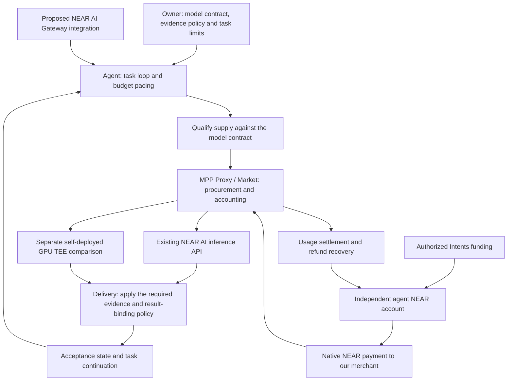

# Private Flex Inference Auctions

**Let agents buy inference they can verify.**

A BitRouter proposal for the NEAR hackathon: agents optimize cost and timing within an explicit model contract. The owner fixes model requirements, authorized scope, budget and the evidence needed for acceptance. Procurement preserves those requirements through supply selection and delivery.

Read the illustrated **[`/proposal`](#proposal-page)** in either browser playground. The [integration contract](docs/specs/2026-11-14-agent-mpp-inference-integration.md) remains the implementation baseline for controlled agent procurement and payments; this proposal adds the product direction for model fidelity and NEAR-native collaboration. It does not change that implementation contract.

## Core thesis: model fidelity in autonomous procurement

Delegating inference purchases gives an agent freedom to choose prices, timing and authorized supply. That freedom needs an acceptance boundary: the purchased model and execution conditions must remain consistent with the owner's authorization.

**Qualify supply against the model contract first. Optimize cost and timing among eligible offers. Verify the delivered result against the required evidence policy.** A cheaper quote cannot silently authorize a smaller model, a different quantization, truncated effective input or an unrelated cached response. Any permitted substitution or reuse must be explicit in the original authorization or receive new authorization.

Model fidelity means conformance to the specified model and execution contract. It does not establish that an answer is factually correct or that the agent completed its task successfully. A response's `model` string alone cannot establish fidelity.

The proposed purchasing loop is:

**Define model contract → qualify supply → choose, wait, revise or stop → pay and execute → check delivery → report acceptance → continue the task.**

Market settlement and refunds retain their own frozen financial terms. A model acceptance verdict does not automatically reverse a payment or discharge an unresolved order. Task budgets, current bids and actual charges are separate quantities.

## The model contract

| Contract element | Fixed before purchasing |
| --- | --- |
| Model identity | Permitted model, checkpoint/revision, quantization, adapters and supported implementation rules |
| Effective request | Full effective input/context, tokenizer/template assumptions, generation parameters, output limits and allowed transformations |
| Evidence policy | Required deployment/model evidence, trust assumptions, verifier policy and supported scope |
| Result binding | Actual returned tokens/bytes or events, original request identity, coverage, stop/completeness state and any allowed response conversion |
| Owner authority | Authorized models/routes, privacy requirements, task and call limits, deadlines and permitted reuse |

Qualification and delivery acceptance are separate checks. Missing required evidence remains unverified or pending; incompatible or unsupported supply is ineligible. Greater urgency does not weaken the model contract. If no offer qualifies within the limits, the agent waits or stops.

These are proposed product requirements. Current hardware, transport and controlled procurement acceptance do not implement the entire model-fidelity contract.

## Current paths: NEAR API and a GPU TEE comparison

NEAR currently provides its **existing inference API** for this collaboration. Separately, we have deployed a model in a GPU TEE as a controlled comparison. The two paths help expose procurement and verification requirements; NEAR-native market allocation belongs to the next collaboration stage.

| Path | What it demonstrates | Evidence boundary |
| --- | --- | --- |
| **Existing NEAR AI API** | Native inference procurement with recorded test-credit buyers, original usage and provider invoices | No NEAR-side market quotes, queue priority or cache control assumed; evaluate available deployment/response evidence separately |
| **Self-deployed GPU TEE comparison** | Recorded CPU/GPU attestation, encrypted native calls and pinned model revision metadata for `Qwen/Qwen3.8-27B-FP8` | Model/deployment association depends on the authenticated provider control plane; loaded weights and a complete per-request execution receipt are not independently proven |
| **Next collaboration: NEAR-native support** | Model contracts and evidence integrated with purchasable service terms, then execution-aware allocation experiments | Proposed work requiring NEAR cooperation, supported interfaces and separate acceptance |

The comparison pins revision `017b9c7af6b5689d5dd426a76e0bc077eb5ca20a`. Its [scoped deployment record](https://github.com/SPIKESPIGEL404/private-flex-inference-auctions/blob/febd7ec4c24c9aff343e185578b7f948a53b1266/docs/acceptance/2026-11-14-chutes-live.md) explicitly describes a **historical live run of a pre-integration release**; it is not live acceptance of subsequent builds. The recorded encrypted path, hardware evidence and model metadata must not be relabeled as a complete model-fidelity proof. Stronger required policies remain unverified until their missing bindings are established.

The November 11 NEAR API evidence is recorded in [batch C](docs/acceptance/2026-11-11-market-batch-c.md). These independent records do not establish one connected, funded agent loop with complete model fidelity.

## Why this matters to NEAR

| Product | Proposed benefit | Next validation |
| --- | --- | --- |
| **NEAR AI Cloud** | Become eligible supply for autonomous buyers whose model, cost, timing, privacy and acceptance requirements are explicit | Native model/deployment identity and request/result evidence; purchasable service terms; then measured allocation and provider economics |
| **NEAR AI Gateway** | Delegate procurement within a model contract and task budget; inspect supply qualification and delivery acceptance while pacing spend across calls | Actual Gateway integration, supported evidence policies, useful controls and task completion under fixed model requirements |
| **NEAR payments and Intents** | Fund independent agents and purchase under authorization, preserving original payment/execution responsibility through interruptions | G1/P3 qualification of native payments, payment gas, usage settlement, refunds and recovery |

Gateway refers to [NEAR's macOS application](https://gateway.near.ai/), distinct from the Cloud HTTP gateway. Its purchasing-policy integration is proposed. [Cloud](https://near.ai/) and [Gateway's launch description](https://near.ai/blog/introducing-near-ai-gateway) establish the existing product entry points, not an implemented integration with this Market.

For Gateway, task-wide pacing matters as much as a single call's price: preserve resources for later tool steps, retries and final verification. The current call's urgency and the remaining budget inform purchasing decisions without overriding model requirements. No optimality or regret guarantee is claimed for the implemented buyer policy.

For Cloud, priority allocation and cache reuse are a future native collaboration. Even one model at one base token price can have valuable scheduling opportunities under congestion, provided the provider can actually control admission. The experiment should preserve authorized cache sharing and measure whether value-aware ordering can retain serving efficiency. A higher bid alone is not a latency guarantee, and an existing external API supplies no additional scheduling authority.

## Proposed architecture



The diagram describes the product design. The **buyer policy** owns purchasing decisions; the **Market** owns admission, reservations and accounting; the **Provider** owns execution. Supply qualification and delivery acceptance apply the authorized evidence policy. Current implementations cover only their documented scopes.

Upstream NEAR AI calls retain existing API credentials and account billing. Native NEAR/MPP payments in this design target our Proxy/Market merchant. Intents/1Click supports preparation or authorized replenishment, not a cross-chain swap for every inference call. The current payment target has the agent pay inference principal and payment gas; the merchant pays refund gas.

## Privacy and evidence boundaries

A private Market protects purchase caps, balances and order conditions as well as sensitive request data. Confidentiality and model fidelity are separate requirements: purchase preferences remain private while procurement and acceptance preserve the authorized model contract.

Verify the Market deployment and channel before sending sensitive purchase limits. Evaluate upstream deployment evidence, model association and request/result binding separately. In particular, a NEAR Cloud gateway signature authenticates that gateway's signed bytes and does not alone establish which model executed. See [NEAR response-signature semantics](https://docs.near.ai/cloud/verification/cloud-api/response-signatures).

Hardware attestation, encrypted transport, model identity, response binding and payment receipts must retain their precise meanings. Full arithmetic inference proofs remain separate R&D, outside the hackathon prototype's acceptance. Do not replace missing evidence with an undifferentiated green “model verified” badge.

## Current evidence and next milestone

The agent integration baseline in this branch is **controlled P2**. API inference, GPU TEE deployment, wallet onboarding and controlled agent execution have separate acceptance records.

| Scope | Evidence | Limit |
| --- | --- | --- |
| Native NEAR AI inference | Recorded November 11 batch C: three test buyers, original usage and provider invoices | Test-credit Market; does not qualify the new native-payment route or prove complete model fidelity |
| GPU TEE comparison | Historical hardware, encrypted transport, revision metadata and scoped procurement record linked above | Specific historical release; independent loaded-weight and complete per-request execution bindings remain outstanding |
| Agent task execution | P2: two real fx sessions, tools, cost/time decisions, budgets and persisted results | Model replies and NEAR chain receipts are fixtures |
| Wallet onboarding | Separate owner, agent wallet/grant and funding-plan entry point | Does not yet join P2 into a real-money task loop |
| **Next validation** | G1/P3 payments and real tasks; supported fidelity policies and the required model/result bindings | Outstanding in this baseline; stronger unsupported policies stay unverified |
| **Next collaboration with NEAR** | Native model contracts, evidence and procurement terms; then priority/cache allocation | Proposed cooperation, not a capability of the existing API integration |

The Market host derives from [Cloud PR 667](https://github.com/bitrouter/bitrouter-cloud/pull/667), pinned to `244177cafa26e8c8b001e61297cf4e7f89ac8de9`. See the [migration spec](docs/specs/2026-11-11-private-market-hackathon.md), [source record](crates/private-market-host/upstream/SOURCES.md) and [P3 plan](docs/specs/2026-11-14-agent-mpp-p3-run-plan.md).

## Validation and future experiments

First validate a complete supported model contract through autonomous procurement and delivery. Fix the required evidence and trust assumptions, exercise wrong model/revision/quantization, altered effective input, missing evidence and unrelated response binding, and report supported versus unverified cases explicitly. Then qualify real funded model tasks with financial recovery under the existing integration contract.

Measure task-wide spend, payment gas, failed attempts and time to usable results. Assess answer quality separately from model fidelity. Test budget pacing across calls and check that urgency or budget exhaustion never silently relaxes authorization.

With NEAR-native admission control, hold workload and model contracts fixed and compare arrival order, cache-only order, bid-only order and cache-aware bidding. Record priority outcomes, urgent-request delays, cache reuse, serving overhead and task completion. Measure provider revenue and utilization separately; improved allocation does not imply higher throughput or revenue. Under light load, avoid unnecessary batch waiting. The sharing domain remains an authorization constraint throughout.

## Proposal page

Both frontends expose the same public **`/proposal`** page and link to it from their header. Its narrative is: autonomous procurement → model-fidelity risk → model contract and acceptance → current API/TEE comparison → NEAR-native collaboration.

The interactive example uses synthetic quotes and policy verdicts. It excludes a cheaper wrong model and a name-only claim without sufficient evidence, applies budget/time limits to qualified supply, and distinguishes matching, mismatched and missing delivery evidence. It performs no real attestation, model verification, inference or payments. The illustrated qualified routes are not real acceptance results from either deployment.

The page is implemented once in [`clients/proposal`](clients/proposal/Proposal.tsx), loaded separately from the terminal/wallet application. Both hosting servers support `/proposal` and `/proposal/`, including fresh-page reloads.

```bash
npm ci --prefix services/mpp-near-direct
npm ci --prefix clients/market-playground
npm run dev --prefix clients/market-playground
# Open the printed local URL at /proposal.
```

The proposal can be reviewed without a wallet, access code, backend or provider credential. Continue below for technical runs and their recorded limits.

## Real inference acceptance

In the recorded November 11 local acceptance, three buyers completed native inference on `Qwen/Qwen3-VL-30B-A3B-Instruct`.
Original model/terminal/usage, replay, test-credit receipts and upstream invoices
are independently auditable. That recorded task spent US$0.00015355 of the approved
US$0.01, including an earlier calibration. See the [batch C guide](docs/market-batch-c.md)
and [acceptance record](docs/acceptance/2026-11-11-market-batch-c.md).

```bash
bash scripts/accept-market-c.sh
```

This command runs offline registration checks with zero inference calls. A new
live run requires a prepared plan and explicit cost authorization as documented.
This local batch does not establish deployment or per-request provider verification.

## Browser playground

The [canonical browser playground](clients/market-playground/README.md) combines
Mono fx/wterm terminals, controlled P2 tasks and ordinary NEAR wallets. Public
preview visitors sign in with a NEAR mainnet wallet; no access code or Agent API
key is required. Each owner receives an isolated pair of controlled agents.
Their optional real wallets use independent browser-held keys and encrypted
backups. Funding and returning NEAR are explicit mainnet operations.

Controlled inference uses a separate virtual ledger, scripted model replies,
and simulated payment/refund receipts. Funding real agent wallets does not pay
for these tasks. Real agent-paid inference remains an unqualified P3 gate.
The older Agent API gateway remains available as a compatibility adapter.

## Verify the Market before buying

The following describes the controlled identity acceptance in this integration; deployment evidence must be evaluated for its own exact release and scope.

The optional ACI identity endpoint and Node buyer now support fresh hardware
evidence, reviewed release/boot policy, the catalog file digest, and actual TLS
SPKI binding before sending credentials or purchase limits. Local controlled integration is covered without
deployment; real hardware and confidential deployment acceptance remain pending.
See the [buyer verification guide](docs/market-buyer-verification.md).

```bash
bash scripts/accept-market-identity.sh
```

This command creates only local controlled infrastructure and sends no external
inference calls. The production buyer rejects the test's simulated hardware proof.

## Run business and recovery regressions

```bash
bash scripts/accept-market-b.sh
```

This includes the batch A baseline, 219 kernel and 24 public domain tests, and
seventeen controlled host scenarios covering concurrent funds/capacity, native
terminals, authorized replacement, Unknown, process restart, offline replay and
lost PostgreSQL COMMIT acknowledgment. See the [batch B guide](docs/market-batch-b.md)
and [acceptance record](docs/acceptance/2026-11-11-market-batch-b.md).

## Run batch A acceptance

Requires Rust 1.93+, Python 3, PostgreSQL tools and Redis tools on PATH. Cargo needs access to the pinned BitRouter repositories. Run as a normal user (`initdb` refuses root).

```bash
bash scripts/accept-market-a.sh
```

The script builds the independent host, creates its own temporary PostgreSQL cluster and Redis process, checks native SSE, receipts, balances, buyer isolation and idempotency, and stops its owned services. It sends no GPU requests. See the [acceptance record](docs/acceptance/2026-11-11-market-batch-a.md) for the measured scope.

The host is an independent Cargo package under `crates/private-market-host`, with its own lockfile. It has no `flex-scheduler` dependency. Buy caps authorize spending; they do not promise GPU priority or lower latency. This legacy core acceptance does not cover the later controlled P2 buyer policy.

## Fund inference credit with MPP

The optional `nearintents.charge` adapter uses the official NEAR Intents SDK to
fund the existing cash ledger. It starts new payment-enabled instances at zero
credit and retains replay and reconciliation through the original Redis outbox.
Funding APIs are disabled by default. Dynamic bid revisions are persisted;
automatic admission and Provider dispatch remain deferred.

```bash
bash scripts/accept-market-nearintents.sh
```

This runs the official client/server SDK against a controlled 1Click backend,
local PostgreSQL/Redis and a controlled seller. It transfers no real assets.
See the [implementation and configuration](docs/market-nearintents-charge.md),
[dynamic bidding spec](docs/specs/2026-11-13-mpp-funded-dynamic-bidding.md) and
[acceptance limits](docs/acceptance/2026-11-13-nearintents-charge.md).
Real settlement, refunds and deployment of the new adapter remain unaccepted.

## Agent MPP integration status

The current target is agent-paid native NEAR principal **and payment gas**,
with merchant-paid refund gas. See the [current integration contract](docs/specs/2026-11-14-agent-mpp-inference-integration.md)
and [P3 run plan](docs/specs/2026-11-14-agent-mpp-p3-run-plan.md).

P0–P2 below provide controlled contracts, execution, budget and recovery tests.
Their v2 NEP-366 fixture incorrectly debits agent principal: real NEP-366 charges
both principal and gas to the outer relayer. Those tests do not qualify real
payments. G1 must verify the selected native Transfer route with agent-paid principal and gas; real P3
wallet funding, inference and refund acceptance remain outstanding. Unfinished
P3 runtime prototypes are excluded from this integration.

The canonical Mono workspace is `clients/market-playground`. It discovers backend capabilities and uses the existing P2 task runtime or wallet-preparation adapter in the same UI. `clients/agent-playground` is a compatibility launch alias. A unified interface does not establish a connected real-money loop; real G1/P3 qualification remains outstanding.

## Agent native MPP — controlled Phase 1

The P1 integration serves `/v1/chat/completions` through an authenticated MPP
Proxy. One controlled agent purchases one native Market execution, with native
NEAR principal attributed to the agent and gas to the project in its historical
controlled fixture. Its chain-economic limitation is explained above.
The original Market PostgreSQL ledger, Redis projection, admission, execution
and usage settlement remain authoritative. JSON and SSE use the same original
execution on replay.

```bash
bash scripts/accept-agent-mpp-p1.sh
```

Requires Node >=24, Rust, PostgreSQL and Redis command-line tools. Uses a separate
`crates/private-market-p1` manifest and pinned owning-source patch; it does not
modify Cargo's shared checkout. The NEAR chain, delegated signer/sponsor and
single-slot seller are explicit local fixtures. It sends no real transactions
or provider requests. Real native-payment qualification G1 stays closed. Browser
funding, tool continuation and multiple agents belong to P2/P3.

See the [P1 implementation](docs/agent-mpp-p1.md) and
[acceptance record](docs/acceptance/2026-11-14-agent-mpp-p1.md).

## Agent native MPP — controlled Phase 2

P2 runs two independent real fx sessions through `/v1/chat/completions`, virtual
bash tools, paid continuation, per-task and aggregate agent budgets, durable
cost/speed decisions, manual controls and full-process recovery. The browser
uses fx WASM and wterm; refreshing or reopening a completed pane replays its
persisted conversation and artifact. Original Market accounting remains the
authority. Model responses and chain evidence are local fixtures; G1/P3 remain
closed.

```bash
bash scripts/accept-agent-mpp-p2.sh
```

See [P2 implementation and demo](docs/agent-mpp-p2.md) and
[P2 acceptance](docs/acceptance/2026-11-14-agent-mpp-p2.md).

## Historical scheduler experiment

The original scheduler, fixtures and phase-one through phase-four evidence remain available as an independent experiment. Its Chutes evidence applies to that scheduler configuration. Start with the [historical overview](docs/scheduler-experiment.md), [scheduler spec](docs/specs/2026-11-02-external-prefill-gating-scheduler.md), and [phase-four report](docs/acceptance/2026-11-02-phase4.md).

```bash
bash scripts/accept-phase3.sh
```

The new Market does not read the scheduler journal, spool or execution plans.
The [earlier security design](docs/designs/2026-11-03-security-design.md) is preserved as historical context; its proposed capabilities are not current acceptance claims.

[MIT](LICENSE).

## Single-model Chutes gateway

[The Chutes integration](docs/chutes-gateway.md) exposes only `qwen3.8-27b` through
a local TDX/GPU verifier and encrypted provider transport. The main-based port
retains signed purchases and catalog-policy pinning, and uses offline buyer
verifying keys in deployment. Its controlled acceptance and the separately
scoped historical live evidence are documented in the run guide. Supply and
funding remain the finite test-credit prototype.
