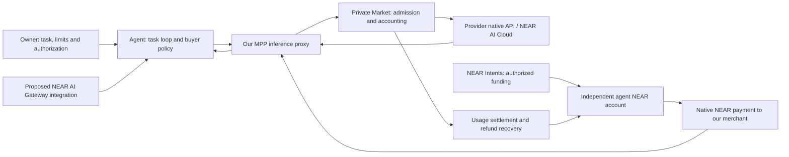

# Private Flex Inference Auctions

**Give agents a budget. Let them buy inference.**

A BitRouter proposal for the NEAR hackathon: a private procurement layer where each agent can choose when to buy inference, what to spend and when to wait, within its owner's authorization. The Market handles admission, native provider execution, accounting and recovery; the agent remains responsible for its own purchasing policy.

Read the illustrated **[`/proposal`](#proposal-page)** in either browser playground, or start with the [current integration contract](docs/specs/2026-11-14-agent-mpp-inference-integration.md).

## Core thesis

An agent's next model call has a purpose, a budget and a time constraint. A background task may tolerate waiting; an interactive tool step may need a usable result sooner. Our thesis is that agents should be able to express those requirements as purchasing decisions rather than requiring the owner to approve every call.

The loop is: **authorize a task → compare eligible supply → accept, wait, revise or stop → pay and execute → settle usage → continue the task.** Cost and speed preferences stay inside hard budget, model, authorization and privacy limits. A higher bid does not itself create a faster service or a scheduling guarantee.

For providers, the corresponding hypothesis is that flexible demand can consume available capacity more effectively. Additional revenue, utilization gains, buyer savings and improved task completion are **experimental questions**, not results established by this prototype. This project does not introduce a new auction clearing algorithm or claim an optimal mechanism.

## Why this matters to NEAR

| Product | Existing role | Proposed benefit | What must be validated |
| --- | --- | --- | --- |
| **NEAR AI Cloud** | Supplies model inference, including private open-weight routes | A demand layer that converts agent budgets and willingness to wait into bounded purchases; explore capacity-aware offers while retaining native serving | Real incremental demand, cost per completed task, utilization and net revenue under actual capacity constraints |
| **NEAR AI Gateway** | A macOS entry point that connects existing coding tools to NEAR AI models | A task-level purchasing policy: delegate a limited budget, choose cost/time preferences, inspect spend and decisions, and pause further purchases | An actual Gateway integration, useful controls and acceptable end-to-end overhead |
| **NEAR payments and Intents** | Payment and cross-chain funding infrastructure | Fund independent agents, then let them purchase within authorization and recover the original payment or execution after interruptions | G1/P3 qualification of native payments, gas, settlement, refunds and recovery |

Cloud and Gateway integration above is **proposed**, not an announced NEAR partnership or shipped NEAR feature. Gateway refers to [NEAR's macOS application](https://gateway.near.ai/); it is distinct from the Cloud HTTP gateway. See also [NEAR AI Cloud](https://near.ai/) and [Gateway's launch description](https://near.ai/blog/introducing-near-ai-gateway) (reviewed November 14, 2026).

## Proposed architecture



The **buyer policy** decides purchasing conditions. The **Market** owns admission, reservations and the accounting record. The **Provider** executes its native API. These are separate responsibilities; an agent does not determine the seller's ask or promise the provider's latency.

The payment target is our MPP Proxy/Market merchant. Upstream NEAR AI requests still use their existing API credentials and account billing. We do **not** claim that NEAR AI's official inference API accepts native NEAR or MPP per request. Intents/1Click is the proposed preparation or authorized replenishment path; it is not invoked for every inference purchase. The current target has the agent pay inference principal and payment gas, with the merchant paying refund gas.

## Privacy and verification boundaries

Purchase caps, balances and order conditions can reveal buyer intent. A private Market aims to protect that information, while each selected provider route has its own data-processing and verification properties. A cheaper offer cannot silently relax the owner's privacy or model requirements.

Verify the Market deployment and channel before sending purchase limits. Separately evaluate provider evidence and retain the exact request/response bytes when response verification is required. NEAR distinguishes a model-serving TEE signature from a Cloud gateway signature; the latter authenticates the gateway's bytes and does not alone establish which model executed. See [NEAR response-signature semantics](https://docs.near.ai/cloud/verification/cloud-api/response-signatures).

Market attestation, provider attestation, payment receipts and full arithmetic inference proofs establish different things. None substitutes for the others. Full computation proofs are separate future R&D, outside this hackathon prototype's acceptance.

## Current evidence and next milestone

**The current integrated agent demo is controlled P2.** Real inference, wallet onboarding, controlled agent execution and confidential deployment work have separate acceptance scopes. They must not be combined into a claim of one live, funded, private agent loop.

| Scope | Evidence | Limit |
| --- | --- | --- |
| Native NEAR AI inference | Recorded November 11 batch C: three test buyers, original usage and provider invoices | Test-credit Market; does not qualify the new native-payment route |
| Market and recovery core | Local business, accounting, replay and process-recovery acceptance | Controlled scenarios are not production economics or hardware evidence |
| Agent task execution | P2: two real fx sessions, tools, cost/time decisions, budgets and persisted results | Model replies and NEAR chain receipts are fixtures |
| Wallet onboarding | Separate owner, agent wallet/grant and funding-plan entry point | Does not yet join P2 into a real-money task loop |
| **Next: G1 + P3** | Qualify agent-funded native NEAR payments, real model tasks, metering, refunds and recovery | Outstanding; Gateway product integration also remains proposed |

The Market host derives from [Cloud PR 667](https://github.com/bitrouter/bitrouter-cloud/pull/667), pinned to `244177cafa26e8c8b001e61297cf4e7f89ac8de9`. See the [migration spec](docs/specs/2026-11-11-private-market-hackathon.md), [batch A guide](docs/market-batch-a.md), [source record](crates/private-market-host/upstream/SOURCES.md) and [P3 plan](docs/specs/2026-11-14-agent-mpp-p3-run-plan.md).

## Experiment to run with NEAR

First demonstrate two funded agents completing real tool-assisted tasks with one supported model. Then compare fixed procurement with adaptive purchasing on the **same workloads, budgets, model requirements and provider conditions**.

- **Buyer value:** cost per completed task, including failed attempts and payment overhead; assess task quality separately.
- **User experience:** time to a usable model result, including quote waiting and payment; report TTFT separately.
- **Cloud value:** additional served work, capacity utilization and net provider revenue under real supply constraints.
- **Correctness of procurement:** cap violations, duplicate payments/executions, unresolved liabilities, refund completion and policy violations.

The first question is whether the complete loop is reliable and useful. The next is whether flexible demand improves economics. Scripted offers or simulated faster/slower routes cannot answer the second question.

A pilot with NEAR needs one supported tool-capable model, meaningful supply offers and a bounded real-payment trial. If offers have identical prices and delivery conditions, we can demonstrate delegated budget control, but cannot establish price discovery, utilization gains or faster service from bidding.

## Proposal page

Both frontends expose the same public **`/proposal`** page and link to it from their header. It explains the thesis, Cloud/Gateway benefits, architecture, trust boundaries, evidence and the next joint experiment. Its interactive quote selector uses hypothetical data, makes no inference calls and moves no funds.

The page is implemented once in [`clients/proposal`](clients/proposal/Proposal.tsx) and loaded separately from the terminal/wallet application. Both hosting servers serve `/proposal` and `/proposal/` directly, including a fresh-page reload.

```bash
npm ci --prefix services/mpp-near-direct
npm ci --prefix clients/agent-playground
npm run dev --prefix clients/agent-playground
# Open the printed local URL at /proposal.
```

The proposal can be reviewed without a connected wallet, access code, backend or provider credential. Continue below for reproducible technical runs and their limits.

## Real inference acceptance

In the recorded November 11 local acceptance, three buyers completed native inference on `Qwen/Qwen3-VL-30B-A3B-Instruct`.
Original model/terminal/usage, replay, test-credit receipts and upstream invoices
are independently auditable. That recorded task spent US$0.00015355 of the approved
US$0.01, including an earlier calibration. See the [batch C guide](docs/market-batch-c.md)
and [acceptance record](docs/acceptance/2026-11-11-market-batch-c.md).

```bash
bash scripts/accept-market-c.sh
```

This command runs offline registration checks with zero inference calls. A new
live run requires a prepared plan and explicit cost authorization as documented.
This local batch does not establish deployment or per-request provider verification.

## Browser playground

The separate [browser playground](clients/market-playground/README.md) provides
an fx-inspired, monochrome UI with independent fx/wterm/just-bash buyer terminals.
Set the buyer count in the header to retile 1–8 panes automatically. The default
mode now uses a [hosted buyer gateway](clients/buyer-gateway/README.md) for NEAR
owner login, independent agent wallets/grants and equal funding plans. Funding
defaults off and real inference procurement remains disabled. The original
scripted preview is available only through an explicit development switch;
wallet-mode failures do not fall back to scripted responses. No deployed Market
or real funds were changed by this implementation batch.

## Verify the Market before buying

The following describes the controlled identity acceptance in this integration; deployment evidence must be evaluated for its own exact release and scope.

The optional ACI identity endpoint and Node buyer now support fresh hardware
evidence, reviewed release/boot policy, the catalog file digest, and actual TLS
SPKI binding before sending credentials or purchase limits. Local controlled integration is covered without
deployment; real hardware and confidential deployment acceptance remain pending.
See the [buyer verification guide](docs/market-buyer-verification.md).

```bash
bash scripts/accept-market-identity.sh
```

This command creates only local controlled infrastructure and sends no external
inference calls. The production buyer rejects the test's simulated hardware proof.

## Run business and recovery regressions

```bash
bash scripts/accept-market-b.sh
```

This includes the batch A baseline, 219 kernel and 24 public domain tests, and
seventeen controlled host scenarios covering concurrent funds/capacity, native
terminals, authorized replacement, Unknown, process restart, offline replay and
lost PostgreSQL COMMIT acknowledgment. See the [batch B guide](docs/market-batch-b.md)
and [acceptance record](docs/acceptance/2026-11-11-market-batch-b.md).

## Run batch A acceptance

Requires Rust 1.93+, Python 3, PostgreSQL tools and Redis tools on PATH. Cargo needs access to the pinned BitRouter repositories. Run as a normal user (`initdb` refuses root).

```bash
bash scripts/accept-market-a.sh
```

The script builds the independent host, creates its own temporary PostgreSQL cluster and Redis process, checks native SSE, receipts, balances, buyer isolation and idempotency, and stops its owned services. It sends no GPU requests. See the [acceptance record](docs/acceptance/2026-11-11-market-batch-a.md) for the measured scope.

The host is an independent Cargo package under `crates/private-market-host`, with its own lockfile. It has no `flex-scheduler` dependency. Buy caps authorize spending; they do not promise GPU priority or lower latency. This legacy core acceptance does not cover the later controlled P2 buyer policy.

## Fund inference credit with MPP

The optional `nearintents.charge` adapter uses the official NEAR Intents SDK to
fund the existing cash ledger. It starts new payment-enabled instances at zero
credit and retains replay and reconciliation through the original Redis outbox.
Funding APIs are disabled by default. Dynamic bid revisions are persisted;
automatic admission and Provider dispatch remain deferred.

```bash
bash scripts/accept-market-nearintents.sh
```

This runs the official client/server SDK against a controlled 1Click backend,
local PostgreSQL/Redis and a controlled seller. It transfers no real assets.
See the [implementation and configuration](docs/market-nearintents-charge.md),
[dynamic bidding spec](docs/specs/2026-11-13-mpp-funded-dynamic-bidding.md) and
[acceptance limits](docs/acceptance/2026-11-13-nearintents-charge.md).
Real settlement, refunds and deployment of the new adapter remain unaccepted.

## Agent MPP integration status

The current target is agent-paid native NEAR principal **and payment gas**,
with merchant-paid refund gas. See the [current integration contract](docs/specs/2026-11-14-agent-mpp-inference-integration.md)
and [P3 run plan](docs/specs/2026-11-14-agent-mpp-p3-run-plan.md).

P0–P2 below provide controlled contracts, execution, budget and recovery tests.
Their v2 NEP-366 fixture incorrectly debits agent principal: real NEP-366 charges
both principal and gas to the outer relayer. Those tests do not qualify real
payments. G1 must verify the selected Agent API native Transfer route; real P3
wallet funding, inference and refund acceptance remain outstanding. Unfinished
P3 runtime prototypes are excluded from this integration.

The wallet onboarding playground (`clients/market-playground` plus
`clients/buyer-gateway`) and controlled inference playground
(`clients/agent-playground`) remain separate runnable entry points. This branch
preserves both; it does not claim a single connected real-money UI.

## Agent native MPP — controlled Phase 1

The P1 integration serves `/v1/chat/completions` through an authenticated MPP
Proxy. One controlled agent purchases one native Market execution, with native
NEAR principal attributed to the agent and gas to the project in its historical
controlled fixture. Its chain-economic limitation is explained above.
The original Market PostgreSQL ledger, Redis projection, admission, execution
and usage settlement remain authoritative. JSON and SSE use the same original
execution on replay.

```bash
bash scripts/accept-agent-mpp-p1.sh
```

Requires Node >=24, Rust, PostgreSQL and Redis command-line tools. Uses a separate
`crates/private-market-p1` manifest and pinned owning-source patch; it does not
modify Cargo's shared checkout. The NEAR chain, delegated signer/sponsor and
single-slot seller are explicit local fixtures. It sends no real transactions
or provider requests. Real native-payment qualification G1 stays closed. Browser
funding, tool continuation and multiple agents belong to P2/P3.

See the [P1 implementation](docs/agent-mpp-p1.md) and
[acceptance record](docs/acceptance/2026-11-14-agent-mpp-p1.md).

## Agent native MPP — controlled Phase 2

P2 runs two independent real fx sessions through `/v1/chat/completions`, virtual
bash tools, paid continuation, per-task and aggregate agent budgets, durable
cost/speed decisions, manual controls and full-process recovery. The browser
uses fx WASM and wterm; refreshing or reopening a completed pane replays its
persisted conversation and artifact. Original Market accounting remains the
authority. Model responses and chain evidence are local fixtures; G1/P3 remain
closed.

```bash
bash scripts/accept-agent-mpp-p2.sh
```

See [P2 implementation and demo](docs/agent-mpp-p2.md) and
[P2 acceptance](docs/acceptance/2026-11-14-agent-mpp-p2.md).

## Historical scheduler experiment

The original scheduler, fixtures and phase-one through phase-four evidence remain available as an independent experiment. Its Chutes evidence applies to that scheduler configuration. Start with the [historical overview](docs/scheduler-experiment.md), [scheduler spec](docs/specs/2026-11-02-external-prefill-gating-scheduler.md), and [phase-four report](docs/acceptance/2026-11-02-phase4.md).

```bash
bash scripts/accept-phase3.sh
```

The new Market does not read the scheduler journal, spool or execution plans.
The [earlier security design](docs/designs/2026-11-03-security-design.md) is preserved as historical context; its proposed capabilities are not current acceptance claims.

[MIT](LICENSE).
