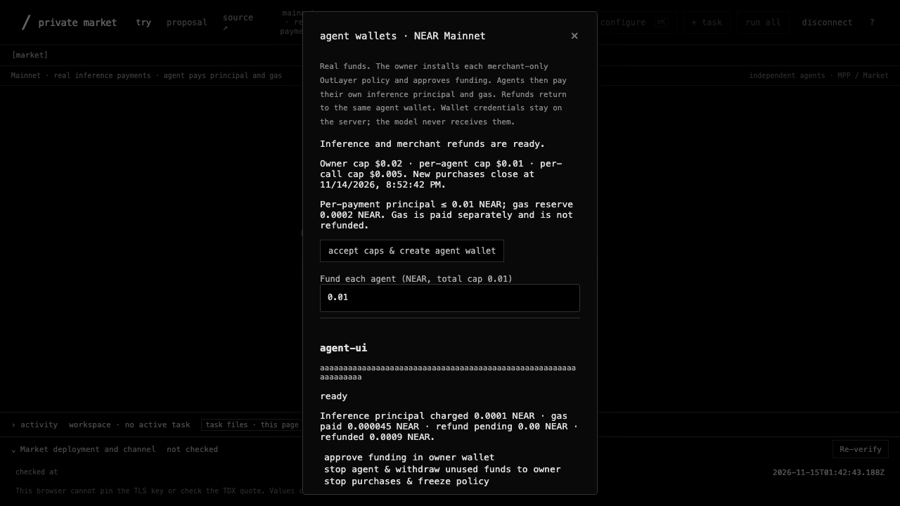

# Mainnet auction integration candidate

Source `69a2a40eeefd642a851111f9e79abb4d0ab8059a` combines PR #20's
OutLayer wallet primitives and PR #24's owning auction/client-memory workspace.
PostgreSQL AuctionMarket is the financial authority. These checks establish a
controlled candidate, not a funded Mainnet launch or independent reviewer approval.

Validation passed: 40 owning PostgreSQL checks, 111 payment/wallet/Cloud/auction
unit checks, 12 playground checks, 50 gateway/comparison checks, 13 Rust checks,
three packaging safety checks and the TypeScript/Vite production build. Counts
are per suite and may overlap. The PostgreSQL suite exercises real fx/just-bash,
cryptography and fee/refund verification against controlled model/chain fixtures.
It includes duplicate dispatch, lost acknowledgments, expiry, gas overrun,
provider refusal, project paid-probe accounting and original owner exits.

The final Linux/amd64 image contains Node v24.22.3. Runtime imports passed without
networking. Its packaged bootstrap initialized PostgreSQL 18/Redis and passed
the owning schema fingerprint verifier without source overrides. Docker network
was disabled; zero wallets, orders, payments and provider invocations existed.
The expected external-RPC boundary stopped startup. This does not prove hosted
readiness, secret delivery or live payment behavior.

Public NEAR AI model listing and strict SDK 0.3.0 UpToDate attestation were checked
read-only. These public interfaces do not validate billing credit. The runtime
now requires a bounded, project-funded paid probe before opening agent purchases.
No real probe, inference or Mainnet transfer was made during this integration.

The screenshot below uses controlled API responses with every wallet mutation
disabled. It verifies layout and distinct principal/gas/refund information; it
does not establish wallet-extension signing or a hosted task. The production
assets were compiled; the dev-only capture encountered font serving restrictions.

Before merge/deployment, complete a funded canary with a valid private Cloud key,
an exact reviewed funding/spend plan and fresh sourced FX. Collect real owner
policy/funding, task/tool, FINAL payment/gas/refund and no-extra-effects replay
evidence. Original #20/#24 remain open while the combined release is reviewed.
The deployed P2 service and its volume were not modified.

SDK captures are in memory until verified persistence; a crash in that window
remains Unknown and never causes a replacement model POST. FX currently requires
operator refresh. The project Cloud account pays upstream while agents pay the
MPP merchant. These limits remain explicit release decisions.

See the adjacent JSON for source/image hashes and scoped evidence, and
`docs/mainnet-auction-operations.md` for reproducible bootstrap/packaging steps.

GitHub Actions independently repeated the final image bootstrap and published the
immutable GHCR candidate successfully: [run 43667319025](https://github.com/SPIKESPIGEL404/private-flex-inference-auctions/actions/runs/43667319025).
Published image: `ghcr.io/spikespigel404/private-flex-inference-auctions@sha256:856227b912c42c927d04312218a6873aa98dcf0d6a209d7d0286c6d7418f761c`.
No CVM or funds were involved in that job.
