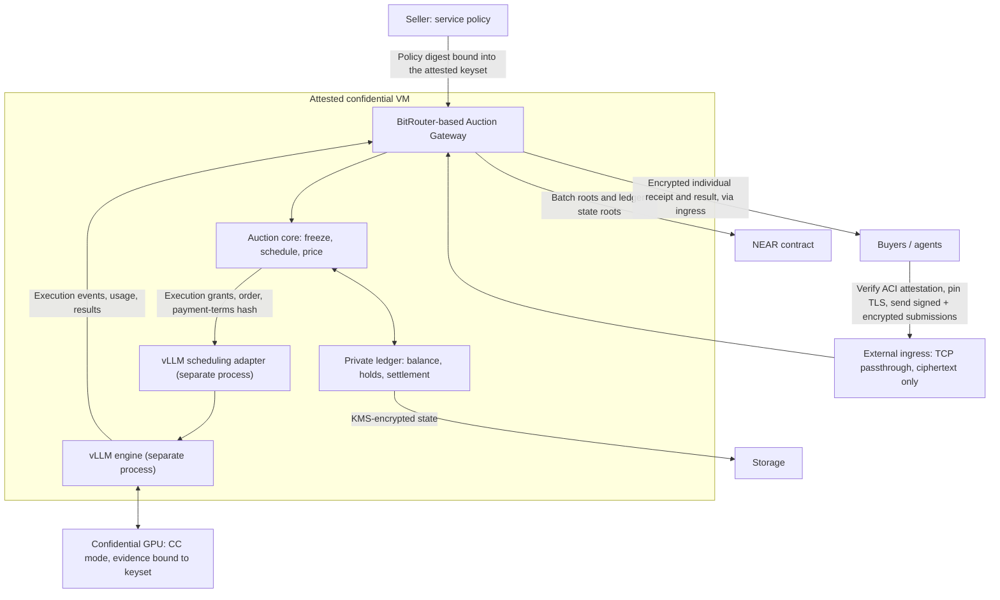

> Historical design proposal preserved from main commit `1a3215be2b780732328a744dba8979e28339b358` (2026-11-03). It describes the earlier auction/scheduler plan, not the implemented native Market or completed security guarantees. See the [current spec](../specs/2026-11-11-private-market-hackathon.md) and [current README](../../README.md).

# Private Flex Inference Auctions

A proposed confidential inference auction for **one model provider and multiple buyers**. Buyers bid for earlier service when inference capacity is congested. An attested auction gateway keeps their bids and budgets private, computes the schedule and payments, and hands execution to a self-hosted vLLM deployment.

Built as a NEAR hackathon prototype and a potential integration component for NEAR AI.

> **Status: design stage.** This README describes the intended MVP. The repository does not yet contain a runnable implementation or a verified TEE deployment. The initial demo will host its own model with vLLM; it does not assume access to NEAR AI's internal scheduler.

## What buyers purchase

Each request purchases a complete inference service with two price components:

- **Base service charge:** the seller's published price for the agreed request specification.
- **Priority payment:** an additional auction-determined charge for earlier service within a scheduling batch.

A bid represents the buyer's maximum willingness to pay to move a request from the back of its batch to the front. It is not the amount automatically charged.

A zero priority bid can still receive service in an admitted batch. When there is no queue, or when a batch has fewer distinct buyers than the published minimum, requests run in FIFO order without an auction delay or priority payment. Admission remains subject to capacity, funding, and request limits.

The MVP uses a base quote fixed for an agreed request size class and output limit, independent of auction order. This keeps cache-dependent billing from changing the incentives of the priority auction. Lower Flex prices would require a seller-provided discount or cheaper capacity; an auction alone does not reduce inference costs.

## Two core modules

| Module | Responsibilities |
| --- | --- |
| **TEE Auction Gateway, using BitRouter as a foundation** | Authenticate buyers, decrypt sealed submissions, enforce budgets, freeze batches, compute schedules and payments, maintain the private ledger, authorize execution, and return private receipts. |
| **vLLM scheduling adapter** | Admit committed batches, apply their frozen order, coordinate with running requests, and report execution events, usage, and results. |

**The gateway decides allocation and price. The scheduling adapter fulfills that allocation.** vLLM receives the request, execution identity, limits, and scheduling order. It does not need raw bids, payment terms, or account budgets.

The initial deployment places both modules inside one attested confidential VM, backed by a confidential GPU, but runs them as **separate processes** (see [Least privilege inside the VM](#5-least-privilege-inside-the-vm)). An optional external ingress forwards encrypted traffic as a TCP/SNI passthrough; TLS terminates inside the VM.

The attestation and channel layer follows [Attested Confidential Inference (ACI)](https://github.com/Dstack-TEE/private-ai-gateway/blob/main/spec/aci.md) and reuses the [dstack Private AI Gateway](https://github.com/Dstack-TEE/private-ai-gateway) verifier and client tooling where possible.



## How a request moves through the system

1. **Publish the service policy.** The seller fixes the model and its weights digest, request limits, base pricing, capacity policy, batch formation rule, minimum batch size, and auction version before the round. The policy digest is part of the attested workload keyset, so a policy change produces a new attested identity.
2. **Verify and submit.** The buyer fetches fresh ACI attestation with its own nonce, checks the hardware quote, the measured release, the keyset, and the policy digest, then pins TLS to the attested key. It encrypts its request, bid, and spending authorization to the attested E2EE key and signs the submission with its NEAR account key.
3. **Check funding and admit.** Inside the TEE, the gateway verifies the signature, rejects replays, validates the request, and reserves enough test credits for the base charge and the authorized priority-payment bound. Unfunded requests remain outside the auction.
4. **Freeze the batch.** Queued requests enter a batch under the published rule. Membership, request contents, identities, and bids are fixed before clearing. The gateway signs a Merkle root of salted submission commitments and gives each buyer an inclusion proof before clearing. Later arrivals enter a later batch.
5. **Clear the auction.** If the batch meets the minimum number of distinct buyers, the gateway computes the schedule and each buyer's payment; otherwise it schedules FIFO with no priority payments. It then commits the allocation, financial obligations, and execution grants.
6. **Execute the allocation.** The adapter registers the complete batch before making it eligible for scheduling. New bids cannot rewrite committed grants or jump ahead of earlier committed batches.
7. **Deliver and settle.** The gateway records execution facts, validates and stores the complete result for the buyer, settles once under the frozen terms, and releases unused holds. Each buyer receives only its own result and a signed receipt, with auction fields encrypted to that buyer. Batch roots and the post-settlement ledger state root are anchored on NEAR.

An execution grant binds the original request, buyer, model, round, scheduling rank, limits, and a hash of the payment terms. Retries and duplicate reports refer to that identity.

## Scheduling and payment

The proposed mechanism follows [Inference Auctions](https://arxiv.org/abs/2609.40070).

### Cache-aware ordering

The gateway constructs a radix tree from the **same final token sequences that vLLM executes**, including the agreed chat template and tokenizer version. Requests with shared prefixes share a path in this tree.

At each branching point, visit child subtrees in descending order of:

```text
subtree score = sum of request bids / number of requests
```

A depth-first traversal produces the schedule. This keeps requests sharing a prefix contiguous while incorporating their bids. The highest individual bid is not guaranteed to be first: its prefix group's average also matters.

vLLM continues to manage its own KV cache. The adapter must account for continuous batching, chunked prefill, and preemption. We will measure actual scheduling and cache behavior; the paper's cache-optimality results are not automatically established for our vLLM configuration.

### VCG priority payments

Each buyer pays the loss in other buyers' reported priority value caused by its bids:

```text
payment_i =
    best welfare of other buyers with buyer i's bids set to zero
    - welfare of other buyers under the selected schedule
```

The counterfactual **keeps the requests and tree structure unchanged**. It zeros all bids belonging to the buyer together; it does not delete that buyer's requests or price each request as an independent buyer.

For example, with three unrelated requests from three buyers, bids of 10, 6, and 2, and position values of 1, 0.5, and 0:

| Buyer | Bid | Position | Priority payment |
| --- | ---: | ---: | ---: |
| A | 10 | First | 4 |
| B | 6 | Second | 1 |
| C | 2 | Third | 0 |

Amounts here are illustrative credit units, excluding the base service charge. Priority bids and payments include any priority-related platform charge; the gateway does not add an undisclosed fee afterward.

The initial implementation can recompute the counterfactual once per buyer for small batches. Faster payment computation can follow measured performance needs.

The auction runs only when a batch contains at least the published minimum number of distinct buyers (default: 3). With two buyers, a winner's VCG payment can reveal the other buyer's bid exactly.

Truthful-bidding guarantees apply to the paper's fixed-request, fixed-batch, linear priority-value model. They do not establish resistance to fake identities, fabricated requests, strategic arrival times, or seller manipulation. Scheduling priority is also not a guaranteed time-to-first-token or completion deadline.

## What "private" means

The main privacy goals are:

- Other buyers cannot directly read a buyer's bid, budget, or complete bidding history.
- The auction operator cannot directly read those values through the host, gateway, storage, logs, or administrative access.
- Each buyer receives its own allocation, payment, balance information, and result over an encrypted channel.

The approved workload can process plaintext inside the TEE. Protecting it from the operator requires more than placing vLLM in a confidential VM: the attested deployment must restrict guest administration and debugging, bind its encryption key to approved code and configuration, and avoid sensitive logs or telemetry. A VM that the operator can freely inspect from inside the guest does not meet this goal.

**Auction outputs can still reveal information.** For example, in a simple two-buyer auction, a winner's VCG payment can reveal the other buyer's bid. Execution timing and allocation also convey information. The privacy target is confidential inputs with explicitly limited outputs, not zero information leakage or differential privacy.

Attestation supports trust in the approved program and its execution environment. It is not a zero-knowledge proof of auction correctness, and it does not prevent the operator from stopping the service or withholding traffic.

The demo may use public synthetic prompts with shared prefixes so that bid and budget confidentiality can be evaluated separately from prompt privacy. A separate benchmark view may show synthetic bids explicitly disclosed by the test clients.

## Security design

Each measure below names the link in the flow it protects.

### 1. ACI attestation and pinned TLS

The gateway serves an ACI attestation report. Its hardware quote binds `report_data = sha256({keyset_digest, nonce})`, and the workload keyset lists separate keys for receipt signing (ed25519), E2EE (X25519), and TLS (SPKI fingerprint). Buyers verify a fresh report with their own nonce, then pin the TLS connection to the attested key. The ingress is a TCP/SNI passthrough: a TLS terminator outside the VM would break the privacy claim. Keys are derived from dstack KMS inside the TEE.

### 2. Policy bound into attestation

The workload keyset carries a `policy_digest` extension field covering the auction version, batch rule, minimum batch size, size classes, pricing schedule, and model weights digest. Because keyset fields are part of the attested digest, buyers verify the rules they bid under, not only the code, and any policy change requires a fresh attested identity.

### 3. Encrypted bid fields

E2EE content encryption covers prompts but not auction fields. The client also encrypts `priority_bid`, `max_total_charge`, and `spending_limit` to the attested E2EE key (X25519, HKDF-SHA256, AES-256-GCM, or an equivalent HPKE envelope). The AEAD associated data includes `round_id` and `policy_digest`, so a bid cannot be moved into another round or replayed under different rules.

### 4. Signed submissions and replay protection

Each submission is signed with the buyer's NEAR account key (ed25519) over its canonical JSON form (RFC 8785), including a fresh nonce and the round. The gateway rejects a repeated (client key, service key, nonce) tuple within a 300-second window, and the ledger tracks a per-buyer sequence number so duplicate submissions cannot create duplicate charges.

### 5. Least privilege inside the VM

vLLM processes attacker-controlled prompts and is the largest attack surface, so it runs as a separate process from the gateway, auction core, and ledger, connected by a local socket. Execution grants carry a payment-terms hash rather than prices, and vLLM request logging is disabled. A later version may move the auction and ledger into a CPU-only confidential VM that verifies the GPU VM's attestation before forwarding, following ACI's gateway-to-provider pattern.

### 6. No-leak logging test

The gateway keeps no access log, and errors are reported as a closed set of error classes rather than free text. A test submits a sentinel bid value, captures every log line, metric, and usage report at the most verbose level, and fails if the sentinel appears anywhere.

### 7. Response timing

The ingress can observe when each buyer's response leaves. Because responses leave in execution order, timing can reveal rank and therefore bid ordering. The gateway supports a `release_mode` setting: `per_request` (lowest latency, documented leak) or `per_batch` (results released together when the batch completes). Streaming chunks are padded to fixed sizes so ciphertext lengths do not reveal output length. An OHTTP relay (RFC 9458) in front of the ingress can hide buyer IP addresses.

### 8. GPU binding

The deployment requires NVIDIA confidential computing mode with developer tools disabled and verifies the GPU's attestation evidence. GPU evidence alone does not prove the GPU is attached to this VM, so the GPU attestation nonce is the workload keyset digest, tying the GPU report to the attested VM identity. Model weights are hashed at load and must match the policy's weights digest.

### 9. Encrypted ledger and rollback protection

Ledger state is encrypted at rest with a key derived from dstack KMS, bound to the approved application. Encryption does not stop the operator from restoring an older ciphertext, so after each settlement the gateway anchors `(sequence, ledger_state_root)` on a NEAR contract. On restart, the gateway makes no new commitments until the loaded state matches the latest anchored root.

### 10. Receipts and batch commitments

Receipts follow the ACI receipt format: signed with the attested receipt key and storing hashes of request and response bodies, not the bodies. Auction events are added: `auction.admitted` (hold), `auction.cleared` (rank, base charge, priority payment), and `auction.settled` (released hold, balance). Auction fields are encrypted to the buyer, because a payment reveals information about other bids. At batch freeze, the gateway signs a Merkle root of salted submission commitments and gives each buyer an inclusion proof; anchoring that root on NEAR gives receipts an external ordering and timestamp.

### 11. Shill bids and small batches

VCG payments go to the seller, so a seller-funded fake buyer could raise prices at no cost to the seller. Production deployments should accept funding only from verifiable external deposits, publish the number of distinct funded accounts per batch, and burn a share of priority payments. The minimum batch size (default: 3 distinct buyers) limits what a single payment reveals.

## Budgets and execution responsibility

These are separate concepts, checked inside the gateway:

| Field | Meaning |
| --- | --- |
| `priority_bid` | Maximum value offered for full priority for this request. |
| `max_total_charge` | Maximum authorized total charge for this request. |
| `spending_limit` | A buyer's cumulative spending restriction across requests. |
| Funded balance | Credits actually available in the ledger; a declared budget does not create funds. |

The MVP uses test credits and one ledger writer. It borrows BitRouter Market's separation of authorization, reservation, execution, delivery, and settlement.

- A committed allocation retains its original execution identity.
- A timeout or lost response is an unresolved execution outcome, not proof that nothing ran.
- Unresolved requests are not automatically resubmitted or replaced.
- Financial closure and release of execution responsibility are separate decisions.
- Duplicate requests and execution reports must not create duplicate charges.

Encrypted storage alone does not prevent rollback or forked state. The MVP must stop new commitments after uncertain recovery until state is reconciled against the latest ledger state root anchored on NEAR (see [Encrypted ledger and rollback protection](#9-encrypted-ledger-and-rollback-protection)).

## MVP scope and validation

The first version targets one seller, one model, one GPU, one auction writer, small scheduling batches, bounded output lengths, and test-credit accounting. A thin client and demo UI expose the buyer flow.

The demo compares the same workloads under:

| Policy | What it demonstrates |
| --- | --- |
| FIFO | Baseline behavior without bidding. |
| Bid-only ordering | Priority allocation without prefix grouping. |
| Average-bid DFS with VCG | Cache-aware allocation and calculated priority payments inside the TEE. |

Validation should cover:

- Allocation and payment correctness against a small reference implementation.
- Budget enforcement, duplicate submission handling, replay rejection, and unresolved execution recovery.
- Agreement between committed order and actual scheduler events.
- Queue wait, time to first token, completion time, cache hits, and throughput.
- Client rejection of an unapproved deployment, a mismatched attestation-bound key, or a mismatched policy digest.
- Absence of plaintext bids and budgets from externally accessible logs, storage, and operator interfaces, enforced by the sentinel-bid test.
- Buyer inclusion proofs against the signed batch root, and refusal to resume after a ledger state that does not match the anchored root.
- What the ingress can infer from response timing under `per_request` and `per_batch` release.

These are planned checks, not completed results.

Multi-seller matching, production payments, hard latency SLAs, and distributed failover are outside the initial scope. Anchoring batch roots and ledger state roots on NEAR testnet follows once the local transaction loop works; on-chain anchoring is never part of per-request scheduling.

## Relationship to BitRouter and NEAR AI

BitRouter provides the intended foundation for ingress and request-lifecycle integration. The auction adds an explicit policy for allocating priority; it does not reinterpret an existing total-charge limit as a bid or require importing the entire multi-provider market.

The self-hosted vLLM demo validates a seller-side component that could later integrate with NEAR AI. Any NEAR AI or on-chain integration will be documented according to what is actually implemented.

## References

- [Inference Auctions](https://arxiv.org/abs/2609.40070)
- [Attested Confidential Inference (ACI) specification](https://github.com/Dstack-TEE/private-ai-gateway/blob/main/spec/aci.md)
- [dstack Private AI Gateway](https://github.com/Dstack-TEE/private-ai-gateway)
- [RFC 9180: Hybrid Public Key Encryption](https://www.rfc-editor.org/rfc/rfc9180)
- [RFC 8785: JSON Canonicalization Scheme](https://www.rfc-editor.org/rfc/rfc8785)
- [RFC 9458: Oblivious HTTP](https://www.rfc-editor.org/rfc/rfc9458)
- [vLLM architecture and scheduling](https://docs.vllm.ai/en/latest/design/arch_overview/)
- [vLLM scheduler configuration](https://docs.vllm.ai/en/latest/configuration/engine_args/)
- [vLLM automatic prefix caching](https://github.com/vllm-project/vllm/blob/main/docs/design/prefix_caching.md)
- [NVIDIA confidential computing trust model](https://docs.nvidia.com/confidential-computing/virtual-machines/threat-model)
- [NEAR AI verification](https://docs.near.ai/cloud/verification)

## License

[MIT](../../LICENSE).
