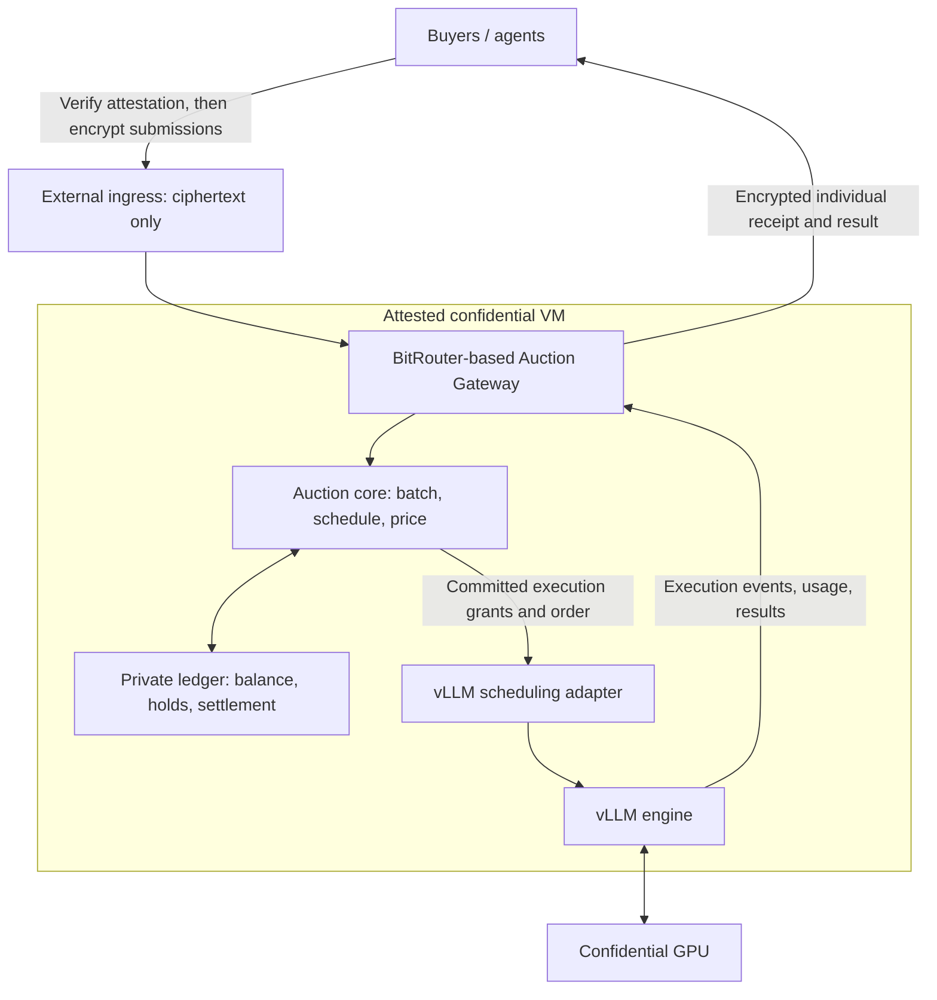

> Historical scheduler experiment. The current Market mainline is described in the [root README](../README.md). Commands below run from the repository root.

# Private Flex Inference Auctions

A proposed confidential inference auction for **one model provider and multiple buyers**. Buyers bid for earlier service when inference capacity is congested. An attested auction gateway keeps their bids and budgets private, computes the schedule and payments, and hands execution to a self-hosted vLLM deployment.

Built as a NEAR hackathon prototype and a potential integration component for NEAR AI.

> **Status: phases one through four implemented and accepted within their documented scope.** The Rust scheduler, HTTP/SSE transport and physical result spool passed local checks; the pinned Chutes vLLM/GPU adapter passed real generation, calibration and isolation recovery checks. BitRouter integration and end-to-end TEE verification remain later work. See the [phase-four acceptance report](acceptance/2026-11-02-phase4.md).

Current design: [External Prefill Gating Scheduler Spec](specs/2026-11-02-external-prefill-gating-scheduler.md). The scheduler receives a committed execution plan from BitRouter, then dispatches the next request after the previous request produces a verified generation signal or reaches a confirmed terminal state, subject to capacity. Decode may overlap; completion order is not guaranteed.

**Phase four is accepted for the measured Chutes configuration and synthetic workload.** Next is **phase five: discuss and align BitRouter integration, then implement it**.

## Current implementation scope

This work focuses on the scheduler. It reuses the user's existing BitRouter auction and settlement capabilities through an adapter; it does not reimplement allocation, VCG pricing, balances, holds, charges, refunds, or buyer receipts. The integration contracts in the spec are proposed contracts to align with BitRouter, rather than claims about its current API.

The scheduler owns complete plan registration, immutable execution identities, ordered dispatch, external prefill gating, capacity backpressure, the vLLM HTTP/SSE adapter, durable execution events, recovery, and a bounded result spool with handoff to BitRouter. It can run as a separate service and does not require a shared database with BitRouter.

The auction and financial sections below describe system context and external ownership. Their economic correctness and payment policies are outside this repository's implementation and acceptance scope.

## Run local acceptance

```bash
CHUTES_PYTHON=/path/to/chutes-venv/bin/python bash scripts/accept-phase4.sh
```

This checks the core, transports, spool and Chutes deployment contracts without GPU calls. Paid live acceptance and recovery require explicit arguments; see the [phase-four guide](phase4-vllm.md), [report](acceptance/2026-11-02-phase4.md), and [calibration record](acceptance/phase4-runtime-profile.json).

`bash scripts/accept-phase3.sh` runs all core, HTTP/SSE and physical spool tests, Clippy, and a walkthrough
with an independent durable mock sink, lost ACK, backpressure and cleanup. It
uses no external model endpoint or credentials. See the
[phase-three guide](phase3-spool.md),
[acceptance report](acceptance/2026-11-02-phase3.md), and
[recovery runbook](runbooks/scheduler-recovery.md).

The HTTP-only phase-two walkthrough remains available with
`bash scripts/accept-phase2.sh`; see its [guide](phase2-http.md) and
[acceptance report](acceptance/2026-11-02-phase2.md).

The original offline-only phase-one walkthrough remains available:

```bash
bash scripts/accept-phase1.sh
```

This runs formatting checks, core acceptance tests, Clippy with warnings denied,
and the offline fixture walkthrough using a fresh temporary journal. The fixture
contains public synthetic data and never sends inference requests. See the
[core implementation guide](phase1-core.md) and
[phase-one acceptance report](acceptance/2026-11-02-phase1.md).

## What buyers purchase

Each request purchases a complete inference service with two price components:

- **Base service charge:** the seller's published price for the agreed request specification.
- **Priority payment:** an additional auction-determined charge for earlier service within a scheduling batch.

A bid represents the buyer's maximum willingness to pay to move a request from the back of its batch to the front. It is not the amount automatically charged.

A zero priority bid can still receive service in an admitted batch. When there is no queue, requests run without an auction delay or priority payment. Admission remains subject to capacity, funding, and request limits.

The MVP uses a base quote fixed for an agreed request size class and output limit, independent of auction order. This keeps cache-dependent billing from changing the incentives of the priority auction. Lower Flex prices would require a seller-provided discount or cheaper capacity; an auction alone does not reduce inference costs.

## System boundaries

| Module | Responsibilities |
| --- | --- |
| **BitRouter: external auction and settlement dependency** | Authenticate buyers, process sealed submissions and budgets, freeze and price allocations, authorize execution, deliver results, and maintain financial obligations and receipts. These capabilities are reused through integration. |
| **Scheduler: this repository's implementation scope** | Register complete execution plans locally, dispatch requests in frozen order using external prefill gating, bound in-flight work, record execution facts, and hand results to BitRouter. |

**BitRouter decides allocation and price. The scheduler fulfills the execution plan.** The scheduler receives order, input bindings, limits, and authorization proof without bids or financial details. vLLM receives the inference request, execution identity, and limits; order is enforced through dispatch timing.

The proposed initial deployment places the trusted components inside one attested confidential VM, backed by a confidential GPU. They need not share a service or process. An optional external ingress only forwards encrypted traffic; deployment verification remains a separate integration requirement.



## How a request moves through the system

1. **Publish the service policy.** The seller fixes the model, request limits, base pricing, capacity policy, batch formation rule, and auction version before the round.
2. **Verify and submit.** The buyer verifies fresh attestation evidence and the approved deployment policy, then encrypts its request, bid, and spending authorization to a key bound to that environment.
3. **Check funding and admit.** Inside the TEE, the gateway validates the request and reserves enough test credits for the base charge and the authorized priority-payment bound. Unfunded requests remain outside the auction.
4. **Freeze the batch.** Queued requests enter a batch under the published rule. Membership, request contents, identities, and bids are fixed before clearing. Later arrivals enter a later batch.
5. **Clear the auction.** The gateway computes the schedule and each buyer's payment, then commits the allocation, financial obligations, and execution grants.
6. **Execute the allocation.** The scheduler registers the complete execution plan before making it eligible for dispatch. It waits for the previous request's verified generation signal or confirmed terminal state before dispatching the next request, subject to capacity. Later plans cannot jump ahead of earlier committed positions.
7. **Hand off, deliver, and settle.** The scheduler reports execution facts and hands off the durable result. BitRouter owns final buyer delivery and applies its existing settlement policy. Each buyer receives only its own receipt and result.

An execution grant binds the original request, buyer, model, round, scheduling rank, limits, and payment terms. Retries and duplicate reports refer to that identity.

## Scheduling and payment

The proposed mechanism follows [Inference Auctions](https://arxiv.org/abs/2609.40070).

### Cache-aware ordering

The gateway constructs a radix tree from the **same final token sequences that vLLM executes**, including the agreed chat template and tokenizer version. Requests with shared prefixes share a path in this tree.

At each branching point, visit child subtrees in descending order of:

```text
subtree score = sum of request bids / number of requests
```

A depth-first traversal produces the schedule. This keeps requests sharing a prefix contiguous while incorporating their bids. The highest individual bid is not guaranteed to be first: its prefix group's average also matters.

vLLM continues to manage its own KV cache. The adapter must account for continuous batching, chunked prefill, and preemption. We will measure actual scheduling and cache behavior; the paper's cache-optimality results are not automatically established for our vLLM configuration.

### VCG priority payments

Each buyer pays the loss in other buyers' reported priority value caused by its bids:

```text
payment_i =
    best welfare of other buyers with buyer i's bids set to zero
    - welfare of other buyers under the selected schedule
```

The counterfactual **keeps the requests and tree structure unchanged**. It zeros all bids belonging to the buyer together; it does not delete that buyer's requests or price each request as an independent buyer.

For example, with three unrelated requests from three buyers, bids of 10, 6, and 2, and position values of 1, 0.5, and 0:

| Buyer | Bid | Position | Priority payment |
| --- | ---: | ---: | ---: |
| A | 10 | First | 4 |
| B | 6 | Second | 1 |
| C | 2 | Third | 0 |

Amounts here are illustrative credit units, excluding the base service charge. Priority bids and payments include any priority-related platform charge; the gateway does not add an undisclosed fee afterward.

Counterfactual calculation belongs to BitRouter's auction module. The scheduler consumes its committed order and does not compute or validate VCG payments.

Truthful-bidding guarantees apply to the paper's fixed-request, fixed-batch, linear priority-value model. They do not establish resistance to fake identities, fabricated requests, strategic arrival times, or seller manipulation. Scheduling priority is also not a guaranteed time-to-first-token or completion deadline.

## What "private" means

The main privacy goals are:

- Other buyers cannot directly read a buyer's bid, budget, or complete bidding history.
- The auction operator cannot directly read those values through the host, gateway, storage, logs, or administrative access.
- Each buyer receives its own allocation, payment, balance information, and result over an encrypted channel.

The approved workload can process plaintext inside the TEE. Protecting it from the operator requires more than placing vLLM in a confidential VM: the attested deployment must restrict guest administration and debugging, bind its encryption key to approved code and configuration, and avoid sensitive logs or telemetry. A VM that the operator can freely inspect from inside the guest does not meet this goal.

**Auction outputs can still reveal information.** For example, in a simple two-buyer auction, a winner's VCG payment can reveal the other buyer's bid. Execution timing and allocation also convey information. The privacy target is confidential inputs with explicitly limited outputs, not zero information leakage or differential privacy.

Attestation supports trust in the approved program and its execution environment. It is not a zero-knowledge proof of auction correctness, and it does not prevent the operator from stopping the service or withholding traffic.

The demo may use public synthetic prompts with shared prefixes so that bid and budget confidentiality can be evaluated separately from prompt privacy. A separate benchmark view may show synthetic bids explicitly disclosed by the test clients.

## Budgets and execution responsibility

These are separate concepts, checked inside the gateway:

| Field | Meaning |
| --- | --- |
| `priority_bid` | Maximum value offered for full priority for this request. |
| `max_total_charge` | Maximum authorized total charge for this request. |
| `spending_limit` | A buyer's cumulative spending restriction across requests. |
| Funded balance | Credits actually available in the ledger; a declared budget does not create funds. |

Balances, credits, and financial obligations remain owned by BitRouter. The scheduler preserves the separation between execution authorization, execution responsibility, result handoff, and financial closure.

- A committed allocation retains its original execution identity.
- A timeout or lost response is an unresolved execution outcome, not proof that nothing ran.
- Unresolved requests are not automatically resubmitted or replaced.
- Financial closure and release of execution responsibility are separate decisions.
- Duplicate requests and execution reports must not create duplicate charges.

Encrypted storage alone does not prevent rollback or forked state. The MVP must stop new commitments after uncertain recovery until state is reconciled. Production recovery needs an explicit freshness and anti-rollback protocol.

## MVP scope and validation

The scheduler MVP targets one model, one GPU, one vLLM instance, one ordered input-plan stream, one scheduling writer, and bounded output lengths. A fixed-plan producer can exercise it before the existing BitRouter integration is connected; no auction or financial simulator is required.

An integrated benchmark can compare the same workloads under orders supplied by BitRouter:

| Policy | What it demonstrates |
| --- | --- |
| FIFO | Execution baseline for an externally supplied FIFO plan. |
| Bid-only ordering | Execution of an externally supplied priority plan. |
| Average-bid DFS | Execution of an externally supplied cache-aware plan; VCG remains outside the scheduler. |

Validation should cover:

- Complete plan registration, authorization binding, sequence continuity, and duplicate plan/event handling.
- Bounded request/context/result capacity and unresolved execution recovery.
- Agreement between committed order and recorded dispatch, generation-progress, and terminal events under the external gating contract.
- Durable result handoff, replay after BitRouter disconnects, and safe resume after old-writer/engine isolation.
- Queue wait, time to first output progress, completion time, cache hits, and throughput.
- Absence of sensitive inference inputs from public logs and metrics; financial fields are not part of the scheduler protocol.

The acceptance reports record completed core, mock HTTP/SSE, physical result spool and independent durable sink checks. Actual BitRouter integration and production deployment checks remain planned. Real vLLM/GPU validation is tracked separately in the [phase-four guide](phase4-vllm.md).

Auction algorithms, VCG correctness, financial policy, buyer-facing delivery, multi-seller matching, hard latency SLAs, distributed failover, and a new TEE control plane are outside this scheduler's scope. NEAR or on-chain integration is separate from per-request dispatch.

## Relationship to BitRouter and NEAR AI

BitRouter supplies the existing auction and settlement side of the integration. This repository contributes a scheduler that consumes frozen execution plans and returns execution/result evidence, without importing the entire multi-provider market or redefining its financial policies.

The self-hosted vLLM demo validates a seller-side component that could later integrate with NEAR AI. Any NEAR AI or on-chain integration will be documented according to what is actually implemented.

## References

- [Inference Auctions](https://arxiv.org/abs/2609.40070)
- [vLLM architecture and scheduling](https://docs.vllm.ai/en/latest/design/arch_overview/)
- [vLLM scheduler configuration](https://docs.vllm.ai/en/latest/configuration/engine_args/)
- [vLLM automatic prefix caching](https://github.com/vllm-project/vllm/blob/main/docs/design/prefix_caching.md)
- [NVIDIA confidential computing trust model](https://docs.nvidia.com/confidential-computing/virtual-machines/threat-model)
- [NEAR AI verification](https://docs.near.ai/cloud/verification)

## License

[MIT](../LICENSE).
