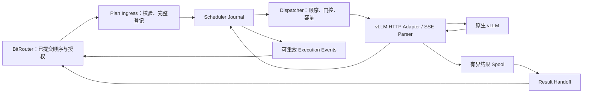

# 外部 Prefill 门控 Scheduler Spec

- **状态：阶段一核心已实现并通过本地验收；候选接口待 BitRouter 对齐，后续阶段尚未完成。**
- 日期：2026-11-02
- 本轮范围：实现可独立运行的 scheduler 组件，复用 BitRouter 已有的 auction 与 settlement。
- 执行方向：前一请求出现可信生成 token 或明确终止证据后，才允许派发下一请求；decode 可并发，不修改 vLLM 核心。
- MVP：一个模型、一个 GPU、一个 vLLM 实例、一个有序计划流、一个调度写入者。
- 关联：[README](../../README.md)、[独立审阅](../reviews/2026-11-02-external-prefill-gating-scheduler-review.md)。本文采纳 scheduler 相关意见；经济机制与金融政策由 BitRouter 拥有。
- 实现与证据：[阶段一核心说明](../phase1-core.md)、[阶段一验收报告](../acceptance/2026-11-02-phase1.md)。离线 fixture 验证状态机，不代表真实 vLLM/GPU/TEE 验收。

## 1. Scheduler 的输入、输出和服务语义

Scheduler 接收 BitRouter 已提交、已授权、顺序冻结的 `ExecutionPlan`，按原顺序派发到 vLLM，并向 BitRouter 回报可重放的执行事件、usage 和结果证据。输入顺序可以来自拍卖，也可以来自其他上游策略；scheduler 不判断该顺序是否经济最优。

它兑现的是**首次处理顺序**：后一个请求只会在前一个请求产生有效生成进度，或取得明确执行终止证据后被提交。请求开始后可共享 decode 容量，不保证完成顺序、固定 TTFT、持续 decode 优先级或生成速度。

按用户说明，BitRouter 已有 auction 与 settlement 实现。本 spec 将它们视为已有外部依赖，不重新设计其算法、付款分摊、资金预留、收费或退款政策，也不声称已验证现有 BitRouter 接口与下文候选 schema 一致。

## 2. 本次设计与实现边界

| 能力 | 拥有方与本次范围 |
| --- | --- |
| 买家认证、出价、预算、批次形成、allocation、VCG | BitRouter；本仓库仅接收最终执行顺序。 |
| 余额、holds、收费、付款分摊、退款、buyer receipt | BitRouter；scheduler 不读取或修改这些状态。 |
| 执行计划登记、顺序验证、门控、容量背压、派发 | Scheduler；本次实现。 |
| SSE 解析、执行 journal、未决执行与恢复 | Scheduler；本次实现。 |
| 执行期间结果 spool、usage 与结果交接证据 | Scheduler；本次实现，交给 BitRouter 后结束临时存储责任。 |
| 买家最终交付、长期结果保留、结算判断 | BitRouter；本次提供集成接口。 |
| KV 分配、continuous batching、chunked prefill、抢占 | 原生 vLLM；本次不改核心。 |
| 端到端 TEE 部署、防回滚与 attestation control plane | 现有部署与集成依赖；本次记录信任要求，不重建这些系统。 |

Scheduler 的协议不包含 `priority_bid`、`budget`、`base_charge`、`priority_payment`、`hold_id` 或金融状态。它可持有不含金额的 `authorization_ref`，表示 BitRouter 对绑定内容的有效执行授权。

不因接入 scheduler 而限制同一买家在一批中的请求数量；买家级 VCG 与逐请求付款的关系由 BitRouter 处理。它们不再是本 spec 的待定决策或实现前置任务。

## 3. 组件与部署



MVP 将 scheduler 作为单写入者组件设计，可在 BitRouter 同机的独立服务中运行，不依赖与 BitRouter 共用数据库或跨服务事务。也可嵌入同一可信应用；同进程不改变权威与数据边界。vLLM 可为本机独立进程。

上游提交、消息投递与 scheduler 登记是不同事实：BitRouter 负责持久化并发布已提交计划；scheduler 负责本地完整登记和执行 journal。双方均使用持久化重放与幂等确认，不假设一次 RPC 可以原子提交两个服务。

Scheduler 不使用 `scheduler_cls`，不修改 `Scheduler`、`EngineCore`、`KVCacheManager` 或 GPU worker。所有目标 vLLM 流量必须经过同一个 scheduler，不允许旁路请求改变执行前提。[S1]、[S4]

## 4. 与 BitRouter 的候选集成契约

本节定义需要对齐的契约，不冒充现有 BitRouter API。具体 transport、路径和类型名由适配层映射；状态与幂等语义必须保留。

### 4.1 ExecutionPlan

| 字段 | 含义 |
| --- | --- |
| `schema_version`, `plan_id` | 契约版本与不可变计划身份。 |
| `stream_id`, `plan_seq` | 单目标执行流及其从 1 开始的连续计划序号，由 BitRouter 适配层分配。 |
| `predecessor_plan_hash` | 前一计划的摘要；首个计划使用约定 genesis 值。 |
| `upstream_commit_ref` | BitRouter 已提交分配的关联标识；不要求其原生数据库序号连续。 |
| `model_profile_id`, `scheduler_policy_version` | 固定模型、输入处理、门控及容量配置的版本绑定。 |
| `manifest_hash`, `request_count` | 规范编码后的完整有序清单摘要及成员数。 |
| `authorization_ref`, `authorization_binding` | 对完整计划及目标执行环境的有效授权；由可信 BitRouter 适配器验证，不携带资金明细。 |
| `ordered_requests` | rank 从 1 开始、连续、无重复的完整请求列表。 |

每个请求包含：

| 字段 | 含义 |
| --- | --- |
| `grant_id`, `execution_id` | 上游原授权身份与一次上游推理提交的关联身份。 |
| `request_ref`, `owner_ref`, `rank` | 原请求关联、用于配额/结果隔离的 opaque owner 标识和冻结位置。 |
| `request_digest`, `prompt_token_ids` | 最终执行输入与有效 sampling/limits 的绑定。 |
| `sampling_config`, `max_output_tokens` | 冻结的有效生成参数与输出上限。 |
| `cache_namespace` | 上游批准的共享域；绑定为 vLLM `cache_salt`。 |
| `context_reservation`, `max_result_bytes` | scheduler 可校验的保守 context 和结果空间上界。 |

只有经过配置中批准的 BitRouter 身份及授权绑定验证的计划可以登记。认证必须绑定目标 scheduler、计划摘要及版本；使用同机受控通道或服务间认证的具体方式由部署 profile 固定。跨 TEE 时须覆盖批准代码与配置，不能只靠一个未绑定工作负载的 bearer token。

已登记授权在整个执行责任期间保持有效；MVP 不支持登记后动态撤销、过期回收后继续执行或原地修改计划。需要这些能力时必须单独定义协议，不能由任一服务单方面用超时替代。财务上的关闭或退款不是 scheduler 的撤销指令。

### 4.2 候选接口

| 接口 | 必须提供的语义 |
| --- | --- |
| `RegisterExecutionPlan(plan)` | 完整校验和持久化后返回登记确认及摘要；同 ID/同摘要幂等；不同内容拒绝。可返回背压、缺前驱或不兼容等明确状态。 |
| `GetPlanState(plan_id)` | 返回本地登记、派发、门控、未决及结果交接状态；恢复不确定时明确返回 recovery 状态。 |
| `WatchExecutionEvents(after_event_seq)` | 从持久化事件游标重放；允许至少一次投递，事件 ID 不变。 |
| `GetResultArtifact(execution_id)` | 通过认证读取原执行的结果、usage 与完整性证据，不触发再次推理。 |
| `AckResult(execution_id, digest, sink_receipt_ref)` | BitRouter 确认匹配的结果已可靠接收；重复确认幂等，使 spool 进入可清理状态。 |
| `PauseDispatch` / `ResumeAfterRecovery` | 受控运维接口；resume 必须验证第 9 节条件。 |

这些接口不包括清算、报价、余额、扣款或退款。BitRouter 消费执行事实后自行应用现有 settlement 政策。

阶段一提供本地 Rust API：登记、元数据查询、分页事件重放及可信运维状态转换。签名计划使用候选 v1 整数编码和 Ed25519 绑定，见阶段一核心说明。服务 transport、流式 Watch、实际 BitRouter 适配和结果 API 留待后续阶段。

### 4.3 顺序与幂等

- `(stream_id, plan_seq)` 及 `plan_id` 均绑定唯一摘要；冲突视为完整性错误并暂停该流。
- Scheduler 必须有经过批准的起始游标；不能把重启后第一个到达的高序号计划当作新的起点。
- 后来的计划可以有界地暂存，不能越过缺失前驱或尚未完整登记的更早计划。`plan_seq` 的连续性在适配层实现，不依赖 BitRouter 原有全局序号没有空洞。
- 同一 `execution_id` 不能因出现在另一个计划或一次消息重投中再次执行；跨计划重复必须拒绝。
- ACK 丢失可重投“登记计划”，但不得重发已有 `DISPATCH_INTENT` 对应的 vLLM POST。
- 背压或登记拒绝不意味着 BitRouter 的原提交被撤销，也不代表资金已经释放。适配层报告具体失败，不改原分配或重排后续计划。

## 5. 派发顺序与门控不变量

全部可执行请求按 `(plan_seq, rank)` 排成唯一序列。只有最早的未派发请求可获得下一次派发资格；不因长度、缓存或实时负载跳过它。

对于相邻的已派发请求 A、B，必须满足：

```text
durable_gate_satisfied(A) < dispatch_intent(B) < send(B)
```

门控依据只有两类：

1. `OUTPUT_PROGRESS`：可信响应中出现非空生成 `token_ids`；
2. `EXECUTION_TERMINAL`：取得经过验证的执行终止证据，包括正常零可见输出结束或明确未执行的拒绝。

首个 token 说明 A 的首次 prompt 处理已经足以开始生成；这不是精确的 GPU prefill-complete 时间。传输、缓冲与持久化可能增加等待。[S1]、[S3]

已满足门控的事实不会因后续断流撤回，但出现未决执行会触发全局停派。Scheduler 不控制后续抢占重计算，不保证任意时刻只有一个实际 prefill，也不保证缓存驻留或完成顺序。

只有单一调度写入者可记录派发意图与推进游标；并发 stream reader 只能提交事件。每次推进至多产生一个尚无门控证据的新提交。跨计划使用相同屏障，不要求前一计划所有 decode 都结束。

## 6. vLLM HTTP 与 SSE

### 6.1 输入一致性

MVP 内部使用 `POST /v1/completions`，单 token-ID prompt、单 choice。BitRouter 适配层提供使用固定 tokenizer/chat template 得到的最终 token IDs；scheduler 校验 profile、摘要和限制，不重新渲染 chat、不构造 radix tree、不修改 token 序列。[S2]

请求示意；token IDs 仅用于说明字段：

```json
{
  "model": "pinned-model-alias",
  "prompt": [1, 42, 314],
  "request_id": "opaque-execution-id",
  "max_tokens": 512,
  "n": 1,
  "stream": true,
  "stream_options": {"include_usage": true},
  "return_token_ids": true,
  "echo": false,
  "add_special_tokens": false,
  "truncate_prompt_tokens": null,
  "cache_salt": "approved-cache-namespace"
}
```

有效 sampling 参数必须冻结并显式解析；不能执行时套用不同模型默认值。禁用自动重试、自动重定向/跨实例 fallback、prompt echo、输入截断、多 prompt、多 choice、beam search、multimodal、工具或 reasoning 专用解析；输出上限至少为 1，原生 priority 使用默认值。

启动前须验证 pinned vLLM、模型与输入配置，并校验实际响应 ID 到原提交的映射。缺少可靠 `return_token_ids` 能力时不得静默改用非空文本判定。[S2]、[S3]

### 6.2 事件分类

Parser 必须有界地完成 SSE 解帧、JSON 校验、响应关联与唯一 choice（index 0）验证，再分类。错误和非法字段优先；异常事件带 token IDs 也不能开门。

| 上游观察 | 行为 |
| --- | --- |
| 非空生成 `choices[0].token_ids` | 持久化一次 `OUTPUT_PROGRESS`；文本可为空。 |
| 仅 prompt IDs、空 token 列表、空文本、心跳、响应头、初始 metadata | 不开门。 |
| 合法终止 choice，MVP 正常原因为 `stop` / `length` | 持久化 `EXECUTION_TERMINAL`，即使没有先前生成进度。 |
| usage-only | 保存计量事实，不单独开门或证明终止。 |
| 单独 `[DONE]` 或普通 EOF | 不单独证明执行终止或结果完整。 |
| 错误响应、格式错误、无法关联、断流或超时 | 有明确终止证据则保留；否则记 `UNKNOWN`。 |

首进度和终止可以在同一个事件出现，须原子记录，各一次性约束不能重复释放。一个 chunk 可含多个生成 token；首次生成进度不等于客户端首个可见字符。重复 token 内容合法，不能按 token 值去重。[S3]

明确未执行的 HTTP 拒绝类别必须在 pinned profile 中验证，不能只凭 4xx/5xx、超时或 EOF 推断没有执行。

## 7. 容量、背压与派发循环

部署 profile 必须明确配置并经过校准；不以未经测试的在途数 4 作为生产默认。校准至少比较 1、2、4，无有效 profile 时拒绝激活真实派发。

| 配置 | 约束 |
| --- | --- |
| `max_inflight_requests` | 目标模型/GPU 测量后固定。 |
| `max_reserved_context_tokens` | 保守 context 总预算，包含引擎开销余量。 |
| prompt/output/model length 限制 | 单请求必须能在空闲时适配，输入加最大输出不得超过上下文上限。 |
| 排队请求数、输入字节数、乱序计划数 | 全部有界；超限返回明确背压。 |
| spool 总量、逐 owner 配额、单结果上限 | 派发前可预留最坏情况输出空间。 |
| parser 缓冲、单 SSE 事件、事件队列大小 | 全部有界，不能依赖买家消费速度。 |
| connect / first-progress / idle / total timeout | 显式配置；超时不是重试、跳过或释放执行预算的依据。 |

建议的 context 计账为：

```text
context_reservation = prompt_token_count + max_output_tokens
reserved_context = sum(context_reservation of dispatch intents without terminal proof)
```

仅已记录派发意图的请求占用在途 context；未知执行继续占用，未派发请求不占用。缓存命中不减少该预算。它是外部保守计账，不是物理 KV 预留，不保证无抢占。

状态机伪代码：

```text
on durable event or capacity change:
    if scheduler is not ACTIVE or any submitted execution is UNKNOWN:
        return
    if previous dispatched request lacks durable gate-satisfied evidence:
        return

    next = request_at(next_unsent_cursor)
    if next is absent or its plan/predecessor is incomplete:
        return
    if request-count, context, or result-spool reservation cannot fit next:
        return

    atomically record dispatch intent, capacity reservations, last-dispatched and next cursor
    issue one upstream HTTP submission for that intent
```

实际实现须维护明确的 next-unsent 游标，只有同一事务记录派发意图后才推进；last-dispatched 的门在下一轮重新检查，不能重新选到已派发请求。早期计划缺失时等待，不从后续已登记计划找一个适配请求。结果空间的逻辑预留与文件存储必须有可恢复的对应记录；无法完成预留不得发起网络提交。

## 8. 执行 Journal 与输出事件

Scheduler 维护三类独立状态，**不包含金融状态**：

| 维度 | 状态或事实 |
| --- | --- |
| 派发 | `UNSENT`、`DISPATCH_INTENT`、`STREAMING`、`UNKNOWN`、`TERMINAL`。 |
| 门控 | `CLOSED`、`SATISFIED_BY_OUTPUT`、`SATISFIED_BY_TERMINAL`。 |
| 结果交接 | `PENDING`、`DURABLE_COMPLETE`、`INCOMPLETE` / `UNAVAILABLE`、`HANDED_OFF`。 |

事件至少包含 `PLAN_REGISTERED`、`DISPATCH_INTENT`、`OUTPUT_PROGRESS`、`EXECUTION_TERMINAL`、`EXECUTION_UNKNOWN`、`RESULT_DURABLE`、`RESULT_UNAVAILABLE`、`RESULT_HANDED_OFF`、`DISPATCH_PAUSED`、`RECOVERY_COMPLETED`。

共同字段绑定 `stream_id`、`plan_id`、manifest/request 摘要、`grant_id`、`execution_id`、`engine_epoch`、不可变事件 ID 和单调 `event_seq`。未涉及单个请求的事件不伪造 grant 关联。时间字段用于观测，不用于替代序列一致性。

- 派发意图在可能写入网络前持久化；意图存在但没有后续证据的崩溃窗口按可能已提交处理。
- 门控证据在允许下一派发前持久化；相关输出 chunk 的持久化不能被虚假宣称成功。
- 原连接内 chunk 序号用于去重，不按内容去重；首进度、终止和容量释放各有一次性约束。
- 正常终止证据释放执行容量；usage 或结果交接缺失不撤回终止事实，也不证明完整结果。
- 事件至少一次投递给 BitRouter；其消费确认与本地执行状态独立，不因事件 ACK 丢失重新推理。

`EXECUTION_TERMINAL` 不表示付款成功。`RESULT_DURABLE` 不表示买家已收到。Scheduler 不产生 `SETTLED`、`REFUNDED` 或金融 hold-release 事件。BitRouter 按原授权与既有政策解释事实，金额调整不能反向覆盖执行记录。

阶段一另外使用 `INTEGRITY_FAULT`、`EPOCH_FENCED`、`LATE_EVIDENCE` 记录冲突、运维隔离和迟到证据。终止 observation 可携带同批生成 token delta，使进度与终止事实在单次提交中原子记录；外部终止事件只提供生成数量，不暴露 token IDs。结果完整与交接事件由阶段三接入。

## 9. 失败与恢复协议

| 情况 | Scheduler 行为 |
| --- | --- |
| 计划身份/摘要/授权/profile 无效 | 拒绝登记并返回具体原因，不发送推理、不改原上游提交。 |
| 队列或输出配额不足 | 背压，保持原顺序；不发送后面的请求绕过它。 |
| 能证明未调用网络提交的本地失败 | 保持或恢复 `UNSENT`；持久化证明条件。 |
| 明确未进入推理的上游拒绝 | 记录终止失败并移过原位置；不自动重试或改变顺序。 |
| 首进度前断流或超时 | `UNKNOWN`，门关闭，进入 `RECOVERY_REQUIRED`。 |
| 首进度后、终止证据前断流 | 保留门控事实，执行 `UNKNOWN`，进入 `RECOVERY_REQUIRED`。 |
| 已终止但 usage / 正常流结束丢失 | 释放执行预算，记录结果不完整，向 BitRouter 报告；不再次执行。 |
| BitRouter 或买家断线 | 健康上游执行继续收集到本地 spool；事件和结果通过原身份重放。 |
| Scheduler 重启、profile/引擎身份变化 | 默认停止派发；不盲目重发已有意图。 |
| Journal/spool 写入失败 | 停止新派发，不虚构已持久化事实；尽可能继续收集现有流的终止证据，无法核对时保持未决。 |

`RECOVERY_REQUIRED` 时拒绝新的执行登记或返回不可用，允许安全的现有状态读取/重复登记查询，并继续收集其他健康流的证据；通知 BitRouter。是否停止新的拍卖承诺由 BitRouter 根据该信号决定，不由 scheduler 修改上游业务状态。

MVP 不假定 vLLM HTTP 有持久化去重、逐请求可靠恢复或权威状态查询。同一 request ID 的第二次 POST 不能视为幂等操作。

### 9.1 返回 ACTIVE 的必要步骤

恢复由受控运维流程触发，journal 中留下证据关联：

1. 隔离旧 scheduler writer；确认没有第二个 writer 可以继续派发。
2. 尽量收齐健康 stream 的终止与结果证据；仍未决时，关闭旧入口并确认旧引擎进程不能继续执行或接收旧提交。切流或健康检查不足以证明这一点。
3. 持久化旧 `engine_epoch` 的关闭证明。逐项核对旧派发意图、门控、终止、结果及待交接事件；无法恢复结果的执行记录为失败/结果不可用，通知 BitRouter，由其处理金融后果。
4. 从 journal 重建最早未派发位置、已终止/未决计数、context 与 spool 预留、事件游标；已派发请求不得重新成为 `UNSENT`。
5. 验证上游 stream/前驱连续性、授权来源、持久化状态新鲜度以及新引擎 profile。无歧义时记录 `RECOVERY_COMPLETED`，启用新 epoch。

旧 epoch 迟到事件只追加为原执行证据或完整性告警，不触发新推理、不重复释放容量，也不覆盖已经核对的记录。不能确认恢复条件就保持停止。

本协议不承诺 GPU exactly-once，也不替代部署的防回滚或状态新鲜度协议。上游退款、超时或消息 ACK 不等于旧执行已结束。

## 10. 临时结果 Spool 与 BitRouter 交接

Scheduler 为隔离上游生成和下游消费速度，提供**执行期间的有界临时存储**。它不实现买家长期结果存储、买家 receipt 或 settlement。

派发前按固定 tokenizer、输出上限和有界协议编码校验 `max_result_bytes`，并同时满足全局与逐 owner 配额。它必须覆盖支持配置的最坏情况结果与必要元数据，不能用任意较小字节数暗中缩短已授权输出。已完成未交接结果仍占 spool，不能随执行容量一并释放。

完整性要求：收到正常终止、有效最终 usage 和正常流结束，结果及摘要可靠存储后，才产生 `RESULT_DURABLE`。usage 缺失显式记录为缺失，不能猜成零；部分内容可以作为诊断证据提供，但不能冒充完整结果。

交接流程：

```text
RESULT_DURABLE(execution_id, digest, usage, artifact_ref)
    → BitRouter 幂等读取并可靠存储结果
    → AckResult(execution_id, digest, sink_receipt_ref)
    → RESULT_HANDED_OFF
    → 按固定清理策略释放本地 spool
```

普通网络接收确认不等于 durable sink ACK。ACK 丢失可重读同一结果、重复确认，不重做推理。未获 durable sink ACK 的结果不因交接超时静默删除；长期不消费会触发背压和告警。ACK 后的清理保留窗口由部署 profile 明确配置，BitRouter 对买家的长期保留政策不在本组件中实现。

结果超过已验证上界或存储写失败时，停止新派发并报告结果故障；已有执行不能仅因文件故障被标成未执行。能够继续读到可信终止时记录终止，否则按第 9 节处理未决责任。

## 11. 缓存、隐私与信任

- `cache_namespace` 来自已授权计划；scheduler 不根据 buyer 输入任意加入其他共享域，不构造或重排拍卖树。
- namespace 参与输入摘要和 profile 校验，并映射为 `cache_salt`。不同域不能仅因 token 相同被视为可共享。[S5]
- 配置使用批准的密码学 prefix-cache hash。公开合成数据共享、私密输入隔离等业务政策由 BitRouter 提供；scheduler 验证并执行映射，不自定经济上的可行集合。
- 不保证缓存命中或物理 KV 节省；共享前缀连续派发只提供复用机会。
- 公开日志/metrics 不记录 prompt、token IDs、完整计划、逐 owner 轨迹或授权秘密；协议本身不接收出价和财务明细。
- 执行证据、spool 与事件接口受可信环境内的访问控制保护；BitRouter 负责最终买家身份映射。
- 独立服务不意味着自动跨越可信边界。跨主机/TEE 部署须将 scheduler、vLLM、密钥接收方和批准配置纳入现有信任策略。

## 12. 当前决策与剩余对齐项

1. **范围已定：** 本次交付 scheduler；auction、VCG、资金和 settlement 复用 BitRouter，不新建这些模块。
2. **执行已定：** 外部 token-ID 进度门控；合法终止可退出；decode 并发；不改 vLLM 核心。
3. **接口待对齐：** 候选 ExecutionPlan / ExecutionEvent / Result Handoff 映射到现有 BitRouter，确认授权证明、连续计划流和结果 ACK。
4. **容量待测量：** 对 1、2、4 在途请求校准 profile，确定 context、输出空间及 timeout；不使用未校准默认值。
5. **Scheduler 交付要求：** 本地幂等 journal、有界 spool、可重放事件、旧 writer/engine 隔离和人工触发恢复。

原 review 中的 buyer-level VCG 分摊与 auction 数学契约属于 BitRouter 的所有权边界，不作为本仓库需重新实现的内容；没有因为本次范围决定而宣称它们已经通过代码或理论审计。

## 13. 实现顺序与验收

### 13.1 实现顺序

1. **已实现并本地验收：** scheduler 契约、单写入者状态机、持久化 journal 与重放；使用固定顺序的计划 fixture，不实现竞价或清算。验收范围与限制见阶段一报告。
2. 接 mock vLLM/SSE，验证门控、并发、重复、背压、错误及崩溃窗口。
3. 实现有界结果 spool、durable handoff ACK 和恢复 runbook。
4. 编写 BitRouter 适配层，对齐其现有计划与事件/结果接口；financial behavior 仍由 BitRouter 的既有实现承担。
5. 接真实 pinned vLLM，验证输入一致性、SSE 信号及 decode 重叠，保存目标 GPU 的校准 profile。

### 13.2 必须通过的验收

| 项目 | 通过条件 |
| --- | --- |
| 完整性与授权 | 缺成员、错误摘要/授权/profile、重复 rank 的计划不产生任何推理提交。 |
| 计划流顺序 | 乱序投递、缺前驱、重复计划、同序号不同摘要均不能越序或重复执行。 |
| 门控 | 每个下一派发意图之前存在前一请求的持久化门控证据；跨计划成立。 |
| SSE | 拆帧/粘帧、空文本有 IDs、prompt-only、usage-only、单独 DONE、错误 choice、错误优先级分类正确。 |
| 正常零输出 | 以可信终止移过位置，不伪造生成进度，不死锁。 |
| 实际并发 | A 长输出、B 短输出；A 首进度后 B 才提交，B 可在 A 结束前完成。 |
| 容量 | 在途/context/spool/owner 配额均有效，不跳过队首；UNKNOWN 不释放执行预算。 |
| 故障窗口 | 派发意图前后、首进度持久化前后、终止后 usage 丢失均不触发盲目重发。 |
| 下游停滞 | BitRouter 长期不读、ACK 丢失、磁盘满、spool 写失败均保持有界；不错误清除执行责任。 |
| 结果交接 | 同一 artifact 可幂等重读/确认；完整性摘要匹配才清理，未确认结果不因超时静默消失。 |
| 恢复 | 旧 writer/engine 存活、迟到事件、epoch 重放、profile 变化与 journal 写失败均满足恢复前置条件后才 ACTIVE。 |
| 外部金融边界 | 事件包含原身份和证据；scheduler 不产生收费/退款，不读取财务字段，也不因金融调整再次推理。 |
| 缓存与隐私 | namespace 按授权绑定；隔离真实有效；敏感输入不出现在外部日志或 metrics。 |

性能报告区分计划登记到派发、派发到首进度、首进度到下一派发、完成时间、吞吐、在途数、实际缓存统计及原生抢占。首进度到下一派发的间隔分开报告持久化开销和容量等待。买家端 TTFT 可由 BitRouter 集成测量。

可以使用 BitRouter 生成的 FIFO、bid-only、DFS 等顺序比较执行效果；这些在 scheduler 中均只是输入 fixture，不增加 auction/VCG 实现或付款正确性验收。

## 14. 调研依据

以下是设计依据，不是运行验收。vLLM 源码调研快照为 `db7f2d7c44f12f8b690c930000d89e479f3838c0`（2026-11-02 main）；实际部署须固定可运行版本并完成兼容性检查。

- **[S1]** [vLLM Architecture Overview](https://docs.vllm.ai/en/latest/design/arch_overview/)：引擎内 step、token 预算与抢占。
- **[S2]** [Completion protocol 快照](https://github.com/vllm-project/vllm/blob/db7f2d7c44f12f8b690c930000d89e479f3838c0/vllm/entrypoints/openai/completion/protocol.py)：token-ID prompt 与返回生成 IDs。
- **[S3]** [Completion serving 快照](https://github.com/vllm-project/vllm/blob/db7f2d7c44f12f8b690c930000d89e479f3838c0/vllm/entrypoints/openai/completion/serving.py)：流式 delta、终止、usage 与错误处理。
- **[S4]** [vLLM Optimization](https://docs.vllm.ai/en/latest/configuration/optimization/)：chunked prefill 与重计算。
- **[S5]** [vLLM Prefix Caching](https://docs.vllm.ai/en/latest/design/prefix_caching/)：缓存 key、salt 与 hash 风险。
- [llm-d Flow Control](https://llm-d.ai/docs/architecture/router/flow-control)：保留外层排队与背压。
- [Dynamo Routing Concepts v1.6.1](https://docs.nvidia.com/dynamo/v1.6.1/knowledge-base/modular-components/router/routing-concepts)：在途负载计账；本次不引入多 worker placement。
- [vLLM Router Program Scheduling](https://github.com/vllm-project/router/blob/main/docs/program_scheduling/program-scheduling.md)：准入与 Router/引擎控制边界；本次不引入 Program 或 KV TTL。

[S1]: https://docs.vllm.ai/en/latest/design/arch_overview/
[S2]: https://github.com/vllm-project/vllm/blob/db7f2d7c44f12f8b690c930000d89e479f3838c0/vllm/entrypoints/openai/completion/protocol.py
[S3]: https://github.com/vllm-project/vllm/blob/db7f2d7c44f12f8b690c930000d89e479f3838c0/vllm/entrypoints/openai/completion/serving.py
[S4]: https://docs.vllm.ai/en/latest/configuration/optimization/
[S5]: https://docs.vllm.ai/en/latest/design/prefix_caching/
