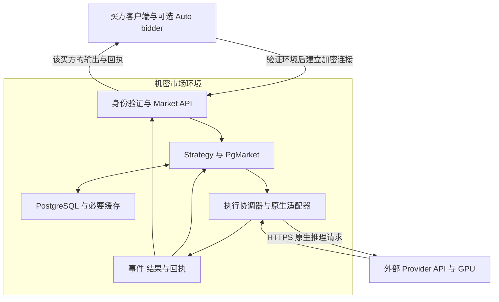

# NEAR Hackathon 私密推理市场迁移规格

- 状态：批次 A、B 已通过本地受控验收；C 已通过 NEAR AI Cloud 真实推理及证据审计；三批均通过 gpt-6-astra 独立 review。D 的买方验证接口与客户端已进行本地受控联调，硬件及私密部署尚未验收；E 尚未开始。
- 日期：2026-11-11，America/New_York。
- 目标仓库：`private-flex-inference-auctions`。
- 主线：私密采购授权与订单撮合，连接真实 Provider 完成推理、交付和结算。

本方案以最新 BitRouter Cloud Market 为业务和执行基线，将其迁入独立的私密市场宿主。市场服务保护买方预算、订单条件和内部状态，通过原生 API 调用外部 Provider。GPU 无须与市场处于同一受保护环境，Provider 无须安装本项目的 proxy。

`flex-scheduler` 不再是新 demo 的运行依赖。新主线沿用 Market 的推理采购和履约合同，不要求 GPU prefill 顺序控制，也不实现旧 README 中的平均出价 DFS 和 VCG 优先级定价。

## 1 已确认方向与待审提案

| 类别 | 内容 |
| --- | --- |
| 已确认 | 以私密竞价与真实推理为 hackathon 主线 |
| 已确认 | 以最新 Cloud Market 路线为迁移基线，直接接入卖方原生 API |
| 已确认 | 私密市场和 GPU 可以分开部署，不要求共享 TEE |
| 已确认 | 新主链路不依赖 `flex-scheduler`；auto-bidder 为可选策略扩展 |
| 本文提案 | 首轮以三个买方、一个已登记 Provider、一个模型演示；多个独立卖方后续扩展 |
| 本文提案 | 首轮只开放一种经过实际验证的原生协议与服务类型，保留源实现的扩展边界 |
| 本文提案 | 使用独立测试积分账本；真实 Provider 调用成本与演示积分结算分别记录 |
| 本文提案 | 先以手动采购授权完成闭环，再决定是否实现 auto-bidder |
| 本文提案 | 市场进程、敏感数据库和必要缓存部署于同一机密 VM，GPU 留在外部 |

本文中的“必须”描述实施和验收条件，不表示相关能力已经实现。第 12 节列出需要 review 的具体选择。

## 2 产品语义

### 2.1 买方购买什么

交易对象是一次推理调用，由模型、请求内容、生成上限、服务类型、费用上限及交付合同共同约束。买方授权最大可接受支出；市场根据已登记的供给及原有资格和选择规则形成成交，冻结价格与执行身份。

本项目中的“私密竞价”指采购授权与撮合输入在受保护环境中处理。买方费用上限不是自动收取的金额，也不直接代表 GPU 优先级。成交和实际收费遵循固定版本的 Market 合同。

演示不得把较高费用上限描述为必然先执行、保证更低 TTFT，或必然获得更低价格。不得把当前 Market 的候选选择描述为已经实现 VCG、密封批次清算或全局价格时间优先；若需要这些机制，另行定义规则和验收。

### 2.2 用户可见流程

1. 买方客户端验证私密市场的环境、程序配置和连接绑定。
2. 买方以自己的身份提交请求、服务类型、费用上限及等待和恢复授权。
3. 市场核验权限和资金，登记原逻辑请求并尝试撮合；需要等待时显示等待状态。
4. 成交后按冻结条款调用原 Provider，买方开始接收输出。
5. 市场保存终态和用量证据，分别显示交付状态与结算状态。
6. 买方取得自己的结果及费用回执；重复提交或续看恢复原请求。

只展示买方自有订单、预算、余额和回执。公开演示屏使用买方明确公开的合成数据，或不含敏感明细的运行状态。

## 3 代码基线与现状

| 来源 | 固定版本 | 用途与边界 |
| --- | --- | --- |
| Cloud PR 667 | `244177cafa26e8c8b001e61297cf4e7f89ac8de9` | 迁移基线，包含 On-demand 和既有 Interruptible 路线 |
| Cloud PR 666 | `1e016731e6482c4e0e94b033beffc900bbc06010` | 统一市场、原生流、恢复与费用保护的父分支 |
| BitRouter 原生协议及客户端 | `f206ca9a6f472b079167c9992c1c1ce1688725af` | 沿用 PR 667 Cargo 配置中的固定依赖 |
| 本仓库 scheduler 阶段四 | `13065b20092d44d5e06946168c434f18c5b03940` | 保留独立实验及验收证据，新 demo 不依赖其执行链路 |

截至本文日期，Cloud PR 666、667 均为 open、未合并。PR 667 记录了领域、内核和受控 PostgreSQL／Redis／卖方端到端验收；指定 staging 和真实卖方端点验收仍待执行。这些记录不构成本项目迁移后或 TEE 部署后的验收结果。[S1][S2]

最新实现由 `NativeRoute` 连接登记的原生 endpoint。Cloud 消费市场采购和交付控制字段，卖方只接收适配后的原生请求。`PgMarket`、coordinator、持久 schedule 和事件存储共同管理业务及执行责任。[S4][S5]

PR 667 使用共享资金权威及其配套表、锁和恢复规则。旧分支的独立 `src/wallet/` 不是本次资金迁移基线；只复制旧钱包或 Market 领域 crate 无法得到当前完整闭环。[S6]

## 4 迁移范围

| 来源组件 | 迁移方式 | 必须保留的语义 |
| --- | --- | --- |
| `crates/bitrouter-market/` | 保留可追溯的源码副本或固定依赖，避免无关改写 | 订单、供给、资格、容量约束、成交与执行身份 |
| `src/market/inference/` | 提取领域合同及 Strategy | 服务类型、预算授权、等待额度、尝试次数、履约判定 |
| `src/market/pg/` | 连同所需 schema、事务和恢复依赖提取 | 单写入者约束、资金提交、原请求、outbox、事件与回执一致性 |
| `src/core_gateway/market_inference*` | 提取最小 HTTP 宿主及 native adapter | 原生终态、输出验证、事件保存、权限和续看 |
| 共享计费与资金依赖 | 沿最新调用链闭合依赖后提取 | 单一可花用余额、预占、费用冻结、结算幂等与恢复 |
| 身份与账户映射 | 通过窄接口接入测试身份配置 | 身份来自验证结果，不能由请求体中的 buyer ID 决定 |
| 模型 tokenizer 与卖方配置 | 在市场侧部署并固定版本 | 输入计量、输出上限、模型及 endpoint 绑定 |
| `bitrouter-ai` 与原生 SDK | 固定版本依赖 | 协议解析、原始 SSE 和单次执行传输 |
| 现有 scheduler、spool、Chutes 专用入口 | 保留历史实现，不链接到新 demo | 旧证据只适用于原实验，不转用为新市场验收 |

迁移首先闭合可运行的最小依赖集合，再收窄 Cloud 耦合；不能为了缩小文件数量而删除资金锁、恢复、身份校验或终态证据。若某项 Cloud 依赖暂时无法安全拆分，先保留该依赖并记录边界，再进行等价重构。

不迁移 Console 完整账户产品、Stripe 充值、生产提现、OAuth 产品后台、托管 Agent 工具循环及与本 demo 无关的 Core 管理功能。隔离测试积分可通过受控初始化创建，不连接生产账户或生产账本。

建议在现有仓库新增独立宿主 package、demo 客户端及部署配置；具体 package 名称在依赖盘点后确定。源码来源 commit、许可证及必要声明随迁移保留。

## 5 部署与信任边界

### 5.1 私密市场保护范围

受保护数据包括买方采购上限、余额与预占、未公开订单条件、策略参数、完整订单历史和市场内部关联。授权程序可在机密环境内处理明文；其他买方及基础设施运营方不能通过宿主、数据库、调试或日志直接读取这些明文。

提案采用机密 VM 内的市场进程、PostgreSQL、必要 Redis 和 tokenizer。敏感卷、数据库日志、临时文件、备份、崩溃转储及遥测均纳入保护范围。仅将应用放进 TEE、同时把明文订单写入外部托管数据库，不满足本目标。

Redis 若保留，仅承担源实现允许的缓存与协调职责，不增加独立资金权威。机密环境边界内的访客系统管理权限也必须受约束；运营方可以任意进入 guest 或替换验证逻辑的部署，不具备这里声明的运营方不可读性质。

### 5.2 外部 Provider 可见范围

Provider 接收模型调用所必需的 prompt、生成参数及协议字段，不接收市场预算、余额、未成交订单或 auto-bidder 策略。适配器检查自定义字段和请求头，避免市场数据进入卖方请求。

Provider 可以看到请求内容和流量时序。首轮建议使用公开合成 prompt，将验证重点放在采购和资金信息的私密性。若增加 prompt 对 Provider 运营方的保密目标，单独验证其机密推理环境和通道；不要求它与市场共享一个 TEE。

市场侧的供给配额和容量约束以已经登记、授权的范围为准，不据此宣称控制 Provider 所有 GPU 负载、禁止其外部流量或保证全局物理不超卖。

### 5.3 允许泄露与证明边界

买方获知自己的成交、收费和结果；这些输出及请求时间可能间接透露供给或其他参与者的信息。网络可见流量时序和大小不在首轮隐藏目标内。

Attestation 用于验证认可的程序和部署配置，不是拍卖算法正确性的零知识证明，也不保证 Provider 诚实、服务持续可用或 GPU 以某种顺序计算。依赖 Provider 原生证据和已验证能力的结算，应明确该信任假设。

## 6 私密提交与持久恢复

### 6.1 客户端验证

优先使用所选 TEE 平台已有的验证工具和连接绑定方案。客户端在发送凭证、预算或订单前验证新鲜证据、认可的程序与配置，以及实际通信端点的密钥绑定。普通公网 TLS 或“部署在 TEE”标签不能单独替代这项验证。

首选提案是经 attestation 绑定的端到端加密通道，TLS 在机密市场内终止。若平台要求应用层加密封装，使用经过审查的现成协议，覆盖身份、请求内容、幂等 key、目标市场及重放约束；加密返回路径也必须绑定原买方。外部入口只能转发密文。

平台选择前不冻结 quote 格式、测量值或具体密码套件。验证失败时拒绝敏感提交；本地开发模式必须明确显示未验证，不计入私密部署验收。

用户随后同意先复用 Private AI Gateway 的 ACI 能力完成“买方 → Market”验证，并选择不部署进行本地验收。当前实现固定 ACI 协议源码，提供绑定 nonce／keyset／证书 SPKI 的 dstack 证明接口，Node 客户端要求显式认可的 compose、启动测量值、目录文件摘要、非 debug TDX 及当前 TCB，真实连接通过后才读取凭证与采购体。目录摘要只覆盖 `catalog.json` 字节，不证明规则正确或硬件验收。受控测试使用独立的模拟 RPC；生产客户端必须拒绝模拟硬件证明。这不构成真实 TEE 硬件验收、TLS 私钥保管证明或 D 完成声明，具体见 [买方验证说明](../market-buyer-verification.md)。

### 6.2 数据和恢复

应用保留源实现的持久写入、事务、写入者隔离和幂等规则。数据库凭证、Provider credential、服务身份密钥不得进入镜像、公共日志或演示素材。

加密存储不能独立防止回滚或 fork。首轮采用单实例、受控生命周期；无法证明状态新鲜性或排除旧写入者时停止新成交和新派发，保留未决状态。进程重启恢复与宿主快照回滚分别验收。

如果所选平台不能提供可验证的恢复新鲜性，首轮只在可核验的连续运行周期内展示私密闭环；不允许用旧快照静默恢复业务。需要重置时创建明确隔离的新市场与测试资金，原未决执行不得因此被判定不存在。生产级防回滚和多副本接管不属于本 MVP。

## 7 业务与执行合同

### 7.1 采购授权和资金

沿用最新原生 API 的 `bitrouter_purchase` 字段：`service_type`、`provider_cap_micro_usd`、`total_cap_micro_usd`、`wait_budget_ms`、`max_attempts`。请求身份和权限由可信认证确定。服务费上限、总收费上限与账户实际资金分别校验。[S4]

金额使用源实现的整数单位和显式转换。不得从旧分支搬入同名但不同单位的类型。迁移须覆盖 API、内部金额、SQL、回执和 UI 的单位一致性。

等待和预占不等于收费。成交冻结原条款、Grant 和 Attempt；后续配置变更不修改原合同。Market 状态、派发授权和相关资金变更保持源实现的原子提交边界；网络推理调用在 SQL 事务外执行。

### 7.2 成交和派发

IOC／GTD 保留原有订单语义。Strategy 管理跨订单等待和授权恢复，coordinator 消费已持久提交的派发权限。Provider 无须安装自定义代理，不要求接收 scheduler 的 `ExecutionPlan`。

不重新引入 prefill 门控、跨请求 token 排序或 GPU 本地调度。市场成交顺序、网络提交顺序、Provider 接纳顺序和 GPU 实际执行顺序分别看待。

卖方端点、模型、协议、incarnation、服务类型和计量能力由受控目录登记。签署 Offer 或登记有限供给的操作必须有卖方授权，不能把任意可调用的公共 API 推断为已同意 Market 的免单或回收合同。首轮可由项目控制的卖方账户提供这项授权，并独立承担真实调用成本。

### 7.3 履约和结算

沿用固定版本的 On-demand／Interruptible 合同，不在迁移中重新定义成功标准。[S3]

| 事实 | 处理 |
| --- | --- |
| 合格输出、可信终态和完整计量均成立 | 按冻结条款结算，发布费用回执 |
| 按约耗尽生成上限且证据成立 | 沿原合同结算并保留截断语义，不承诺答案完整 |
| 明确失败、回收或其他原合同免单终态 | 保留证据并执行对应免单和责任处理 |
| 已交付但计量不足 | 保留结果和预占，等待计量核验 |
| 断流、超时、NotFound、缺少可信终态 | 保持 Unknown，不仅凭这些现象释放责任或发起替代执行 |

原 Attempt 被证明允许替代、买方授权及剩余额度满足时，才可创建下一次采购。只结算最终符合合同的尝试和应收的一次逻辑请求平台费；失败记录不因后续成功而消失。

原生 Chat／Messages 没有通用的可靠远端查询和停止能力。买方续看可回放本地已保存事件，不代表恢复了卖方连接或重新生成。原生 Responses 的后台续接仅对已验证支持该能力的端点开启。[S3][S4]

### 7.4 接口与事件

保持源实现的 `/market/v1` 采购入口及按 request ID 查询、取消、事件回放的业务语义；最终挂载路径随宿主装配验证。第一轮只暴露选定的原生协议，不因源代码支持三种协议而宣称全部已在新部署验收。

`background`、`stream`、`bitrouter_delivery` 和采购授权分别处理。扩展恢复模式保留 Attempt 边界，不能把 A 的部分输出与 B 的重新生成静默拼接。同键同内容恢复原请求，同键不同内容拒绝。

身份校验覆盖提交、查询、取消、事件回放、结果和财务回执；禁止通过其他买方的 request ID 读取或操作其数据。结果可用、执行终止和结算完成分别展示。

## 8 Auto bidder 的可选范围

第一轮由买方手动填写采购条件，现有 Strategy 完成等待、重试额度和已授权恢复。Auto-bidder 不作为私密闭环的前置依赖。

如启用，它根据买方预先授权的预算、累计支出、可接受模型、服务类型和等待意愿，决定提交时机与采购上限。它不能直接修改市场余额、原成交价格或绕过执行责任。

| 可选能力 | 限制 |
| --- | --- |
| 首次提交前选择报价与时机 | 不超过用户授权，不声称预测收益或最低价格 |
| 未成交订单撤销后重新报价 | 必须确认原单已不能成交；新单使用正常的新身份和排队位置 |
| 明确失败后的再次采购 | 优先复用现有 Strategy，不建立第二套自动重试循环 |
| 逐步提高采购上限 | 当前请求授权冻结；需要另行定义安全的撤单和重新授权契约，首轮不实现 |

Auto-bidder 不能同时维持多份可成交订单来规避单次采购或累计资金上限。它的权限和状态持久化需要独立验收。若在买方设备运行，策略无需交给市场运营方；若托管，则其敏感状态纳入私密环境。

## 9 演示场景

主演示使用三个独立买方、有限的显式卖方供给和公开合成 prompt。三者提供不同采购上限或等待条件，展示满足报价的订单成交、未满足条件的订单等待或关闭，以及每个买方仅收到自己的结果和回执。展示原因依据实际撮合规则，不伪造“高出价先执行”。

正常路径至少包含一次真实 Provider 推理。真实费用使用单独批准的测试额度；测试积分仅证明账本行为，不代表 NEAR 链上资产或真实资金清算。

恢复演示分两类：买方断线后重连，展示已保存输出和原结算；可控卖方故障，展示 Unknown 或证据允许的替代执行。第二类可使用明确标注的受控测试端，不能冒充真实 Provider 已验证的故障恢复能力。

公开证据展示部署身份、验证结果、合同版本、请求关联和收费状态。完整订单摘要或低熵预算哈希不作为默认公共证据，避免通过枚举恢复敏感内容；本轮不要求链上发布订单或预算摘要。

## 10 实施批次与验收

| 批次 | 交付物 | 通过条件 |
| --- | --- | --- |
| A 迁移闭环 | 固定来源、最小宿主、领域与存储、测试身份和积分初始化 | 在独立数据库启动；原生请求到受控卖方、结果和回执贯通；无 scheduler 依赖 |
| B 业务保持 | 资金、恢复、隔离和事件回放回归 | 适用的源测试完成迁移并通过；并发资金、重复提交、Unknown 和重启不变量通过 |
| C 真实推理 | 已登记卖方、固定模型与实际计量 | 有限供给和多个买方完成真实推理；原始终态、usage、收费及余额可核对 |
| D 私密部署 | 机密市场镜像、客户端验证、密钥与存储部署 | 新鲜验证及通道绑定通过；外部观察面不暴露采购明文；验证失败不发送敏感输入 |
| E 演示交付 | 最小客户端、运行说明及证据包 | 新环境按说明复现；明确区分受控、真实 Provider、私密部署三类证据 |

批次 A 的实现、依赖边界及本地证据见 [运行说明](../market-batch-a.md) 和 [验收记录](../acceptance/2026-11-11-market-batch-a.md)。本批次暂保留固定版本 Cloud 整库依赖，独立宿主只装配 Market 所需服务；进一步收窄 crate 边界不包含在本次完成声明中。

批次 B 的源回归迁移、宿主恢复修复和故障验收见 [运行说明](../market-batch-b.md) 与 [验收记录](../acceptance/2026-11-11-market-batch-b.md)。

批次 C 使用项目授权的卖方测试账户承担 On-demand 合同及上游费用，登记三个共享一个容量 slot 的有限 Offer，通过 NEAR AI Cloud 原生 Chat SSE 完成三个买方的真实请求。固定 API 模型为 `Qwen/Qwen3-VL-30B-A3B-Instruct`，本地 tokenizer 固定 Hugging Face revision 和文件哈希；这不证明上游实际权重字节。真实终态、usage、回执、余额和上游账单可核对，详情见 [运行说明](../market-batch-c.md) 与 [验收记录](../acceptance/2026-11-11-market-batch-c.md)。这些功能证据不构成 D 的私密部署验收。

C 的 [gpt-6-astra 独立验收报告](../reviews/2026-11-11-market-batch-c-review.md) 结论为 PASS，无开放阻塞；reviewer 独立运行离线检查和原始捕获／数据库审计，未新增推理调用。

必要验收矩阵如下。

| 编号 | 场景 | 必须观察到的结果 |
| --- | --- | --- |
| M1 | 未授权身份或跨买方访问 | 提交或读取被拒绝，敏感内容不进入错误信息 |
| M2 | 不支持的服务类型、模型、输出上限或过期 Offer | 在不合规成交前拒绝或保持未成交，资金变化符合原合同 |
| M3 | 并发采购接近余额或供给上限 | 无重复花费、无重复出售同一有限 Offer，保留原共享容量约束 |
| M4 | 同键重复提交及同键冲突 | 前者返回原身份，后者拒绝；无新增推理和重复收费 |
| M5 | 正常、上限截断、明确失败、安全拒绝 | 各自按冻结合同判定，保留原生终态与用量证据 |
| M6 | 提交后断流及进程重启 | 原 Attempt 和派发事实保留；Unknown 不触发第二次提交 |
| M7 | 买方离线后续看 | 原事件顺序及 Attempt 边界不变，未重新生成 |
| M8 | 允许替代的失败 A 后成功 B | 仅在原授权和充分证据下替代，A 责任记录保留，结算符合原合同 |
| M9 | 结算提交回执丢失 | 查询并恢复原结算，无二次扣费 |
| P1 | 过期证据、错误测量值或端点密钥不匹配 | 客户端拒绝发送预算、订单及身份凭证 |
| P2 | 日志、代理、磁盘、备份和遥测检查 | 无私密订单或凭证明文；访问其他买方数据失败 |
| P3 | 对外卖方请求捕获 | 只有允许的原生字段和凭证，无市场预算和策略字段 |
| P4 | 旧写入者或存储新鲜性不确定 | 停止新成交和新派发，不静默恢复或自动释放未决资金 |

P2 的扫描是泄露检查的一部分，不能替代硬件证明、密钥和管理权限边界验证。无真实 Provider 验收时只能称为受控端到端 demo；无 D 批次验收时只能称为功能原型，不能称为已验证的私密市场。

## 11 现有仓库与 NEAR 集成

旧 scheduler 源码、fixtures、spec 和阶段四证据保留为独立实验。新宿主采用独立启动入口和状态目录，不读取旧 scheduler journal，也不复用其执行身份。旧 Chutes 实验端点曾只暴露 scheduler 专用入口，因此不能直接假设它适用于新的原生 API 路线；新卖方接入需单独配置与验收。

本 spec 经 review 后，实施批次 A 同步更新根 README，明确新主线和旧实验边界；历史验收文件保留原语境。本文不授权立即删除 scheduler、变更已有 Chutes 部署或迁移历史账本。

NEAR 链上支付、托管余额、保证金、链上清算和证明锚定不属于当前 MVP。批次 C 已验证 NEAR AI Cloud 的原生推理与账单；本项目尚未验证其模型环境证明，该证明也不能替代市场程序的证明。市场 TEE 平台、具体赛事赛道和 NEAR 技术集成要求在第 12 节确认，不能仅凭项目名称宣称符合赛事要求。

## 12 Review 决策

| 编号 | 需要确定的事项 | 建议 |
| --- | --- | --- |
| R1 | 首轮市场规模 | C 已采用三个买方、一个项目授权卖方、一个 NEAR AI Cloud 上游模型；项目承担合同责任 |
| R2 | 首轮协议与服务类型 | C 已验证 Chat Completions SSE、项目授权 On-demand；不推断 NEAR 同意 Market 的免单或恢复合同 |
| R3 | 私密环境及持久化 | 一台机密 VM 承载市场、PostgreSQL 和必要缓存；Provider 独立部署 |
| R4 | 隐私目标 | 必须保护采购和资金信息；首轮公开合成 prompt，不额外承诺 Provider 侧 prompt 保密 |
| R5 | Auto bidder | 第一轮不实现；手动授权完成闭环后再决定是否增加提交策略 |
| R6 | 演示资金及真实调用成本 | 用户已批准 NEAR AI Cloud 项目测试账户本轮上限 US$0.01；五次真实调用累计 US$0.00015355，含早期校准。测试积分与上游费用分别核对 |
| R7 | NEAR hackathon 的具体约束 | 补充赛事链接、截止日期、赛道和要求的 NEAR 集成，确定 TEE 平台及额外工作 |

## 13 来源

- [S1 Cloud PR 667](https://github.com/bitrouter/bitrouter-cloud/pull/667)：最新 On-demand 履约实现及验收范围。
- [S2 Cloud PR 666](https://github.com/bitrouter/bitrouter-cloud/pull/666)：统一 Market、Interruptible 与原生流实现。
- [S3 固定版本统一市场规格](https://github.com/bitrouter/bitrouter-cloud/blob/244177cafa26e8c8b001e61297cf4e7f89ac8de9/docs/market-flex-unified-refactor-spec.md) 与 [On-demand 规格](https://github.com/bitrouter/bitrouter-cloud/blob/244177cafa26e8c8b001e61297cf4e7f89ac8de9/docs/market-on-demand-inference-spec.md)：业务边界；实现状态以固定代码和 PR 验收范围为准。
- [S4 原生执行入口](https://github.com/bitrouter/bitrouter-cloud/blob/244177cafa26e8c8b001e61297cf4e7f89ac8de9/src/core_gateway/market_inference.rs) 与 [部署装配](https://github.com/bitrouter/bitrouter-cloud/blob/244177cafa26e8c8b001e61297cf4e7f89ac8de9/src/core_gateway/market_inference/launch.rs)。
- [S5 PgMarket](https://github.com/bitrouter/bitrouter-cloud/blob/244177cafa26e8c8b001e61297cf4e7f89ac8de9/src/market/pg/mod.rs) 与 [执行协调器](https://github.com/bitrouter/bitrouter-cloud/blob/244177cafa26e8c8b001e61297cf4e7f89ac8de9/src/market/pg/coordinator.rs)。
- [S6 共享资金接入](https://github.com/bitrouter/bitrouter-cloud/blob/244177cafa26e8c8b001e61297cf4e7f89ac8de9/src/market/pg/wallet.rs) 与 [固定依赖](https://github.com/bitrouter/bitrouter-cloud/blob/244177cafa26e8c8b001e61297cf4e7f89ac8de9/Cargo.toml)。
- [S7 旧 scheduler spec](2026-11-02-external-prefill-gating-scheduler.md) 与 [阶段四验收](../acceptance/2026-11-02-phase4.md)：保留的独立执行实验。
