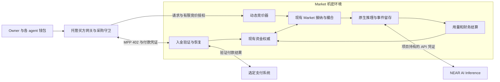

# MPP 入金与推理额度动态竞价规格

- 状态：**Draft — for review**。第 1 节记录本轮确认的方向，其余具体合同与实施选择为待审提案。
- 日期：2026-11-13，America/New_York。
- 适用仓库：`private-flex-inference-auctions`。
- 目标：买方 agent 通过 MPP 购买推理额度，使用同一资金账户持续调整采购报价；成交后沿现有 Market 调用 NEAR AI 原生推理并按合同结算。
- 交付范围：设计评审稿；已有[第一批受控实现](../market-mpp-controlled.md)，尚未部署新版本、接入真实支付或进行新增付费推理验收。

## 1. 本轮决定与既有草案的关系

| 类别 | 内容 |
| --- | --- |
| 用户已确认 | 在我们代理 NEAR AI inference 的买方入口接入 MPP |
| 用户已确认 | 通过 MPP 购买额度，用于动态竞价 |
| 用户后续明确选择 | 使用标准 `nearintents.charge` 实现并验收 |
| 本轮已接受的产品结构 | 充值形成资金池；余额、竞价上限与实际收费分别记录；支付频率与竞价频率解耦 |
| 本文提案 | MPP `charge` 为平台买方账户入金；动态竞价及逐次推理结算留在 Market 内 |
| 本文提案 | 首版采用一个 Provider、一个已验证模型、On-demand Chat 和确定性的动态出价策略 |
| 本文待审 | 资产与换算、退款规则、动态竞价首版合同及真实试点额度；支付方法已选 nearintents.charge |

本规格调整另一项工作中的《Agent 独立钱包与自主推理采购草案》的资金方案：其第 1、2、3、7、8、9 节中“逐单预付款、只用于该订单、不建立后续可消费余额、逐单退差”的提案，由本文的“MPP 入金、可复用额度、成交预占、按量结算、未消费额度回收”替代。本文适用范围内，以本文为后续 review 的资金方案；该关联草案不随本 PR 发布，本文完整说明本次资金合同，不能将两套付款流程同时实现。

旧草案记录的独立 agent 钱包、同一 owner、网页连接自有 NEAR 钱包、选定本金平均分配、有限 grant、托管买方网关及隔离 fx 会话继续作为关联约束。钱包到 agent 的初始注资，与 agent 通过 MPP 向 Market 购买额度，是两次独立资金动作，界面和审计必须分别记录。本文不重新选择这些用户入口，也不默认增加 Tempo 钱包或修改既有 owner 权限。

## 2. 产品合同与首版范围

买方购买的是以明确货币单位计价的**推理采购余额**。充值本身不锁定模型价格、购买 GPU 容量或产生推理订单；买方随后使用额度，在自己的授权范围内动态报价。只有成交和后续履约才形成相应费用。

首版包括：

- 每 buyer 独立的真实资金账户、MPP 入金记录、竞价策略、采购 intent、用量账单与退款记录。
- 一笔入金支持多轮出价及多次推理采购；每轮改价不产生外部支付。
- 买方在硬上限内调整尚未成交的报价；已成交条款冻结。
- 共享余额、任务预算、并发成交、取消和资金不确定状态的统一处理。
- 原请求恢复、原始推理证据留存及用户自有记录查询。

首版不引入支付 session、自动充值、信用透支、买方间额度转账、多个 Provider 直接分账或新的拍卖清算算法。初始真实演示建议沿用三个买方、一个项目授权卖方及一个模型；这些数量和运行金额仍须在实施计划中冻结。

本文中的“动态竞价 v0”具体指：针对同一份已冻结的推理需求，买方逐步调整可接受的采购价格上限，Market 在有效供给和资金约束内尝试成交。首版建议沿用已登记 Offer 的价格及既有选择规则。有限容量可导致多个买方争用，但不因此承诺最高价优先、统一清算价、VCG、GPU 调度优先级或延迟保证。若 review 要求买卖双方竞争决定清算价，需在实施前补充该机制合同，不能用本稿的调价演示代替。

## 3. 当前代码基线与缺口

本轮检查的宿主通过固定 Cloud 依赖 `244177cafa26e8c8b001e61297cf4e7f89ac8de9` 复用 Market、资金与原生执行。初始化仍向三个测试买方创建 `test_credit`；原生路由挂载于 `/market`。这不是已存在的生产入金接口。[L1][L2]

上游 `PurchaseControls` 已有 `provider_cap`、`total_cap`、等待与尝试授权；`Submission::fingerprint` 同时包含原生请求和采购控制。同一幂等 key 改 cap 不能当作普通请求重放。动态报价必须有新的 intent/revision 合同，不能直接修改已经接纳的 `RequestTerms`。[L3]

| 可复用基础 | 必须新增或重新验收 |
| --- | --- |
| 共享现金账户、资金预占、结算与恢复 | MPP 入金验证、资金归属、幂等记账与退款 |
| 固定采购条款、Offer、原生执行和原请求恢复 | 成交前动态报价、版本并发控制与接纳衔接 |
| buyer 认证、独立测试 principal | 真实 owner/agent 到资金 principal 的不可伪造映射 |
| 已有 Node 买方验证与可选身份端点 | 修改后支付入口、程序和配置的重新验证 |
| 特定文本请求的真实 NEAR 验收 | 动态任务输入、完整历史与工具 transcript 的计量和资格 |

初稿编写时尚无 MPP 入金或动态调价实现。随后用户要求开始实施，第一批受控代码增加了测试 MPP 入账、原现金账本衔接及持久动态报价状态，范围见[实现说明](../market-mpp-controlled.md)。这不是正式支付方法、生产现金账户、自动撮合接纳或整份 P1/P2 的完成声明。已有真实推理和硬件证据只适用于各自记录的版本与范围。

后续按用户选择接入官方 `nearintents.charge` SDK，完成标准客户端/服务端及本地资金恢复的受控验收，并从正式 1Click 取得无转账报价和 402 Challenge；见[标准方法实现](../market-nearintents-charge.md)。主网付款、生产余额与新部署仍未验收。

## 4. 架构与身份边界

MPP 买方入口收取我们提供的采购额度。项目继续承担对 NEAR AI 的上游付款；MPP 入金不直接给 NEAR AI API key 账户充值。

每个 buyer 固定绑定一个资金 principal、一个 agent 钱包及版本化的退款目的地。同一 owner 的多个 agent 仍分别持有余额；owner 归属不允许后台自动合并或挪用余额。当前上游现金账户按 `user_id` 组织，接入时必须保证不同 buyer 的资金 principal 不意外落到同一个账户。[L4]

订单与账户权限来自应用认证。付款 Credential 的 `source`、请求体中的 buyer ID、公开交易哈希或一份付款回执均不能自行建立账户归属。创建入金 intent 时先认证并冻结收款条款，再通过随机 reference 将付款绑定回该 intent。第三方代付若被允许，也只入原 intent 的固定账户；付款提交者不能替换受益人或退款地址。

买方 grant、partner key 留在买方网关；Market 不需要持有它们。NEAR AI key、商户退款凭证和 MPP 服务端密钥留在其授权服务中，不进入模型上下文、浏览器 bundle、终端文件或 Provider 请求。

## 5. 支付方法选择

MPP 是付款交互层，`charge` 的资源在本产品中是“购买指定数量的采购额度”，不是一次推理。MPP 的付款回执、账本入金记录和最终推理账单是不同证据。[M1][M2]

| 路径 | 可用语义 | 本稿选择与限制 |
| --- | --- | --- |
| 标准 `nearintents.charge` | 1Click 跨链付款，Credential 使用源链交易哈希 | 用户已选择；使用官方 SDK。需要支付账户支持源链付款及证明，不能直接接受 Agent API 私密回执 |
| Agent API 私密转账 + 项目方法 | 沿用独立 agent 钱包，向 Market 付款并呈交回执 | 历史备选，本轮不实施；不能宣称与标准 `nearintents` 直接兼容 |
| Tempo `charge` | 标准 MPP 单次付款 | 仅作为后续选项；本稿不默认新增用户钱包、资金迁移或网络 |

现有 Agent API 文档的付款回执通过透明日志证明已记录的结算条款，包含支付 reference，且不证明付款人身份；其外部信任根和证明范围必须固定并展示。[N1] 标准 MPP NEAR Intents 方法采用不同的凭证和结算过程。[M3]

旧草案的临时项目方法 `bitrouter-near-agent` 属于历史备选，本轮不开发它。标准 `nearintents` 仅使用其既定 hash 凭证和 1Click 结算合同；若未来恢复 Agent API 私密回执路线，需另行评审自定义方法。[M4]

首版只启用标准 nearintents charge、一种信用资产、一组固定网络/结算系统和一个商户账户。试点准备了 NEAR wNEAR → NEAR USDC 的无转账报价，实际资金操作与资产合同仍需在试点计划中确定；不得静默换轨。

## 6. MPP 入金流程

### 6.1 冻结入金 intent

认证买方使用稳定幂等 key 创建 FundingIntent。服务端冻结：

- 账户 principal、owner/buyer 归属和环境标识。
- 购买额度、付款资产 ID、精度、付款金额、信用换算和报价版本。
- MPP method/intent、商户收款对象、有效期、随机付款 reference。
- 版本化退款目的地、手续费承担方式、付款与入账的证明要求。

同 key 同内容返回原资源；同 key 改金额、资产或账户返回冲突。reference 使用不可预测随机标识，不包含 prompt、最高出价、任务名或低熵内容摘要。付款不会预留推理供给。

### 6.2 402、付款与入账

1. 客户端访问该 intent 的付款端点，服务返回 MPP `402` Challenge；Challenge 绑定完整入金条款。
2. 买方守卫检查单笔、累计购额度授权及钱包策略。发送资金动作前，先持久保存原操作 key、参数和 intent 关联。
3. 客户端完成选定方法的付款，重呈原 Credential。普通认证仍使用 `Authorization: Bearer`；Challenge 建议指定 `header="Payment-Authorization"`，避免两个权限相互覆盖。[M5]
4. 服务端先持久记录验证操作身份、原 Challenge 和受保护的 Credential 恢复材料，再验证实际商户收款结果、资产/金额/reference，以及底层资金身份的全局唯一性。
5. 验证结果先持久化，再由同一账本事务完成付款消费标记、入金分录、余额变更和必要的 durable projection/outbox。具体事务边界以资金权威的集成接口为准。
6. 事务确认且余额投影达到可采购状态后，返回原 FundingIntent、入金分录引用和 `Payment-Receipt`。响应丢失时重读原资源，不再付款。

SDK 验证/消费 Credential 与 PostgreSQL 入账不构成天然原子事务。必须保存可恢复的验证结果；在“外部已付、SDK 已接受、本地未入账”窗口，通过原支付记录修复一次入账，不能要求重新转账。方法适配必须支持从持久方法状态或独立验证的底层结算恢复可信结果；若只返回 replay 错误、又无法恢复原收款结果，则不能通过 P0。不能仅凭客户端声称“已付”或一个 consumed 标记补记现金。

`payment_verified` 和 `credited` 分别表示外部付款已验收和本地入账已提交；余额尚不可采购时显示 `credit_pending` 或 `projection_pending`。此时返回 `202` 和状态地址，客户端不得把 pending 解释成再次付费指令。付款成功回执不能被显示为推理已消费。

### 6.3 不确定与异常款

付款进行中、proof/checkpoint 未就绪或 RPC 超时不证明未付款。恢复时查询同一操作、重呈原证据；不能自动换 key 或创建另一笔充值。MPP 的协议绑定与支付方法防重之外，本地仍必须对底层实际转账去重。[M6][N2]

过期 intent 不再接受新的正常付款授权；已实际发生的迟到款继续核对，并进入固定账户入账或退款的异常处理。建议默认：只有买方确认原条款且可证明归属时才修复入账，否则退款。多付、少付、错误资产或无法归属款记录为待核对负债，不按任意市价自动换成额度，也不作为收入。

## 7. 额度、金额与单一资金权威

### 7.1 金额合同

建议首版采用一种六位精度稳定币，明确报价为每个资产最小单位对应一个 microUSD 采购额度；资产 ID、网络、精度及信用换算必须在付款前冻结。这是产品报价，不从 symbol、付款服务的 `usd_value` 或浮点市价推算。其他精度、跨资产兑换和价格浮动另行设计。

所有金额经边界检查，以整数或十进制整数字符串传输。沿用现有 Market 的 NanoUsd/provider MicroUsd/现金 MicroUsd 转换、费用和舍入合同；入金代码不另写一套近似扣费。账单同时保留原始用量、原费率、计算精度、现金扣费及舍入差，须满足最终扣费不超过已冻结的总 cap。

钱包本金、转账/兑换手续费、实际商户到账和购买额度分别显示。只有确认满足报价的实收资金才能入账；手续费归属在付款前披露，不能靠事后减少已承诺余额补足成本。

### 7.2 逻辑余额视图

以下为同一账本的审计视图，不是第二个钱包或可独立花用的缓存：

| 符号 | 含义 |
| --- | --- |
| F | 累计已确认入账的采购本金 |
| A | 当前可用额度 |
| H | 推理成交预占及 Unknown 占款 |
| W | 已从可用额度冻结、待证实支付的退款 |
| C | 累计已提交推理扣费，含合同规定的平台费与舍入 |
| R | 累计已证实退回买方的本金 |

首版无赠送或其他资金来源时，必须持续满足 `F = A + H + W + C + R`，且各项非负。未证实的外部付款不计入 F；一笔资金从 A 转入 H 或 W 后不能再次消费。多付异常款另有负债记录，不能丢在这条等式之外不追踪。

实际余额字段、锁、预占和 Redis projection 沿用现有资金权威；上述视图应从其状态派生，禁止用 `raw_balance - guessed_holds` 自造另一个可用额。任何拥有该账户扣款权限的入口都必须受同一资金协议约束。

真实资金使用独立 namespace/账户及资金来源标识；不得把测试积分改名为实收本金，也不能通过 demo 重启、重新部署或重新初始化补发现金或供给。

### 7.3 三层授权

外部钱包购额度授权、Market 任务采购授权和单次成交授权分别验证。grant 限额被充值消耗后，不假设退款会恢复钱包策略额度；Market 剩余余额也不自动授权新的任务。

每个任务有独立的最高累计费用和有效期。任务占用包含已扣费、全部推理预占及不确定责任；并发 intent 必须原子争用同一任务可用额。其他任务可使用余额，但不得借用已占用的任务授权或资金。

## 8. 动态竞价合同

### 8.1 ProcurementIntent 与授权

ProcurementIntent 表示一次模型调用的待采购需求，绑定固定原生请求、输入计量、输出上限、模型/provider 范围、服务类型及任务身份。多轮工具调用产生多个独立 intent；同一 intent 的调价不改变 prompt 或生成规格。

首版建议以“针对这份固定需求，当前最多愿付的 Provider 总费用”表达 bid，映射现有 `provider_cap`。这不是输入/输出 token 的统一单价。需要比较 token 费率时，按已固定的输入和最大输出换算可比的保守费用。

每个 intent 包含：

- `bid_revision`、`current_provider_cap_micro_usd`。
- `hard_provider_cap_micro_usd`、`hard_total_cap_nano_usd`。
- `task_budget_id`、绝对截止时间、允许模型/provider 及单次执行限制。
- 策略版本、调价规则、最小间隔、暂停/取消权限。

任何新 bid 都不得超过硬 Provider cap，且在加入平台费及既有舍入规则后不得超过 hard total cap 或任务授权。账户余额、硬上限和当前出价分别存在；账户有钱不代表可自动提高出价。

### 8.2 首版策略

建议先实现可审计的阶梯报价：从指定初始 cap 开始，在绝对计划时间上按指定步长提高，最多到硬 cap；到期关闭未成交需求。具体初始值、步长和周期由任务授权提供，不在本文假定市场价格。

策略可以在无模型调用时启动；不需要账外免费的 planner。后续模型若建议改价，建议也必须经过同一确定性守卫。修改硬上限、范围或延长授权需新的 owner/任务授权，不能伪装成普通策略 tick。

调价计划、当前 revision 与截止时间持久保存；重启不会重置等待时长、累计预算或从头生成一组新授权。人工降低或取消仅作用于尚未进入接纳提交的需求。

### 8.3 成交与价格

撮合按当前有效 bid、已登记供给、资格及容量运行。首版建议成交费率取被接纳 Offer 的费率，并冻结身份、版本、计量、费用和执行条款；买方最高可付金额不是成交收费。

余额允许时才可原子预占 `H_request`；其金额按现有资金合同计算，足以覆盖该次接纳的最大责任，并且不超过冻结 cap。多个 intent 可以开放报价而不预留现金，UI 必须说明只有成交预占成功才得到执行资金。资金不足可等待已授权的后续入金至原截止时间，不能自动充值或透支。

## 9. 报价、取消与接纳的并发边界

动态报价不能通过“换幂等 key 再提交一遍原生推理”实现。需要在固定依赖的 owning source 暴露或扩展窄接纳接口，保证 revision、资金和原请求可追踪；仅在 HTTP 层读取余额后放行不满足要求。

建议接纳流程：

1. 对 `open@bid_revision` 执行 CAS，冻结该版本为 `admission_pending`，记录唯一 `admission_id`、原请求身份及 durable command。
2. 使用这个稳定身份执行一次有界接纳。无成交必须能确证“无未决 grant、无 Provider 派发、无残留资金责任”，才能回到 `open` 并允许后续调价。
3. 成交时由现有权威完成资金和任务预算预占、供给授权及冻结条款的持久关联；全部必要提交确认前不得派发 Provider。
4. 提交确认丢失则保持 `admission_pending`，查询原命令/原请求；不生成新 admission，也不重新开放竞价。接纳接口必须能返回原结果或明确的不确定状态。

报价修改、取消与步骤 1 串行化：修改先提交则接纳使用新 revision；接纳先取得冻结权则修改返回冲突及原状态，不声称取消已完成。该边界后的取消沿现有 Market 取消合同处理。

一个 intent 同时最多有一个未决或已接受的接纳责任。首版建议单次执行，接纳后不自动换 Provider 重跑；任何 Unknown 都保留原身份和预占，不能靠调价、超时或换任务 key 重新购买同一次调用。

此节描述新增接口必须满足的行为，不声称当前 pinned API 已支持上述事务。实现前需评审具体接纳和资金扩展点，尤其是 intent 状态与原 Market 事务之间的故障窗口。

## 10. 推理履约、结算与恢复

MPP 入口只负责入金，原生推理继续由 Market 管理。请求体送入 Provider 前去除采购、钱包与付款字段；NEAR 只收到必要的原生输入。

成功、达到输出上限、确定失败、免单条件、取消和 Unknown 的费用处理沿用冻结的 Market 合同。不得把“连接中断”直接解释为免单，也不得把“Provider 已收费”直接解释为买方必付。Provider 实际账单与买方合同收费分别核对。

费用确定后，通过原结算身份将相应 H 转为 C，并释放剩余预占回 A。客户端断线后仍恢复原执行、原事件与原账单；不再次向买方收 MPP 付款，也不盲目再次调用 NEAR。

MPP Proxy 内置 replay 不留存 SSE，不能替代现有 Market 的原请求/事件恢复。[M7] 本方案不在每个推理请求前增加固定 `charge`，也不向原生 SSE 插入付款控制事件。

保存 NEAR 上游原始请求/响应字节及返回标识；若 Market 为公开回放改写 ID 或事件，分别保留上游字节与下游事件的关联。NEAR 的精确字节签名只适用于其签署对象，付款回执和 Market 回放均不能自动扩大该证明范围。[N3]

## 11. 未消费额度回收

建议未消费实收额度可退回该 buyer 预先验证的原钱包目的地；任务结束不自动退款，余额保留供 owner 后续授权的任务使用。无转售、跨 buyer 调拨或任意第三方提现接口。

退款发起时，在同一资金权威内将金额从 A 转为 W；有 H 的部分暂不可退。记录固定退款目的地、资产、金额、退款操作 key 和来源分配后，再派发商户转账。退款与新成交竞争同一可用余额，不能分别检查后同时花掉。

退款未决期间金额保留在 W；确认成功后移入 R。只有确证外部未付款、且原操作不再可能执行时才能恢复到 A。进程重启、钱包 grant 撤销和 HTTP 超时均不能删除退款责任。

建议正常回收退回完整可用本金，由项目承担商户退款费用；用户外部钱包购额度时的既有手续费单列。最低退款额、正常回收费用和商业政策仍待审，必须在真实收款前冻结。退款目的地变更需重新证明控制权及版本化授权；不能使用 Credential 中自报的 source 或链上 `from` 代替。

## 12. 建议 API 与持久记录

以下路径和字段均为新增提案，不代表当前接口。所有读取和写入均按认证 principal 隔离。

| 接口 | 行为 |
| --- | --- |
| `POST /market/v1/funding-intents` | 幂等创建不可变入金条款，不转账、不派发推理 |
| `POST /market/v1/funding-intents/{id}/pay` | 无付款凭证时返回 MPP 402；带原凭证时验证并入账，或返回 pending 状态 |
| `GET /market/v1/funding-intents/{id}` | 查询付款、入账和可采购状态，不再次收费 |
| `POST /market/v1/funding-intents/{id}/reconcile` | 重呈原证明、恢复迟到/不确定款，不自动产生新付款 |
| `GET /market/v1/funds` | 返回 A/H/W 与来源、版本；测试积分与真实额度明确区分 |
| `POST /market/v1/procurement-intents` | 固定模型调用需求及有限动态竞价授权 |
| `PATCH /market/v1/procurement-intents/{id}/bid` | 携 `expected_revision` 和操作 key，在 open 状态内更新报价；旧版本冲突 |
| `POST /market/v1/procurement-intents/{id}/cancel` | 取消或请求取消，分别返回报价关闭与执行取消状态 |
| `GET /market/v1/procurement-intents/{id}` | 返回 bid revision、接纳、执行与结算，链接原请求/事件恢复资源 |
| `POST /market/v1/fund-refunds` | 幂等创建退款及冻结 W |
| `GET /market/v1/fund-refunds/{id}` | 查询原退款状态及付款证明 |

每个写操作都有稳定 key；同 key 同参数返回原结果，同 key 不同参数拒绝。浏览器入口另沿既有网关合同执行会话、Origin/CSRF 和 owner 检查。余额不足作为业务状态返回；若展示购买额度选项，只引导创建独立 FundingIntent，不能把推理重试变成隐式充值。

至少保留下列逻辑记录，物理表与索引在 owning source 集成评审时决定：

- FundingIntent、方法验证记录及全局 PaymentConsumption；方法附件须定义按支付系统、网络、收款方及底层实际资金移动生成的 canonical payment identity，不能只按 receipt 包装或 challenge ID 去重。同一资金移动经不同方法或证明重呈时，也只能入账一次，method 名称不能分割去重域。
- 现有入金、资金预占、扣费与 durable balance mutation；不新建独立可花用余额。
- TaskAuthorization/Budget、ProcurementIntent、不可变 BidRevision、AdmissionCommand 及原 Market request 映射。
- RefundIntent、商户资金操作及可恢复 outbox。
- 各类 evidence/receipt 引用、权限归属、事件序列与状态版本。

## 13. 私密性、展示和运行约束

接触 prompt、余额、竞价上限、策略及完整订单的入金处理器、竞价器和必要存储位于既有机密边界；外部支付服务只取得结算必需字段。外部不得直接读取敏感数据库、日志或备份。修改镜像、compose、可信支付配置或验证客户端后须重新验证相应部署。

MPP Challenge/reference 不公开任务内容或私密预算；Base64 与普通内容哈希不是保密措施。买方入金金额可能被支付系统、收款方或公开网络看到，且金额、地址、时序可能形成关联。动态 bid 留在 Market 内，不把充值隐私等同于竞价隐私；Agent API 私密路线也不扩大为所有观察者下的匿名保证。

UI 分别展示钱包余额、已购可用额度、推理预占、待退款、任务可用预算、当前出价、最高授权、成交条款和实际扣费。MPP receipt、账本 entry、Market 财务回执及 Provider 证据分别命名，并通过私密关联 ID 对账。

后台恢复不依赖页面存活；暂停 agent 只停止新采购，继续核对未结付款、执行和退款。不能证明持久状态新鲜性或单写入者资格时停止新资金变更及派发，避免恢复旧快照重复入账或重花。支付证明、checkpoint、幂等历史与未决负债的保留期限须覆盖资金恢复窗口，不能短于仍可重呈或迟到的付款。

## 14. 验收矩阵与实施阶段

| 编号 | 场景 | 必须观察到的结果 |
| --- | --- | --- |
| A1 | 认证篡改、跨 owner/buyer 提交 intent 或 receipt | 无越权入账、消费、退款或记录泄露 |
| A2 | 402 付款、原回执重复提交、不同 challenge 包装同一转账 | 同一实收本金只入账一次；重试返回原记录 |
| A3 | 付款完成后崩溃，SDK 接受后崩溃，入账 COMMIT ACK 丢失 | 原支付恢复一次入账，不再次转账、不重置余额 |
| A4 | 错误金额/资产/商户、伪造 receipt、checkpoint 未就绪、过期迟到款 | 正确拒绝或 pending；真实异常款保留核对/退款责任 |
| A5 | 余额投影失败、两个接收实例并发入账 | durable repair；投影未达到资金协议要求时不放行采购 |
| A6 | 一次充值后多轮报价、至少两次独立推理采购 | 仅一次外部入金；各次成交/用量/余额独立可核对 |
| A7 | 无供给或初始 bid 不足，随后计划提高 bid | 观察真实 revision 与成交条件变化；未成交不收费，成交取有效 Offer 条款 |
| A8 | bid/取消与接纳并发、旧 revision、重复 tick | 一个确定提交顺序；无过期 bid 成交、双重接纳或误报取消 |
| A9 | 接纳结果未知、进程退出和命令重呈 | 恢复同一 admission/原请求，不换 key 再派发 |
| A10 | 多 intent/任务并发抢余额，退款与成交并发 | A/H/W 非负，任务预算和资金守恒，无重复花用 |
| A11 | 越过硬 cap、任务预算、模型范围、有效期或钱包授权 | 发送资金/采购动作前拒绝，余额充足也不能绕过 |
| A12 | 原生成功、上限终态、明确失败、取消与 Unknown | 按原冻结合同结算；Unknown 保留责任，无盲重跑 |
| A13 | SSE 中断、重新连接及原事件回放 | 不再收 MPP 付款，不新增 NEAR 执行；保留上下游证据对应 |
| A14 | 退款响应丢失、付款已发出但本地未确认 | 原退款恢复，无重复退款，W 不提前恢复可用 |
| A15 | 精度边界、舍入、费用和部分余额退款 | 与冻结换算/Market 规则一致，守恒成立且最终扣费不超 cap |
| A16 | 全进程重启、旧快照、重复初始化或演示重放 | 无现金/供给补发；状态不新鲜时停止新变更 |

建议实施顺序：

| 阶段 | 工作与退出条件 |
| --- | --- |
| P0 合同与接口 | 确定支付方法附件、资产/换算、退款、动态竞价语义及 owning source 的资金/接纳接口；review 决策可直接转成实施任务 |
| P1 受控入金 | 本地真实 PG/Redis 和受控支付方法覆盖 A1–A5、A14–A16；不使用真实资金 |
| P2 受控竞价 | 新 intent/revision、任务预算、接纳 fencing 及原生恢复覆盖 A6–A13；供给/支付 fixture 均明确标注 |
| P3 有界真实闭环 | 新费用计划明确充值本金、手续费、退款资金、最多 Provider 调用、部署费用和停止条件；按计划完成真实入金、多轮竞价、推理和余额回收对账 |

真实验收必须分别证明资金、策略行为、真实供给、Provider 执行、用量及退款；fixture 不证明支付服务可靠性或市场机制效果。有限 Provider 的固定 ask 演示可以证明动态买方价格上限工作，但不能宣称已验证竞争性清算。

本文仅授权范围内的文档工作。真实收款、创建钱包、授权 grant、资金划转、付费推理和部署不由本稿自动触发；已有测试推理预算不扩展为主网资金授权。

## 15. Review 决策清单

| 决策 | 当前建议 | 状态 |
| --- | --- | --- |
| R1 资金产品 | MPP 购额度，复用余额参与动态竞价；余额/出价/收费分开 | 本轮方向已确认 |
| R2 旧草案关系 | 替代逐单预付款；保留独立钱包、owner 及网页入口 | 本文明确的整合提案 |
| R3 动态竞价 v0 | 确定性阶梯调整 Provider 总费用 cap，按有效 Offer 条款成交；单次执行 | 待审；若需要竞争决定清算价须补机制 |
| R4 支付方法 | 标准 nearintents.charge，官方 SDK 及源链 hash 凭证 | 用户已选择；已通过受控互通和真实无转账报价预检，主网结算待验收 |
| R5 资产与信用换算 | 一种六位稳定币，明确固定兑换报价，沿用 Market 扣费精度 | 具体资产、网络、金额范围及费用待审 |
| R6 未消费额度 | 可退原验证钱包；项目承担正常商户退款费用 | 待审及资金恢复验收 |
| R7 并发与自动化 | 未成交报价不占款，成交原子预占；不自动充值；Unknown 不重买 | 本文建议的首版合同 |
| R8 真实试点 | P0–P2 后按具体资金/Provider/部署计划验收 | 金额与运行授权尚未确定 |

## 16. 来源与核对范围

公开资料在 2026-11-13 查阅；实施时固定 SDK/方法版本并重新核对接口。以下外部资料说明协议或依赖能力，不代表本仓库已实现或验收。

- [M1 Proxy an existing service](https://mpp.dev/guides/proxy-existing-service)：402 支付入口与上游凭证注入模式。
- [M2 MPP Receipts](https://mpp.dev/protocol/receipts)：付款成功回执与其方法相关引用。
- [M3 MPP NEAR Intents](https://mpp.dev/payment-methods/nearintents)：标准方法的 1Click、charge 与源链 hash 凭证。
- [M4 Custom payment methods](https://mpp.dev/payment-methods/custom)：方法 schema、客户端付款及服务端验证的扩展边界。
- [M5 Credentials](https://mpp.dev/protocol/credentials)：Payment Credential 与独立 Payment-Authorization 头。
- [M6 Challenges](https://mpp.dev/protocol/challenges) 与 [Credentials](https://mpp.dev/protocol/credentials)：条款绑定与方法级防重责任。
- [M7 Proxy recovery](https://mpp.dev/sdk/typescript/proxy#recover-a-paid-response)：SSE 不留存、重试不等于执行一次保证。
- [N1 Agent API Receipts](https://docs.agentsonintents.com/integration/agent-api/receipts)：付款条款、随机 reference、日志证明和身份范围。
- [N2 Agent API Executions](https://docs.agentsonintents.com/integration/agent-api/executions)：操作幂等身份、异步状态及 grant/策略检查。
- [N3 NEAR AI Response Signatures](https://docs.near.ai/cloud/verification/cloud-api/response-signatures)：精确原始字节及 gateway/model 签名范围。
- [L1 宿主源码](../../crates/private-market-host/src/main.rs) 与 [固定来源](../../crates/private-market-host/upstream/SOURCES.md)：测试积分初始化、路由与依赖边界。
- [L2 现有迁移规格](2026-11-11-private-market-hackathon.md)、[batch C 真实 NEAR 验收](../acceptance/2026-11-11-market-batch-c.md)：已有功能及验收范围；不覆盖本次新增支付适配器。
- L3 固定 Cloud commit 的 [contract.rs](https://github.com/bitrouter/bitrouter-cloud/blob/244177cafa26e8c8b001e61297cf4e7f89ac8de9/src/market/inference/contract.rs)、[state.rs](https://github.com/bitrouter/bitrouter-cloud/blob/244177cafa26e8c8b001e61297cf4e7f89ac8de9/src/market/inference/state.rs)、[market_inference.rs](https://github.com/bitrouter/bitrouter-cloud/blob/244177cafa26e8c8b001e61297cf4e7f89ac8de9/src/core_gateway/market_inference.rs)：本轮直接检查的采购控制、fingerprint、状态和恢复路由。
- L4 同一固定 commit 的 [billing.rs](https://github.com/bitrouter/bitrouter-cloud/blob/244177cafa26e8c8b001e61297cf4e7f89ac8de9/src/db/billing.rs)：账户以 `user_id` 为键；未把宿主测试初始化代码当作可复用生产入金入口。
- 关联钱包草案为另项工作的设计输入；本 PR 不引入其实现，也不依赖该草案文件才能运行。
