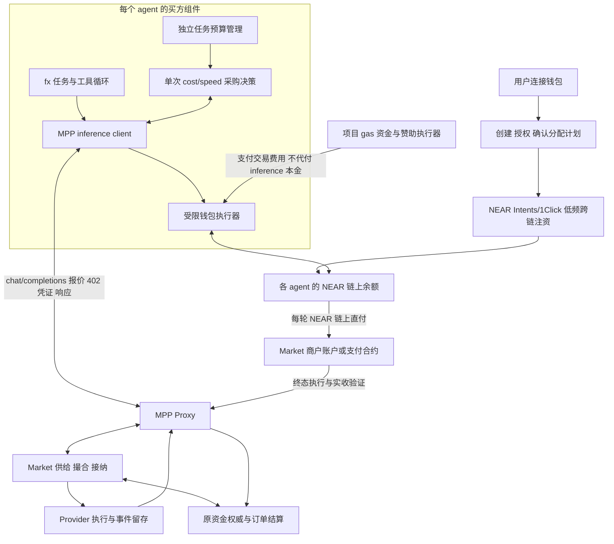

# Agent 自主竞价与 MPP 推理整合规格

- 状态：**Draft — for review**。第 1 节为本轮确认的产品方向；其余具体接口、付款和实施合同为待审提案。
- 日期：2026-11-14，America/New_York。
- 适用仓库：`private-flex-inference-auctions`；整合 PR #4、#5、#6 的相关能力。
- 首要目标：证明 agent 使用自己的资金，自主购买 inference，并利用真实模型和工具完成任务。
- 用户流程：**Connect wallet → fund 每个 agent → 各 agent 自主 bid、通过 MPP 付款并完成任务。**
- 本轮修订：agent 自付 inference 本金；项目承担 inference 付款及服务退款的链上 gas；订单到期停止新采购/新接纳，已发起的付款继续核对，不要求链上交易同时失效。

本稿的 P0 已有[合同与受控原型](2026-11-14-agent-mpp-p0-contract.md)及[owning interfaces](2026-11-14-agent-mpp-p0-owning-interfaces.md)。用户现已确认 native NEAR、按量预付退差、项目承担 gas，以及订单到期与链上交易失效分离。旧 F1（agent 自付 gas 的逐笔费用硬上限/同期限失效）由本次授权修订替代，不再作为当前产品合同的必要条件；这不表示原 SDK 已新增能力或新支付路线已验收。真实发送仍须先验证项目赞助 gas 的钱包/relay 路线、订单绑定和恢复（G1），并按对应资金与部署计划验收。历史 P0 的 44 项结果和 PARTIAL 结论保留其原快照范围，不因修改 spec 自动变为 PASS。

## 1. 已确认方向与旧规格的关系

| 类别 | 方向 |
| --- | --- |
| 用户已确认 | 整合版首先证明“agent 能自主购买并完成任务” |
| 用户已确认 | agent 直接调用 MPP proxy 的 chat/completions 进行 inference |
| 用户已确认 | 每个 agent 有自己的 autobidder，实时为自己的 inference 出价 |
| 用户已确认 | 用户连接钱包并给每个 agent 注资，随后各 agent 自己通过 MPP 支付 inference |
| 用户已确认 | 用户可从受支持链经 NEAR Intents/1Click 给 agent 注资；高频 inference 付款使用 agent 的 NEAR 链上余额，不逐单经过 Intents |
| 用户已确认 | autobidder 同时权衡 cost/speed，在预算、能力和时间约束内决定接受、等待、调价或停止 |
| 本轮接受的设计方向 | 跨调用管理任务预算，单次调用内根据紧迫性和报价选择采购条件；阶梯加价只是可选策略 |
| 本轮接受的设计方向 | speed 首版优先考虑取得可用模型终态的端到端耗时；TTFT 单独记录 |
| 本轮接受的设计方向 | 报价区分延迟估计与服务承诺；没有真实速度差异/调度能力时不宣称可以加钱买更快 |
| 保留的入口约束 | 浏览器运行独立 fx 会话；同一 owner 的不同 agent 分别持有钱包、grant、任务和预算 |
| 本轮替代的支付方向 | 标准 `nearintents.charge` 不再作为每轮 inference 的付款方法；NEAR 链上直付通过独立 MPP 方法适配 |
| 用户本轮已确认 | 首版 native NEAR（24 位精度）；FT 不在 v1；项目直付方法具体实现见 P0 合同 |
| 用户本轮已确认 | 首版按量预付退差；固定订单价保留为未来独立合同，不在执行后切换模式 |
| 用户本轮已确认 | agent 用自己的 NEAR 本金购买 inference；项目承担付款及服务退款的 gas，作为基础设施成本，不额外从 agent 扣取 |
| 用户本轮已确认 | 订单到期后停止新采购/付款操作和新执行接纳；已发起或结果未知的付款继续恢复、核对及退款，不要求链上交易在订单到期时同时失效 |
| 本文建议，待审 | v0 用确定性规则实现 cost/speed 选择；具体预算留存、偏好映射和风险参数须冻结版本 |
| 本文建议，待审 | 先完成两名 agent、一个卖方、一个支持工具的模型的真实任务闭环 |

直接调用 chat/completions 确定了产品入口和责任归属，并不单独决定资金模型。本轮另行确认按量预付退差；第 10 节的费率、交付/异常边界和具体参数仍须 review。固定订单价不在当前实现中启用。

cost/speed 双目标同样不自动选定固定订单价或按量收费，也不要求拆分基础费与优先费或引入 VCG。本文分别定义买方采购决策、Market 成交机制和付款/结算合同，不能用其中一层替代另一层。

本轮明确将注资通道与日常支付分开：跨链兑换/交付发生在准备或获授权的补充资金阶段，日常推理向本项目 MPP Proxy/Market 商户在 NEAR 链上付款。本项目调用上游 NEAR AI 的 API 凭证和账务单独保留，不据此宣称 NEAR AI 官方 chat API 支持逐请求原生链上 MPP 付款。改变付款路线不表示已确认更低延迟；实际改善须分阶段测量。

本稿修订以下旧设计：

- 原工作区的历史钱包采购草稿：保留 owner、独立钱包和注资体验；采购入口改为直接请求 MPP inference，加入每 agent 必备 autobidder；不采用其旧私密回执项目方法。该未提交草稿不作为此分支的可执行合同。
- [MPP 入金与动态竞价规格](2026-11-13-mpp-funded-dynamic-bidding.md)：保留金额、幂等、资金恢复与报价版本原则；本稿不要求先购买通用 Market 额度，并以 NEAR 链上直付替代本次整合中逐单 `nearintents.charge` 的路线。其标准方法实现及受控验收仍作为历史证据保留，不能直接作为新方法验收。
- [browser playground 设计（固定 #5 源码）](https://github.com/SPIKESPIGEL404/private-flex-inference-auctions/blob/863b6a54cc05e0ed276b15706dba2633dabd28dd/docs/designs/2026-11-13-browser-market-playground.md)：保留终端和独立任务体验；实际调用路径按本文调整。

上述文件保留其历史背景和验收记录；不能将相互冲突的资金方案同时接入，也不能据本稿声称代码已经改变。

## 2. 当前基线与交付范围

本稿审阅基线固定为下列 PR head，不代表其后续更新：

| 来源 | 可复用部分 | 当前缺口 |
| --- | --- | --- |
| [#4 @ 69be964](https://github.com/SPIKESPIGEL404/private-flex-inference-auctions/pull/4) | fx/wterm/just-bash、独立会话、布局、恢复；已被 #5 包含 | 响应、费用、采购状态和 provider statistics 均为模拟数据 |
| [#5 @ 863b6a5](https://github.com/SPIKESPIGEL404/private-flex-inference-auctions/pull/5) | owner 登录、独立钱包/grant、等本金注资计划和恢复 | 原注资进入 Intents 余额，策略未开放所需 native 路径；funding 默认关闭，采购未接通 |
| [#6 @ ce10314](https://github.com/SPIKESPIGEL404/private-flex-inference-auctions/pull/6) | MPP 交互、防重/恢复、原账本/outbox、bid revision/CAS 的集成经验 | `nearintents.charge` 围绕账户入金构建，不是 NEAR 直付验款器；bid 不接纳/派发，退款未实现 |

本次包含钱包到 inference 的自主采购、cost/speed 选择、工具续轮、预算和故障恢复。不以卖方收益提升、GPU 利用率提升或竞争性清算效果作为首版通过条件；这些指标需要后续实验。

跨链注资沿所选链/资产的实际支持范围实施，不承诺任意区块链或任意 token。跨链 funding 与 owner 身份/签名授权分别验证；不能把成功兑换或存款视为已取得创建、grant 或任务权限。

上述固定基线未提供完整的双目标买方控制器及可比较的端到端速度合同。受控报价可以验证选择逻辑；真实加价换取更快服务的结论，必须来自实际不同的服务条件及后端交付能力，不能由模拟快慢标签推出。

不新增通用钱包、任意转账代理、跨 agent 资金调拨、自动充值、信用透支或新拍卖清算算法。支持浏览器 1–8 panes 不等于已支持 8 个真实资金买方；运行数量由实际验收计划冻结。

## 3. 架构与职责



| 组件 | 拥有的责任 | 边界 |
| --- | --- | --- |
| Owner/网页 | 登录、确认跨链注资本金/源链费用、native 权限和任务授权；查看、暂停和撤销 | inference 付款 gas 由项目承担；funding 与 owner 签名能力分开核验；每轮不再请求 owner 签名 |
| fx runtime | 构造模型请求、执行本地工具、使用结果继续任务 | 不持有 grant，不通过模型文本批准突破预算 |
| 每 agent autobidder | 跨调用管理预算；单次调用内权衡成本、紧迫性、预计交付时间和风险，决定采购条件 | 不决定卖方 ask、全局清算、其他 agent 的报价或实际调度结果 |
| MPP inference client | 包装模型 transport，处理等待、402、付款、重呈和恢复 | 给 fx 返回正常模型结果；不要求 fx 显式编排资金/采购 REST 操作 |
| 钱包执行器 | 按该 agent 的 grant、native 权限及冻结条款授权本金融资动作，并衔接项目 gas 赞助路线 | 独立核验 agent 本金/任务预算和原操作；不提供任意转账或合约调用 |
| 项目 gas 赞助执行器 | 按原订单发送/恢复获授权付款，承担付款与服务退款的链上费用 | 使用独立运营额度和资金记录；不替 agent 支付 inference 本金，不向 agent 追扣 gas |
| MPP Proxy | 对外 inference API、认证、付款验证和订单绑定 | 通过 Market 执行，不绕过其供给、资金、接纳及恢复权威 |
| Market | 供给/价格/速度信息、条款有效性、成交与预留、执行许可、用量、结算和恢复 | 保存有效 bid 与接纳权威；不替所有 agent 运行共享买方策略，不将延迟估计自动变成服务保证 |

autobidder、MPP client 和钱包执行器可以托管于共享服务，但必须按 agent 隔离状态、授权和并发。逻辑上每 agent 独立，不要求每 agent 单独部署进程。

NEAR Intents/1Click 仅承担注资、必要兑换及另行授权的补充资金；热路径不请求 1Click 报价、solver 结算或 Intents 付款回执。可以继续使用 Agent API 管理钱包/grant 及执行其 native 路由；这不等于继续用 Intents 余额支付每个订单。

“直接调用”指模型请求落在 MPP proxy 的 inference endpoint。浏览器仍可调用受限钱包服务取得资金操作结果；不得为了直接调用而把 partner key/grant 放入浏览器、fx 环境或模型上下文。原 `/buyer-api/inference` 不再作为产品 inference 协议；如保留兼容层，须明确弃用并禁止形成另一套订单权威。

## 4. 钱包连接、授权与注资

### 4.1 身份与余额边界

复用 #5 的 owner 验证、不可变分配计划和独立 grant 恢复，修改资金落点和权限。必须建立以下持久关系：

`verified owner → buyer_id → Agent API agent_id → NEAR 链上账户/付款权限 → Market principal → NEAR 退款目的地版本`

不同 agent 使用不同 Market 资金 principal；owner 相同不授予自动合并余额的权限。buyer label、请求体 ID、MPP source 或公开交易 hash 不能建立账户归属。

Intents 内部余额、NEAR 账户的 native NEAR 及各 NEP-141 合约余额分别读取，不能因它们使用同一个 account ID 就视为同一余额。现有 Agent API Intents balance 读数不证明 native 付款资金已经到位。[N2]

充值所用源链钱包与 owner 身份分开记录。#5 的 NEAR owner 登录是审阅基线；若首版还支持其他链钱包作为 owner，须另外实现服务支持的 owner 类型、签名验证与恢复，不能从“支持跨链付款”推导出所有 owner 签名均已支持。

### 4.2 跨链注资计划与最终落点

用户选择 agent 数量 N、受支持的源链/源资产及总计划本金 A，并确认目标 NEAR 结算资产和费用。以源资产真实最小单位计算 `q = floor(A / N)`，余数留在源钱包。等额默认指源资产计划本金，兑换/路线费用与每 agent 实际净到账分别展示；不承诺相同净到账，也不统一假设源资产为六位精度。

每 agent 的跨链 quote 应将目标收款设置为其已验证 NEAR 链上账户，并采用 `recipientType = DESTINATION_CHAIN`。目标资产、网络、账户及必要注册须匹配实际路线；该参数不能被替换成 `INTENTS` 或 `CONFIDENTIAL_INTENTS` 后仍显示为可直接付款。[N3]

计划保存每 agent 的源资产最大扣款、目标资产与最低/精确到账条款、有效期、source refund destination、操作 key 和原始交易身份。采用等目标净额/EXACT_OUTPUT 的分配方案属于另一种分配语义，须在计划中显式确认其源资产上限；不能悄悄改变等本金方案。

如果已有资金在 confidential Intents balance，可在准备阶段按独立授权提现到同一 agent 的 NEAR 链上账户，核对完成后再运行。它是迁移/注资步骤，不在每个 inference 请求前反复执行。旧计划不能原地改成新落点并重复付款；需保留旧责任并建立明确替代关系。

### 4.3 gas、账户准备与可运行状态

- 首版 agent 的 native NEAR 余额承担 inference 本金；付款和服务退款的链上 gas 由项目承担。项目 gas 资金、运营额度和实际费用独立保存，不从 agent 任务预算扣取，也不先扣 agent 再将未确认补偿当作已到账。
- 赞助路线必须证明 gas 实际由项目承担。当前 `nativeNearTransfer` 默认由 agent 付 gas，不能仅将代码中的 gas cap 设为零便宣称满足本合同。[N2] 可评估 NEP-366/relayer 或钱包原生 gas sponsorship，具体实现另行资格验收，不以本次经济合同选择代替方法验收。
- agent 仍须有扣除账户存储锁定及已有本金预留后的可用 NEAR；项目则准备独立 gas 资金并限制赞助并发和运行开销。赞助不可用时等待/拒绝新采购，不静默退回 agent 自付 gas。
- 用户跨链注资的源链费用、兑换费用及另行授权的跨链资金回收费用继续按独立计划披露；本次不把这些费用自动纳入免费 gas 赞助。
- 用最终链上结果及账户/合约余额核对到账；跨链服务返回完成或一串源链 hash 本身不能替代目标账户可用资金检查。

每 agent 创建、grant、native 策略、资产 funding 和 gas 准备独立跟踪；刷新/部分失败恢复原操作，不重新创建整组。签署策略前展示商户/合约、资产、受 native 路径约束的规则和本项目额外执行的任务预算守卫，不能暗示 Intents 的全部预算/审批保护继续适用。

任务设置至少区分总预算、单次最大支出、任务截止时间和成本/速度偏好。具体调用期限与出价由该 agent 在授权内产生；用户不需要配置每轮加价步骤或手动执行付款。提高硬 cap、延长授权或扩大模型范围须新的有效授权。

首次运行须同时满足身份绑定、grant/native 策略生效并读回、agent 链上本金核对、项目 gas 赞助可用、对应 MPP 方法可用和任务授权。只有 Intents 余额时不得显示为可直付。准备完成后无需额外让用户手动购买平台额度。

## 5. 每 agent autobidder

### 5.1 用户授权、偏好与时间定义

每个任务保存有限授权：总任务预算、单次服务费和钱包总支出硬上限、授权有效期、任务截止时间、允许模型/服务及输出范围。用户可以选择“节省／平衡／尽快”的成本/速度偏好；具体映射是版本化策略，不要求用户输入经济参数。

硬约束先于偏好：紧迫性不能突破预算、延长授权或静默切换未经允许的模型。模型可以在已付费的任务推理中建议优先级，确定性守卫仍核验所有采购与资金动作。第一轮出价和付款不依赖账外免费的 planner。

| 时间概念 | 语义与建议字段 |
| --- | --- |
| 任务截止时间 | `task_deadline_at`：整个任务的目标期限，不等于一次调用的报价有效期 |
| 单次可用终态期限 | `call_deadline_at`：本次调用取得完整、可消费模型结果的目标绝对时间，不能晚于任务期限 |
| 最大竞价等待 | `max_bid_wait_ms`：允许等待/调价的时长，从首次逻辑调用开始累计 |
| 最晚新接纳时间 | `latest_admission_at`：综合付款窗口与交付条件后推导的最晚新执行接纳时间，不等于结果已交付 |
| 报价/付款有效期 | `quote_expires_at`、`payment_expires_at`：允许启动新付款操作/正常呈证的窗口；卖方预留另有有效期，不表示链上交易必须同时失效 |
| 授权有效期 | owner/task 对新采购与资金动作的许可期限；到期不删除旧责任 |

可用终态指符合该次约定交付边界、可供 fx 消费的文本/结构化结果或完整有效的工具调用；它不等于“任务正确完成”。输出上限终态是否属于正常交付按报价合同另定，发生截断单独记录；不完整的工具参数不可执行。首个文本 delta 不表示结果已可用，TTFT 作为独立指标保留。

客户端以剩余期限做决策，不因刷新、重试或服务重启重置计时。到期后停止创建新付款操作和新执行接纳。尚未签署/派发且可确证未发送的操作可以关闭；已签署、已派发或结果未知的原操作继续恢复，不将恢复视为再次购买。订单到期不要求原链上交易同时失效；交易自身的协议有效期/nonce 仍正常验证。只有经卖方接受的具体服务承诺才形成交付期限义务，目标 deadline 本身不保证 Provider 按时完成。

### 5.2 bid 与冻结需求

本文建议外部 `current_bid` 表示**这次固定、有界推理的服务总价上限，包含 Market 服务费**；支付路线费用另受钱包最大总支出和任务总预算约束。它不是统一 token 单价或最终应收金额。内部 provider cap、平台费与金额精度按 owning source 的规则换算。

bid、服务报价和任务预算均携带明确计价单位；NEAR 链上付款金额另外携带资产/合约及精度。USD cap 不能直接与 yoctoNEAR 或 token 最小单位数量比较，换算按冻结的订单报价执行。

完整采购条件由价格上限、时间目标/要求、允许的服务范围和策略版本共同组成；不能用一个加价数字代替 speed 偏好。成交价格及实际速度由供给、竞争、Market 接纳和执行决定，提高 bid 不自动增加收费或保证更快。

同一调用的 messages、tools、模型范围和输出限制冻结。改变这些条件须建立新逻辑调用，并先处理原调用责任；不能为追求低价或速度静默降低能力或截短请求。在既有授权内修改价格或时间偏好只增加采购 bid revision，硬期限的延长另需授权。

### 5.3 两层决策与预算责任

| 决策层 | 输入与输出 | 约束 |
| --- | --- | --- |
| 任务预算管理 | 依据已花费用、未决责任、剩余预算、任务阶段和后续调用需求，为当前调用给出可用授权 | 为工具续轮留钱；单次授权不能把预期退款当作已可用资金 |
| 单次采购决策 | 依据本次调用紧迫性、可比较报价、时间信息和风险，选择接受、等待、调价、取消未成交需求或停止 | 仅使用该任务/agent 的授权，付款后不得以调价重买原调用 |

两层可以由同一托管服务实现，不引入新的中央协调 agent。买方拥有策略及其持久版本；Market 保存当前有效 bid、报价、预留与接纳状态，防止客户端重试造成越权或双重执行。

任务预算占用包含已提交支出、尚可能发生的支出上界和未核清付款/执行责任，避免同一笔金额在不同状态重复计算。并发调用必须原子争用同一预算授权；钱包真实可用资产是另一项必要检查。内部软性“后续步骤留存”只影响分配偏好，不产生现金，也不能替代真实预算预留。

任务轮数未知时，不假设一个准确的总轮数并将预算平均分配。v0 的后续预算留存、目标支出与释放条件须有明确、可审计的规则；预算 pacing 与当前调用紧迫性同时生效。这里不声称在线最优性或 regret 保证。

### 5.4 cost/speed 决策目标与 v0 策略

对候选服务 j，建议比较：

`score(j) = E[最终服务费用 + 支付路线费用] + E[L_task(从本次调用发起到可用终态的耗时)] + risk_penalty(j)`

首版支付路线不额外向 agent 收取 gas，因此 score 中买方承担的热路径 gas 费用为零；服务费及其他事前明确授权的买方费用仍按冻结报价核验。项目实际 gas 成本单独记录，赞助资格/运营额度作为采购可行性条件，付款及 relay 的实际时间仍计入端到端耗时。跨链注资费用与耗时另记，不重复计入每轮。本金不足或赞助不可用时停止新采购，不在 402 handler 中隐式充值或提现。

`L_task` 将等待损失表达为同一计价尺度；v0 可用分段规则映射用户偏好和剩余期限，具体阈值/参数待 R8。总费用、时间损失和风险不是未经标定直接相加的原始数值。

先过滤硬约束，再比较 score：

- 符合模型、工具、输出和服务授权，未超过授权/新接纳期限。
- 最大服务责任按同一计价单位比较不超当前 bid；agent 本金满足原资产金额上限及冻结换算后的单次/任务授权。项目 gas 额度独立核验，不占用或扩大 agent 授权。
- 满足用户要求的服务承诺与证据等级；若只存在时间估计，不能把它当作已满足硬交付保证。
- 所用价格、时间信息与当前请求可比且未超过配置的新鲜度要求。

固定价以成交金额作为服务费用项；按量方案以有依据的预计费用比较，同时以最大责任做资金守卫。未知用量/时间不能按零成本或零延迟处理；缺失信息采用已披露的保守策略或拒绝购买。

预计端到端耗时包含已发生的竞价等待，以及从现在起尚需的付款结算、接纳排队、Provider 执行和交付时间。各阶段必须有明确起止点，不能把 TTFT 与包含 TTFT 的完整生成耗时重复相加。

v0 建议实现确定性规则：先检查授权和有效候选，再按版本化偏好/风险规则选择。无合适候选时可以在剩余期限内等待；临近 deadline 可在硬 cap 内更积极出价，预算收紧则降低授权或停止。不能仅因时间流逝便持续提高 bid，而不检查是否存在更快服务的实际依据。

阶梯加价可以作为一项策略，但不代表完整的双目标采购。人工降价后暂停该调用的自动加价；恢复自动模式显式记录。后续优先权拍卖、复杂预测器或新计价机制另行 review，不由这次修订自动引入。

### 5.5 可比较报价与速度依据

| 报价信息 | 必须表达的内容 |
| --- | --- |
| 价格合同 | 固定总价，或按量费率、预计费用和最大责任；Market 费和支付路线费归属 |
| 能力与请求范围 | 模型/版本、工具和输出合同，以及估计所适用的输入/输出规模 |
| 时间估计 | 排队、TTFT、可用终态等指标，明确从哪个阶段起算、是否包含付款及交付 |
| 估计依据 | 来源、采样/更新时间、样本范围、分位数或不确定性；不适用时明确缺失 |
| 服务承诺 | 经卖方接受的具体条件、起止点、例外与未满足时的处理；无承诺则明确标识 |
| 有效期与供给 | 条款有效期、付款窗口、可取得的真实供给预留 |

Market 提供服务侧信息，买方加入自己的付款路线及已等待时间形成端到端评估。历史 p95 或均值不是本次调用的保证；容量预留本身也不自动保证响应时间。估计误差影响后续策略与评估，因速度未达预期产生的赔付/退款以已冻结的速度承诺及违约规则为依据，不改变正常按量退差或其他失败处理。

一个卖方可以提供多个真实服务条件，不要求首版新增多个 Provider。若后端只有一种服务、不能控制优先调度或没有可验证差异，autobidder 只能接受、等待或放弃；可以验证策略运行，不能宣称已实现“加钱买更快”。候选报价也不泄露其他买方的私密 bid 或预算。

### 5.6 状态、并发与冻结

报价比较阶段不为每个候选同时锁定资金/容量。选择后仅为一个候选取得可付款预留；替换前须确证原预留已释放、付款未开始且没有接纳责任。

每 agent 的策略、任务预算、原始计时、输入报价快照、选择原因和操作日志持久保存。只有在未成交、无未决付款/接纳责任时可重新评估和调价。付款开始后冻结价格、服务条件、bid revision 及预算责任；付款不确定时不得换报价再次支付。

实时指策略响应和采购决策在授权期限内持续推进，不承诺毫秒级成交或链上支付完成。频率、估计新鲜度、超时和并发上限作为配置进入验收。

## 6. 对外 inference API 与客户端适配

### 6.1 主入口

建议统一对外为 `POST /v1/chat/completions`，由部署层将其映射到 MPP Proxy 的 Market 服务。该根路径是本项目的 API 提案，不声称为官方 proxy preset 的默认挂载路径。[M1]

原生 JSON 只承载 model、messages、tools、生成限制和 stream 等模型字段。任务授权、报价和付款通过认证及项目扩展 metadata 传递，不塞进 prompt 或交给 Provider。

```http
POST /v1/chat/completions
Authorization: Bearer <agent-scoped-access-token>
Idempotency-Key: <stable-logical-call-key>
Bitrouter-Task: <task-authorization-reference>
Bitrouter-Bid: <authenticated-current-bid-reference>
Content-Type: application/json
```

```json
{
  "model": "<reviewed-model-id>",
  "messages": [{ "role": "user", "content": "<task or continuation>" }],
  "max_completion_tokens": 512,
  "stream": true
}
```

两个 `Bitrouter-*` header 及其引用格式是项目提案，不是 MPP 标准。实现前冻结版本和鉴权方式；任务引用须绑定 agent、原请求、预算/能力授权、各类硬期限和 cost/speed 策略版本，bid 引用须绑定当前价格上限、时间偏好与 revision。复用这两个引用承载采购上下文，不为每项时间指标增加一组公共 headers。客户端自报的 cap 或偏好不能替代服务端授权核验。普通 agent access token 与付款 grant 分离。

收到 402 后，客户端使用 Challenge 指定的付款头重呈 Credential，保留应用认证。本项目建议使用 `Payment-Authorization`，避免覆盖 `Authorization: Bearer`。同一次付款重试使用原凭证及原逻辑调用，不生成新的模型调用 key。

### 6.2 辅助控制与响应

| API 提案 | 调用者与用途 |
| --- | --- |
| `POST /v1/chat/completions` | 模型 transport 发起或恢复原调用，内部处理竞价、付款和执行 |
| `GET /v1/inference-requests/{id}` | 客户端库/网页读取本调用可比较报价、时间信息依据/承诺、选择原因、付款、执行及账单状态 |
| `PATCH /v1/inference-requests/{id}` | autobidder 或暂停控制器提交带 `expected_revision` 和操作 key 的 `revise_bid` / `cancel`；revise 只修改既有授权内的价格/时间采购条件 |

辅助 API 不要求任务 LLM 调用，也不要求用户手工串联。#6 的 funding/procurement/tick 路径不作为新的主调用流程；是否保留为内部/兼容接口在实现时收口，且不能绕过本稿的权限和订单资金限制。

候选服务的报价、速度信息和条款按第 5.5 节使用版本化对象表示。状态 API 明确区分“估计”“服务承诺”“已观测实际值”，不向 fx 返回一段伪装成模型响应的采购描述。完整内部策略日志按 owner 权限查询，Provider 不接收这些字段。

| 对外结果 | 客户端库行为 |
| --- | --- |
| `200` + native JSON/SSE | 将模型结果交给 fx；采购控制信息通过 headers/独立状态资源提供 |
| `202` + 状态位置/重试间隔 | 结合剩余期限重新评估原调用的报价或等待；不把状态 JSON 当作模型回答，不视为付款指令 |
| `402` + MPP Challenge | 核验已选价格/服务条件、剩余付款与接纳窗口，再在已预留授权内付款并重呈 |
| 版本冲突、预算不足、到期或确定拒绝 | 查询原状态或返回有意义的错误，不隐式充值或新建调用 |
| 超时/断线/付款结果未知 | 恢复原操作，保留责任，不再次付款或派发 |

`202` 竞价等待与 bid 控制是本项目扩展。承诺原生请求/成功响应兼容，不承诺未经适配的任意 SDK 能自动完成动态竞价和 MPP。#5 的 fx transport 需要显式适配其请求及流协议，不能仅更换 URL 后透传。

## 7. 一次调用的生命周期

1. 客户端持久创建 `logical_call_id`，关联 fx session、task、agent 和原生请求原始字节/指纹。第一次提交与后续重试使用同一身份。
2. 任务预算管理给出当前调用可用授权；Proxy 保存原始计时及请求记录，Market 检查模型能力、计量和有效供给。此授权额度不等于已经取得现金/容量预留。
3. 单次采购决策评估价格、速度依据、服务承诺及 NEAR 链上付款/验款时间和 gas，在硬约束内选择候选；跨链注资不属于本轮 402 付款步骤。无合适候选则等待、调价或到期关闭，尚不付款或派发。
4. 为选定候选预留任务授权，取得第 8 节的真实供给预留，冻结 bid revision、Offer/价格合同、服务条件、时间起止点、最大责任和报价/付款期限；再创建绑定订单的 MPP Challenge。替换候选先确证释放原责任。
5. 钱包执行器核验 grant/native 权限、任务授权、agent 本金及新付款启动期限，赞助端核验项目 gas 资金与运营额度；保存关联的原操作 key、条款、本金预留、赞助记录和可取得的原签名/交易身份，再通过已验收赞助路线发送。尚未签署/派发且可确证未发送时，条件失效可结束原报价；开始或未知后不重新选择、不换 key 再付，也不退回 Intents 付款。
6. 客户端通过本项目 MPP 直付方法重呈原交易证据；Proxy 独立核验最终执行、实收、订单绑定和全局消费状态，再将款项写入原账本/projection。钱包 API 声称成功或提交 hash 不等于验款完成，更不等于 inference 已执行。
7. Market 核实原报价、服务条件、预留、最晚接纳时间与资金条件，通过唯一 admission command 冻结执行授权。必要提交确认前不派发；已收款但不能履行原条款时进入原订单退款流程。
8. 执行后，将 native response/SSE 交给 fx，记录实际各阶段耗时，按第 10 节最终选定的价格/履约合同结算；发生退款义务时沿原身份恢复。固定价不因正常短输出自动退差，按量提案则计算应退差额。
9. 更新任务预算、未决责任及策略观察，fx 使用结果调用本地工具或完成任务。每次后续模型调用建立新身份；恢复原调用不计作新调用。预计但未确认的退款不资助下一轮付款。

| 状态域 | 建议状态 |
| --- | --- |
| 报价/调用 | `bidding`、`quoted`、`admission_pending`、`executing`、`terminal`、`closed_unfilled` |
| 付款 | `not_started`、`payment_pending`、`payment_unknown`、`verified`、`recording_pending`、`exception` |
| 财务 | `unfunded`、`held`、`settlement_pending`、`refund_due`、`refund_pending`、`settled` |

三个状态域分别记录，不能用一个“complete”同时表示任务完成、付款成功和资金核清。Provider 终态可以已经取得，而退款仍未完成。

## 8. 报价、供给预留与并发接纳

本稿建议在发出可付款 Challenge 前，Market 为该逻辑调用建立**有期限、可恢复的供给预留**。必须冻结 Offer 身份/版本、供给容量、价格合同、服务条件与时间起止点、有效 bid revision、订单指纹和付款期限。它是待付报价预留，不授予 Provider 派发权。

只有 owning source 能确保该预留与其他成交竞争同一容量时，才能将报价描述为有供给保证。当前接口若只提供非绑定估价，必须先补接纳/预留接口；不能用网关内存锁冒充供给保留。

容量可用与速度承诺分别核验。只有已由执行方接受、可落实的条件才能作为承诺进入报价；违反时的费用/退款处理须在付款前固定。没有实际优先调度能力的外部 API 路线不能仅根据更高 bid 标注为更快服务。

- 报价修改、取消与取得预留串行化；先冻结后到达的改价返回原状态/冲突。
- 预留长度覆盖所选路线的合理付款与结算窗口，并有绝对上限；具体数值待 R4。
- 买方同时考虑调用/任务期限和最晚接纳时间；报价尚未过期不表示仍值得或获准付款。付款窗口与执行承诺的计时起点不能混用。
- 每调用最多一份有效预留，每 agent 有数量和速率限制；不得靠不断重新报价无限占用未付款供给。
- 钱包付款尚未开始且预留过期时，可以确证释放后继续在原调用下报价。
- 付款开始后停止重新报价。预留可按明确期限失效，但付款核对义务不会随之消失。
- 晚到款或付款确认时供给已经失效：不盲目派发或改价；记录实收并进入全额退款。未经新授权不购买另一份推理。
- 未成交且确证未付款/未派发时不收 inference 服务费；项目承担已发生的付款 gas，不向 agent 追加追收。

付款后接纳使用稳定 `admission_id` 和原生请求映射。当前原生 fingerprint 含采购控制；不能用同一原生幂等 key 改 cap。整合层在调价阶段保存原生内容与 bid revision，最终接纳时冻结一次原生条款及执行 key。无成交须能证明没有残留接纳/执行责任，才可重新开放调价。

接纳提交确认丢失时恢复同一 command，不创建新 admission。前置检查、HTTP 余额判断或普通转发不能替代原资金和接纳事务。[L3]

## 9. MPP 付款与钱包方法衔接

### 9.1 两条资金路径与方法范围

| 环节 | 路线与验收对象 |
| --- | --- |
| 低频注资 | 支持链源资产 → NEAR Intents/1Click → agent 的 NEAR 链上本金余额；项目另行准备 gas 赞助资金 |
| 每轮付款 | agent 的 NEAR 链上本金 → Market 商户账户或经审查的支付合约；项目承担 gas，以实际本金支出、商户实收及订单绑定验款 |
| 商户服务退款 | 商户从 NEAR 链上向该 agent 的认证退款目的地返款；不逐单再次兑换/跨链 |
| 上游采购成本 | 项目调用 NEAR AI/Provider 的原 API 账户账务；不由上述资金转账自动结清 |

标准 `nearintents.charge` 的 1Click 地址和结算验证不适用于上述每轮直付。[M2] P0 已实现项目方法 `bitrouter-near-direct/charge` v1 的受控原型，不声称官方已发布 `near.charge`。双方必须固定同一个方法版本，不能把新 payload 放进标准 `nearintents` 名称下。[M5][M6]

`chat/completions → 402 → 自主付款 → 原请求携 Credential 重呈 → Receipt/响应` 保持不变。待定义的是请求/凭证 schema、具体资金动作、验证和恢复合同，不另建一个让用户手工编排的付款产品入口。

### 9.2 native 钱包执行与支出守卫

Agent API 提供 `nativeNearTransfer` 和 `nativeNearCall`，从 agent 的 NEAR 链上账户执行，不消费其 Intents 内部余额。相关 native 开关需 owner 授权、有效 grant 和策略读回；#5 的 confidential transfer/withdraw 策略不能原样视为已开放这条路线。[N2]

native 路径的 `budget`、timelock、schedule 和 owner approval 不按普通 Intents 动作执行。原生 NEAR 转账或 call 附带的 NEAR 有目的地及适用金额限制；这不等于可以限制 NEP-141 call 实际转出的所有 token。[N2] 因此：

- 本项目在可信买方执行器内持久、原子地检查任务总预算、单次本金、资产/网络、商户/合约、方法及参数，并预留本金责任；项目 gas 资金和赞助责任独立检查与恢复。
- 不提供面向模型/浏览器的任意 `nativeNearCall` 转发。只执行经过已认证 Challenge、冻结订单和允许资产合同校验的付款动作。
- 若 token 合约 allowlist 无法由 wallet provider 强制限制收款方/金额，须在签署授权时如实说明可信执行器的权限边界；P0 review 专用支付合约/受限签名方案，不将其伪装成 provider 已强制执行的预算。
- 钱包 API key、grant、原生密钥不进入浏览器或模型；不要求每次 owner 签名。项目钱包只承担 gas，不替 agent 支付 inference 本金。

首版结算资产保持 native NEAR；赞助机制须独立验收。NEP-366 是候选，不能把普通 NEP-413 消息签名当成委托交易签名，也不能假设当前 Agent API 已开放该能力。若采用 relay，需校验内层 agent 授权/nonce、实际本金支出、目标商户 receipts 和外层费用承担者，并对 MPP schema/方法路由作明确版本升级；现有只接受 agent 直接签署单笔 Transfer 的 v1 验款器不能原样当作已支持 relay。

### 9.3 Challenge、订单绑定与验款

付款资源固定：agent/principal、实际付款账户、logical call、quote、原生请求指纹、bid/策略版本、价格/服务条件、NEAR 网络、精确资产/合约与最小单位金额、收款对象、各适用期限、随机订单 reference 和退款目的地版本。付款前验证预期商户、Proxy 的当前 TLS/身份及资源绑定，历史部署证据不代替当前判定。

钱包执行器在发送前保存逻辑资金操作 key、冻结参数、agent 本金预留、项目 gas 赞助关联及可取得的原签名/交易身份。钱包/relayer 响应丢失时恢复同一操作；如可安全重播，只恢复原已授权资金动作，不为原订单重新构造另一份 agent 本金授权或付款。relay 外层重提若确有必要，必须证明不会执行第二次内层扣款并限制项目开销。

原生 NEAR Transfer 没有任意订单 memo 字段。P0 选用同一 agent 交易签名 key 的 NEP-413 签名，将原 Challenge、订单条款和交易 hash 绑定，再由资金权威全局消费该实际转账。它是链下签名分配，不声称链上 invoice 合约的约束；双签只能消费一次。只有 hash、相同金额或大致时间不足以验收，具体 schema 与信任边界见 P0 合同。

服务端从受信的 NEAR RPC/验证路径独立检查：[N4]

1. 网络及资产/合约正确；所证明的实际资金支出主体与认证 agent 映射一致，不信任 Credential 自报的 source/payer。
2. 交易与相关执行 receipts 达到方法冻结的终态/最终性要求；广播成功或钱包 API ACK 不能视为已收款。
3. native NEAR 动作或 NEP-141 合约执行使指定商户/支付合约收到约定资产及金额；合约名、参数、日志和净结果须相互一致。`ft_transfer_call` 等可能退回未使用 token 时检查净结算，不能只看初始 call 成功。[N5]
4. 原 Challenge/quote/reference 与该订单匹配，付款证据未被其他资源消费。公开交易 hash 不能被旁观者用于给自己购买 inference。
5. 生成 canonical 资金移动身份，定位到实际交易/receipt/action 或经定义的支付事件；跨订单、方法和凭证包装原子防重。不能只按 Challenge ID 或方法名分割去重域。

输入验证、RPC/合约信任根、最终性、错误/迟到款和超时语义作为方法 schema/实现合同一起 review。验证前保存受保护的原证明；验证结果、消费身份、订单资金用途、原账本/outbox 和响应恢复沿 #6 的原则重新集成，不声称旧 nearintents SDK 的验收已覆盖新方法。

### 9.4 付款未知与异常款

RPC 超时、钱包状态 unknown 或 hash 尚未查到均不能证明未付款。用原操作/原交易恢复，不换 key 重发；SDK 返回新 402 也不构成第二次付款授权。服务端能返回 pending 或已记录结果，不能让浏览器仅按 HTTP 错误再次转账。

到期后实收、少付/多付、错误资产和不可归属款项保留异常负债与核对记录。订单/MPP Credential 到期不表示链上原付款已失效、未发送或未到账。正常呈证拒绝过期 Credential 时，通过认证恢复流程核实原资金动作；不绕过 expiry 强行接纳，不新建付款，也不删除实收责任。尚未接纳且确认时原报价/供给已失效的匹配本金全额退回原 agent，相关 gas 仍由项目承担。

此路径的付款成功与否由 NEAR 资金移动判断，常规 inference 付款不使用 1Click `SUCCESS` 或 Agent API Intents 透明日志回执作为收款证明。主网真实验收前必须完成原生转账/合约验款及异常退款能力。

### 9.5 项目赞助 gas 与订单到期的验收边界

每笔付款分别绑定 `principal_payer = agent`、认证的项目 gas 承担方、原订单、原 agent 授权与稳定 sponsor operation。费用承担不能仅靠 Credential 自报字段；对应方法须核实实际本金支出和商户实收，并建立可审计的 gas 承担关系。赞助不可用、运营额度不足或资格未知时，不启动新本金付款，也不切回 agent 自付。项目费用估计与实际开销分开记录，不把估计包装成逐笔链上硬上限。

| 到期时的原操作 | 处理 |
| --- | --- |
| 尚未签署/派发，且可确证没有发送 | 关闭报价与原操作；按同一权威释放容量及本金预留；不再启动新付款 |
| 已签署、已派发、可能发送或结果未知 | 保留原 key、授权、本金和赞助责任，继续恢复原操作；不因订单过期判作未付款，不重新授权另一笔本金 |
| 本金确认，但原报价/供给/接纳授权已失效且尚未接纳 | 保存真实收款证据和全局消费记录，不执行过期订单、不事后改价；按原目的地全额退款，项目承担 gas |
| 已接纳的原执行 | 按原执行身份继续恢复、停止和结算；订单期限不会自动撤销已有执行、免单或生成一笔未经核实的退款 |

`payment_expires_at` 和 MPP Credential 的 expiry 继续约束新付款/正常呈证与准入；交易自身的 nonce、协议有效窗口或候选机制中的 `max_block_height` 另行验证，不要求其与订单墙钟期限完全相同。过期后只允许认证恢复和责任核对，不借恢复重开采购窗口。

G1 是当前真实发送前的资格检查：实际赞助钱包/relay 能力、版本化付款证据、agent 本金与项目费用分离、稳定操作恢复和退款。历史 v1 的单 Transfer/NEP-413 受控测试不能代替 G1；本次合同修订也不自动更新历史验收状态。

## 10. 价格与资金合同（按量 v1 已确认）

### 10.1 付款金额

cost/speed 选择不决定收费方式。用户已确认 P0 v1 使用按量预付退差；下表保留两个模式的比较，不能同时在 v1 启用，或在执行后按商户更有利的模式收费。真实资金前须冻结具体费率、交付和异常合同并写入报价与付款资源：

本节 P/C/H/W/R 均以同一订单结算资产的最小单位记账，报价 Q、bid 和 cap 则携带各自明确的服务计价单位。两者不同币种时保存冻结的换算及舍入；下文 P 是实收本金数量，不能直接当成 USD 账本金额。

| 模式（v1 仅按量） | 采购比较与付款 | 正常履约结算 |
| --- | --- | --- |
| 按量预付退差 | 以有依据的预计费用比较；以冻结费率和最大输出计算责任并预付 P | 按原计量合同得出 C，余款按规则退回 |
| 固定订单总价 | 以冻结成交金额 Q 比较，按冻结换算支付 P；仅在相同资产/单位时 P = Q | 达到约定正常交付终态时 C = P；正常短输出不自动按 token 退差 |

MPP charge 的金额在付款前确定，它本身不定义推理用量结算。[M3] 对按量候选，预付 P 覆盖冻结费率下的输入、最大输出及 Market 服务费，沿原金额/舍入合同计算。固定价候选购买一次明确的有界模型调用，不承诺用该金额完成整个 agent 任务；有效 tool call、输出上限终态、拒答、无效格式及取消的履约/退款规则均须事前 review。

两种模式均满足 `0 <= C <= P`，C 按选定价格及履约合同确定。bid 是可接受上限，P 来自成交条款，不能直接把买方最高 bid 或按量最大费用上限当作固定售价。未履约、明确失败和 Unknown 按冻结合同处理，固定价同样需要资金恢复和异常退款。

固定价改变成本风险分配：若上游仍按量收费，须明确由谁承担上游实际成本与 Q 的差额；若卖方给固定 ask，须取得卖方对该合同的有效接受。上游用量/成本仍独立核对，不通过改写实际 usage、手工调整余额或跳过原结算权威实现买方固定扣费。相关 retail/provider 结算扩展在 P0 review，不将固定价当作关闭退款开关。

付款前以服务计价单位核验 `value(P) <= frozen_current_bid <= hard_service_cap`；value(P) 使用冻结换算并反映舍入。agent 本金按原资产数量上限及同一计价尺度核验单次/任务总授权。项目 gas 单独记账，不追加扣取 agent 本金，不以赞助失败为由扩大 agent 授权。先完成精度/舍入再比较 cap。

用户已确认日常结算资产为 native NEAR，首版不启用 NEP-141。链上金额以 yoctoNEAR 整数字符串传输（24 位精度）；跨链源资产仍按其真实精度分配，不能统一按六位精度读写。

若服务计价仍以 USD 表达，付款前固定 USD 与链上资产的换算报价、期限、整数舍入及责任上限；退款沿原订单资产及换算合同，不因之后价格变动重新解释本金。原 Market 现金账本以 USD 计价时须增加经过 review 的资产/换算关联，不能把 yoctoNEAR 或 token 数量直接写成 MicroUsd。

跨链注资的源资产、兑换和费用是独立资金记录。热路径已有结算资产时不每轮重新兑换；gas 作为项目基础设施开销，记录实际 NEAR 支出并关联原订单/退款，不计入 agent 可扣本金或买方任务预算。第三方估值或浮点市价不能代替冻结的付款条款。

### 10.2 订单资金隔离

复用原现金账本、预占和 durable projection，不新建网关可花用余额。每笔实收须同时绑定唯一订单资金用途；其他任务、agent 和普通资金入口不能消费这笔订单款。

即使底层账户聚合记录现金，也必须由同一资金权威强制用途限制，不能先把钱变成通用可用余额，再依赖客户端自觉使用。若当前公开接口不能原子建立该限制，应在 owning source 增加窄接口。

对正常、已确认入账的单个订单，以同一结算资产最小单位满足：

`P = C + H + W + R`

- `C`：已确定并提交的服务扣费。
- `H`：仍被执行、结算或 Unknown 占用的本金责任。
- `W`：已冻结、待确认付出的退款。
- `R`：已确认退回的本金。

各项非负，不能重复分配；退款前的余款进入 W，不自动成为下一订单可消费的平台额度。错误资产、少付、多付或无法归属的款项另记异常负债，不伪装成正常 P 或收入。上述视图来自原账本，不另造可消费权威。

### 10.3 退款和任务预算

对按量差额或两种模式产生的失败/违约退款，商户在 NEAR 链上退回该 agent 经认证、版本化的退款账户/受限合约，沿原订单结算资产处理。日常退款不默认跨回用户最初注资的链或再进入 Intents；用户将 agent 资金提回源链属于另外授权的资金回收动作。

商户服务退款与 1Click 对跨链注资失败的退款分别记录：前者绑定 inference 订单和 agent 的 NEAR 退款账户，后者绑定 allocation/funding leg 与当时确认的源链退款目的地，不能重复返款或合用一个全局 refundTo。商户退款有稳定操作 key、资金冻结和恢复 outbox；原生链上付款执行失败若没有商户实收，不凭失败状态生成第二笔商户退款。

退款响应丢失时恢复原链上转账；只有确认原资金动作不可能执行时才能解除退款冻结。确认最终链上净到账并核对可用余额后再恢复可花用资金，不把“已发送”或 hash 当作退款到账。grant 撤销不解除商户退款责任；收退款的权限路径不应要求买方重新开启付款 grant。

用户已确认项目承担 inference 付款和服务退款的 gas，作为基础设施成本；正常失败/晚到账的付款 gas 也不转嫁给 agent，不从应退本金中扣除。跨链注资费用另外列示。P0 的每个正退款单位均应返还，不设置吞掉小额本金的最低退款门槛。若不能执行原币退款，该模式不能进入真实资金验收。

agent 任务预算预留最大服务本金责任及明确授权的其他买方费用；项目承担的 gas 不列入该预留。项目赞助额度单独管理，并发报价/付款不能重复使用任一侧预留。退款核清后可按任务政策释放对应本金责任，但不能假定 provider 周期限额/grant budget 同步恢复。未决付款、执行和退款继续保留相关责任。

按量预付时，NEAR 链上退款等待仍可能阻塞工具续购，真实验收须覆盖周转资金占用。固定价减少正常退差，但不消除交易确认、验款或失败退款。速度违约按已接受的承诺处理，普通预测误差不能被客户端自行解释成已退款；正常退差、未履约和其他失败仍沿各自冻结合同处理。

另选支持 metered session 的支付方法仍属独立提案。价格模式和支付方法都不得作为实现中的隐式 fallback，也不将应退现金静默改成下一轮平台额度。

## 11. fx、工具循环与推理履约

fx 第一次模型调用、工具结果续轮和后续推理均使用同一个 MPP inference client。初始调用不能使用项目免费模型，之后才切换付费路径。

cost/speed 决策围绕当前已冻结的模型需求进行。若 fx 为后续调用在允许范围内改变模型或生成限制，建立新的逻辑调用；不得把选择较低能力模型或偷偷截短输出伪装成同一请求变快。完整有效的工具调用到达后，才记录该轮“可用终态”并继续工具循环。

接入前须验证：

- 模型 alias 与实际登记模型一致，不继续保留预览模型名而实际静默调用另一个模型。
- 完整 messages、tool schema、tool calls、tool results、生成限制与 stream 字段有明确映射。
- 计量/资格覆盖动态 prompt 和工具 transcript，不复用旧固定请求的 token IDs 或资格观察。
- seller/Provider 确认支持该工具合同；当前 live catalog 的 `client_tools: false` 必须经过能力扩展及重新资格验收。[L4]
- native JSON、文本和工具调用的 SSE delta、finish reason 与 usage 可被 fx 正确消费。
- wallet、grant、报价、付款和任务预算字段不进入 Provider 请求或 just-bash 工作区。

保留原 Provider 请求/响应字节及其证据映射，协议转换后的事件单独标识。付款回执、Market 财务记录和 Provider 证明各自保留范围，不互相替代。

## 12. 恢复、暂停与取消

| 事件 | 必须行为 |
| --- | --- |
| 页面刷新/服务重启 | 恢复原任务、bid、钱包操作、付款与 admission；不重置预算或生成新的同义调用 |
| 跨链注资 ACK 丢失/仅 Intents 余额增加/项目 gas 赞助不可用 | 恢复原 allocation/funding leg 并核对 agent 本金；独立检查项目赞助，未满足时不显示可运行，不重复注资或隐式提现 |
| 付款响应丢失 | 查询原资金操作并重呈原证据，不再次发送 |
| 付款验收后账本失败/COMMIT ACK 丢失 | 保留证明并恢复同一笔入账与用途绑定，不把已付视为未付 |
| 付款确认时报价失效 | 不派发替代订单；记录退款责任并恢复原退款 |
| 接纳提交未知 | 保留原 admission 与资金责任，不重新报价或盲重试 Provider |
| 到达任务/调用的新采购截止条件 | 停止新付款操作/新接纳；原操作可能继续上链，保持核对；未接纳且原条款失效的实收本金全额退款，已接纳执行按原证据结算 |
| 速度预测过期、缺失或明显偏离 | 未付款时按保守规则重新评估；付款后恢复原执行，分别记录预测误差与是否违反服务合同 |
| SSE 中断 | 从原执行事件恢复；不再付费、不新派发，不把断线当作无费用失败 |
| Pause/缩减 pane/断开钱包 | 持久停止新采购；已有付款、执行和退款继续核对 |
| Cancel 与成交并发 | 返回确定提交顺序；接纳之后按原执行取消合同处理，不误报“已取消且未收费” |
| grant 撤销或过期 | 禁止新买方资金动作；商户仍承担已收款订单的结算/退款责任 |

浏览器关闭后不承诺 fx 任务循环继续运行。已授权调用的资金、接纳与退款恢复必须独立于页面存活；autobidder 对当前调用是否继续等待由任务期限和持久暂停状态决定。

付款、执行、退款和幂等记录的保留覆盖仍可能重呈/迟到的操作。无法确认状态新鲜性或单写入者资格时停止新资金变更和派发；恢复旧快照不得抹掉已发生的资金动作或重新开放原责任。

官方 Proxy replay 不提供 SSE 留存，也不保证上游只执行一次。本项目必须接入原 Market 请求/事件恢复，并禁用会导致重复推理的通用上游自动重试。[M4]

## 13. 界面、隐私与时间指标

任务设置提供预算、截止时间、成本/速度偏好和允许能力；具体算法参数留在 review 的策略配置，不加入普通用户流程。准备阶段分别展示源链注资/兑换费用、agent NEAR 本金、项目 gas 赞助可用性与权限状态；不将 Intents 余额标成链上可用。运行时展示本金剩余授权、采购状态、成交价格、预付/扣费与未决退款；项目 gas 为单独的运营指标，不计入用户已付款。

时间展示区分目标期限、预测及其不确定性、卖方承诺与实测值。选择原因可简要表达为“在预算内预计更早取得结果”“等待较低费用”“预算不足而停止”等，并有对应记录；不能显示为“提高出价就一定更快”。

保留 #4 的终端布局、缩减停放与 owner 隔离。运行时的采购状态来自真实记录；模拟 provider statistics 保持显式标注，不因接通聊天而改称真实收入或 uplift。

记录 `bid_wait_ms`、`payment_settlement_ms`、`admission_wait_ms`、Provider TTFT、端到端 TTFT 和 `usable_terminal_e2e_ms`，另记录任务总费用、任务完成时间/成功情况、退款占款时间及截断续购次数。各指标定义固定起止事件；重连恢复沿用原调用起点，不能重新计时使延迟看起来变短。

端到端首输出和可用终态均包含先前竞价/付款等待，Provider TTFT 单独报告。对跨进程/主机的事件标记时钟来源和可比较性，避免直接减去未对齐的墙钟时间。报价预测与实测值按相同指标/起点对比，记录误差、缺失、过期及承诺是否满足。

低频注资另记录 quote、源链确认、跨链交付和目标余额就绪时间；热路径单列 wallet/API、NEAR 广播/执行/最终确认、商户验款。把 Intents 移出每轮支付是减少路径步骤的设计，尚无本项目更快的实测结论。比较须固定资产/金额、钱包、RPC 与最终性策略，报告样本量及各阶段耗时；历史/受控数据不冒充新版本真实性能。

评估 cost/speed 时固定请求和能力条件，并同时观察任务完成情况。失败、取消或没有取得可用结果的调用单独报告，不能作为更快成功的样本；不能通过降低服务质量、只显示 Provider 延迟或忽略退款/支付费用来宣称改进。

托管买方组件可见其处理的任务/预算，须在部署信任边界中说明。Proxy/Market 的钱包、资金和报价记录按 principal 隔离，grant/partner key 不进入日志或浏览器。NEAR 链上直付暴露对应地址、金额与时序；不能继续把这部分描述为 confidential Intents 付款，也不因 Market 在 TEE 中运行就获得支付匿名性。

修改镜像、服务、支付配置或可信客户端后重新验证对应部署。历史 TEE/通道或模型证据不自动覆盖新增组件。[L5]

## 14. 持久记录与 owning source 扩展

至少保存以下关联，物理表与索引在实现设计时确定：

| 记录 | 关键关联与用途 |
| --- | --- |
| AgentBinding / TaskAuthorization | owner、链上付款账户、Market principal、grant/native 策略、任务预算/权限、cost/speed 偏好和各类期限 |
| Allocation / FundingLeg | 源链/资产及精度、最大扣款、目标本金账户/资产、1Click 资源、源链退款目标、原操作与最终到账；与 inference 订单和项目 gas 分开 |
| InferenceRequest | 逻辑调用 key、fx session、原生请求字节/指纹、任务、原始计时、当前状态 |
| BudgetAllocation / Decision | 当前调用授权与占用、后续预算留存规则、候选输入快照、预计 cost/time、风险和选择原因 |
| BidRevision / BidOperation | 当前价格/时间采购条件、策略版本、绝对时间、CAS、人工控制和幂等结果 |
| Quote / SupplyReservation | Offer/价格合同、速度依据与服务承诺、有效 revision、各类期限、容量预留、付款 reference |
| PaymentOperation / PaymentConsumption | 直付方法/版本、钱包原操作及交易身份、Challenge/Credential、NEAR 网络/receipt/action、订单绑定、实收与全局防重 |
| SponsorshipOperation | 项目费用承担方、原订单/本金操作关联、项目资金/运营预留、签名/relay 身份、实际 gas 和恢复状态；不是 agent 可花余额 |
| AdmissionCommand / NativeRequestMapping | 原调用到唯一接纳、原生执行及原事件的关联 |
| Settlement / RefundOperation | 资产/精度/换算版本、原账本与订单用途、C/H/W/R、NEAR 退款操作及终态证据；不复用跨链 funding 退款 |
| TimingObservation | 各阶段起止、时钟来源、可用终态、与原预测/承诺的对应及偏差 |

需要在实际拥有资金、供给与执行权威的源码中审查：待付供给预留、订单资金限制、任务授权预留、价格/服务条件与 bid revision 的 admission fencing、付款后无法履约的退款，以及原生事件恢复。任务预算只能有一个逻辑消费权威，两层决策不能各维护独立可花用余额；Market 校验有效单次授权和原接纳结果，不能把客户端 score 当作执行许可。

买方策略负责选择，执行方负责确实能提供的服务，资金权威负责支出与责任；不能仅在独立宿主 HTTP 层拼接顺序调用后宣称原子性或兑现速度保证。

NEAR 交易、钱包 API 与数据库无法组成一个天然原子事务；跨系统使用持久操作身份、可恢复链上证据和明确补偿义务。#6 中与原 ledger 共用事务的原则保留，但其 1Click SDK 状态不再充当直付付款权威。内部资金/接纳事务继续使用既有 fencing、触发器、outbox 和 Unknown 处理。

## 15. 实施阶段与验收

| 阶段 | 工作 | 退出条件 |
| --- | --- | --- |
| P0 合同与方法可行性 | 已有历史 v1 原型；本轮冻结 agent 本金/项目 gas 分离及独立期限，补赞助方法资格设计 | 旧 F1 由新合同替代，非 SDK 修复；G1/新方法与恢复须重新复核，不将历史 PARTIAL 自动改成 PASS |
| P1 受控单调用 | Proxy 原生 API、一个 agent、受控 NEAR 交易/receipts、项目 gas 赞助状态、cost/speed 条件、真实 PG/Redis | 验证本金预算、项目费用隔离、订单绑定/全局消费、到期后原操作恢复及退款、到账到执行关联；不声称 fixture 代表真实赞助付款 |
| P2 受控任务与多 agent | 两层策略、fx 工具续轮、两 agent、并发预算、取消和全进程恢复 | 改变预算/紧迫性时采购行为可解释；任务和异常用例通过；fixtures 明确标识 |
| P3 有界真实验收 | 按源链本金/费用、agent 结算本金、项目 gas 运营预算、native/赞助授权、退款、Provider 次数和部署上限执行 | 经跨链注资后两 agent 各自在 NEAR 链支付本金完成任务，项目承担 gas；至少一个工具续轮；每轮无 1Click 结算 |

| 编号 | 验收场景 | 必须观察到的结果 |
| --- | --- | --- |
| A1 | owner 登录、创建、grant、跨链等本金注资及部分失败 | 源链付款不充当 owner 授权；钱包独立，恢复原计划，无跨 agent 转移或整组重发 |
| A2 | fx 首次调用与工具结果续轮 | 都请求 Proxy chat endpoint，均由对应 agent 的付款路径承担 |
| A3 | 初始条件不满足，后续在策略内调价/等待 | 真实 revision 与选择原因；授权内成交；无供给阶段零付款、零 Provider 调用；不把加价等同于提速 |
| A4 | 两 agent 不同预算/策略同时运行 | 报价、付款和任务进度互不冒用；停止一个不停止另一个 |
| A5 | 错商户/资产/金额/退款目标/过期 Challenge | 付款前拒绝；不扩大 grant 或静默换路线 |
| A6 | 同一 Credential 重呈、换包装、跨订单/agent 重用 | 同一实际资金移动只消费一次，不能给另一订单执行 |
| A7 | 钱包已付款但 API ACK 丢失/进程重启 | 恢复原资金操作；无第二笔付款 |
| A8 | 链上验款后账本回滚、COMMIT ACK 丢失、projection 落后 | 原证明可恢复；一次入账；权威未就绪前不派发 |
| A9 | 付款中预留过期、晚到款、供给失效 | 无替代派发/加价；实际款保留完整核对和退款责任 |
| A10 | bid/取消/预留/接纳并发 | 一个确定提交顺序；无旧 revision 成交、双重接纳或误报取消 |
| A11 | 多任务抢同一 agent 预算、并发钱包支付 | 任务与钱包预留不超限；无余额双花或先查后扣漏洞 |
| A12 | 接纳成功但 ACK 丢失、Provider 结果未知 | 恢复原 command/执行；Unknown 不释放责任或盲重跑 |
| A13 | JSON/SSE、工具 delta、断线及原事件恢复 | fx 可继续原任务；不重复付款、执行或重复提交工具续轮 |
| A14 | 成功、输出上限、确定失败、取消和 Unknown | 原冻结合同结算；C 不超 P；各资金状态可对账 |
| A15 | 退款发送后 ACK 丢失、grant 已撤销 | 商户恢复原退款；不重复退款或提前恢复可用资金 |
| A16 | Pause、切 owner、停放 pane、旧状态恢复 | 停止新采购且隔离权限；旧责任继续核对；不补发现金/供给 |
| A17 | 精度边界、费用、少付/多付、错误资产 | 整数计算与原金额规则一致；异常款有负债记录；正常订单守恒 |
| A18 | 真实任务与付款证据复核 | 各 agent 的任务产物、工具轨迹、付款、用量、账单和退款可关联 |
| A19 | 固定原生请求与候选服务，改变节省/尽快偏好或剩余期限 | 在存在价格/时间权衡时按策略改变选择或等待；预算和能力约束不变；可重放决策依据 |
| A20 | 紧迫性提高但剩余预算下降，多调用并发 | 降低授权或停止；不因急迫而超支；跨调用保留的授权与实际资金责任可核对 |
| A21 | 加入付款/relay 延迟、先前等待或项目赞助额度不足 | 端到端评估及可购买性反映这些条件；项目 gas 不作为买方额外费用，不只按 Provider TTFT 排序 |
| A22 | 仅有一种真实服务、无优先调度能力 | 只接受、等待或放弃；不伪造更快等级，不宣称已验证花钱提速 |
| A23 | 速度估计缺失、过期、分位数不适用或未对齐时钟 | 不按零延迟或保证处理；采用冻结的保守/拒绝规则并标明原因 |
| A24 | 实测速度偏离预测或违反服务承诺 | 分别记录估计误差和违约；仅按事前合同处理费用/退款，不自行免单或重复执行 |
| A25 | 策略人工覆盖、任务恢复、时间偏好修改 | 保留策略版本、预算、原始计时与 CAS；不延长硬授权、不覆盖人工控制、不改原生需求 |
| A26 | 对最终选定价格模式验收正常/异常结算与后续续购 | 按冻结模式计算费用及退款；上游成本单独核对；未知/未到账退款不资助下一轮 |
| A27 | 注资到错误余额、agent 本金/账户准备不足、项目 gas 不足、源资产非六位精度 | 分开核验 source/funding、agent 链上本金及项目赞助；未满足不 ready，按真实精度，不自动补资 |
| A28 | 一次跨链准备后连续 inference 与工具续轮 | 每轮由对应 agent 的 NEAR 余额付款，无逐单 1Click quote/swap/withdraw、无重复 owner 签名 |
| A29 | native 方法已开放但任务预算/商户/token 参数越权 | 本项目守卫在签名/发送前拒绝；不依赖 native 路径不适用的 Intents budget，不开放任意 call |
| A30 | 伪造/public hash、错误 agent/网络/合约/订单、RPC pending、FT 回退部分资金 | 独立终态/净到账及绑定检查；未验收不派发，资金移动持久全局防重，unknown 不再付 |
| A31 | 1Click 注资退款与商户 NEAR 服务退款并发或 ACK 丢失 | 分别恢复原操作和已认证目的地，无重复退款；native grant 失效不抹掉商户责任 |
| A32 | 低频注资与热路径付款的延迟/费用复核 | 阶段和样本来源可区分；链上确认/验款仍计入；不把少一个中间环节直接宣称为已验证提速 |
| A33 | 项目赞助一次 inference 付款及对应退款 | agent 本金扣款/商户实收/原订单匹配，项目实际承担 gas；不追扣 agent，不从退款扣 gas；候选 relay 正确区分内外层身份 |
| A34 | 原付款已签署/派发或未知，订单先到期，之后才上链/被观察到 | 原操作继续恢复，无新本金授权；失去接纳资格时不派发，实收本金全额进入原退款流程，未知责任不提前释放 |
| A35 | 赞助端失效、运营额度不足、ACK 丢失或外层交易重提 | 不启动无赞助的新付款，不回退 agent 自付；恢复原 sponsor/本金操作，不重复内层扣款；记录项目实际开销 |

真实任务建议选择可复核的本地文件/计算任务：模型读任务，调用 just-bash 工具取得实际结果，再购买下一轮推理并交付可检查的产物。人工核对产物和工具结果；受控模型响应只能验证协议接线，不证明自主任务能力。

受控验收不代替主网付款或 Provider 质量验收。单卖方固定 ask 场景可证明买方策略运行与任务采购，不声称验证竞争性拍卖效果。真实“为速度付费”验收还须有相同能力条件下确实不同的服务条款和执行能力；若暂不存在，只报告单一服务采购及受控双目标策略结果，不把该子目标标记为已通过。

## 16. Review 决策表

| 编号 | 本稿建议 | 状态/待确认 |
| --- | --- | --- |
| R1 价格与付款单位 | 按量预付、实际结算、原币退差；固定订单价另案 | 用户已确认模式；P0 已给交付边界及整数换算提案，具体费率仍须运行配置 |
| R2 结算与退款 | 按量退差/确定失败/失效订单退款回原 agent；项目承担付款与退款 gas，不吞小额应退本金 | gas 成本归属已确认；具体服务费率和非正常执行责任继续按冻结证据合同处理 |
| R3 bid 与买方策略 | 在硬预算/能力/时间约束内同时权衡 cost/speed；任务预算管理与单次采购两层运行 | 双目标及两层方向已确认；服务总价 cap 与内部 provider cap 的换算、留存/人工覆盖细则待审 |
| R4 供给预留 | Challenge 前建立有期限的真实容量预留；迟到款退款 | 待审；冻结持有时长、付款窗口和占用限制 |
| R5 注资与结算资产 | Intents/1Click 低频注资本金；agent 每轮支付 native NEAR 本金，项目承担 gas | 资产和成本归属已确认；旧 F1 被新合同替代，真实赞助路线资格 G1 待验证 |
| R6 API 与运行位置 | Proxy chat 为主入口；每 agent 独立托管 bidder/钱包执行组件；浏览器保留 fx | 主入口与每 agent bidder 已确认；部署位置、辅助 API、认证、metadata 和暂停合同待审 |
| R7 首轮真实闭环 | 两 agent、一个卖方、一个支持工具的模型，至少一个任务有工具续轮 | 待审；另定本金、手续费、退款、Provider 和部署运行上限 |
| R8 speed 合同与策略参数 | 主要看可用终态端到端耗时；分开 TTFT、估计、承诺和实测；v0 采用版本化确定性规则 | 指标方向与区分原则已确认；各期限/时钟、偏好与风险映射、新鲜度及真实服务能力待冻结 |
| R9 MPP 直付方法 | 原生 NEAR 结算；在原绑定/防重基础上新增项目赞助 route 与证据版本，区分本金支出方和 gas 承担方 | NEP-366 等为候选，SDK 支持、内层验款和原操作恢复须验收；不将 v1 单 Transfer 结果等同于已支持赞助 |

当前选择与历史原型边界见 [P0 合同修订](2026-11-14-agent-mpp-p0-contract.md)。用户已确认 native NEAR、按量模式、项目承担 gas 及订单/链上期限分离；其他参数保持待审。旧 F1 属于被替代合同的历史发现，新路线须通过 G1 和相应阶段验收；不能把本次 spec 修订或历史 44 项结果当作已完成赞助实现、P1 或 P3。

## 17. 来源与证据边界

本稿使用固定 PR 源码审阅和 2026-11-14 的官方文档核对；文档能力不表示本项目已经实现。实施时重新核对锁定 SDK 和部署版本。

- [L1 #5 runtime](https://github.com/SPIKESPIGEL404/private-flex-inference-auctions/blob/863b6a54cc05e0ed276b15706dba2633dabd28dd/clients/market-playground/src/runtime.ts#L122)、[onboarding](https://github.com/SPIKESPIGEL404/private-flex-inference-auctions/blob/863b6a54cc05e0ed276b15706dba2633dabd28dd/clients/buyer-gateway/src/onboarding.mjs#L20)：当前 inference transport、钱包 policy 与禁用采购。
- [L2 #6 bid 状态](https://github.com/SPIKESPIGEL404/private-flex-inference-auctions/blob/ce103148278090f52fb8578fa7e2dab611e430df/crates/private-market-host/src/procurement/bids.rs#L95)、[live buyer 限制](https://github.com/SPIKESPIGEL404/private-flex-inference-auctions/blob/ce103148278090f52fb8578fa7e2dab611e430df/crates/private-market-host/src/procurement/mod.rs#L105)：不自动接纳/派发及单固定退款地址的范围。
- [L3 固定依赖与接纳边界](../../crates/private-market-host/upstream/SOURCES.md)、[旧规格第 9 节](2026-11-13-mpp-funded-dynamic-bidding.md#9-报价取消与接纳的并发边界)：owning source、原生 fingerprint 和接纳恢复约束。
- [L4 live seller 能力](https://github.com/SPIKESPIGEL404/private-flex-inference-auctions/blob/ce103148278090f52fb8578fa7e2dab611e430df/crates/private-market-host/src/live.rs#L549)：当前 client_tools 关闭；不证明动态工具工作负载已资格验收。
- [L5 #6 scoped acceptance](https://github.com/SPIKESPIGEL404/private-flex-inference-auctions/blob/ce103148278090f52fb8578fa7e2dab611e430df/docs/acceptance/2026-11-13-nearintents-charge.md)：受控互通/资金恢复与历史无转账预检；不覆盖主网收款、新部署或自主任务闭环。
- [M1 MPP Proxy](https://mpp.dev/sdk/typescript/proxy)：付款 API 代理、服务挂载与原生 endpoint 配置。
- [M2 NEAR Intents 方法](https://mpp.dev/payment-methods/nearintents)：旧方案的 1Click/hash 付款语义；不能替代本稿 NEAR 直付验证。
- [M3 Charge](https://mpp.dev/intents/charge)：一次确定金额付款；本项目按量结算与退差是额外合同。
- [M4 Proxy paid-response recovery](https://mpp.dev/sdk/typescript/proxy#recover-a-paid-response)：重呈范围、SSE 不留存和重复执行边界。
- [M5 Custom payment methods](https://mpp.dev/payment-methods/custom)：定义方法 schema、客户端 Credential 及服务端验款的扩展边界。
- [M6 官方付款方法目录](https://mpp.dev/payment-methods)：本次查询列出 nearintents，未列独立原生 NEAR 方法；本稿的方法名称/实现属于项目提案。
- [N1 Agent API Executions](https://docs.agentsonintents.com/integration/agent-api/executions)：普通 Intents 动作与原操作恢复；不能把其授权/回执能力全部套用到 native 路径。
- [N2 Agent API Native Accounts](https://docs.agentsonintents.com/integration/agent-api/native-accounts)：独立链上余额、native transfer/call、grant/策略与 gas，以及不适用的 budget/审批规则。
- [N3 1Click quote](https://docs.near-intents.org/api-reference/oneclick/request-a-swap-quote)：DESTINATION_CHAIN 与 Intents 内部目标的区别；实际链、资产和费用按运行 quote 冻结。
- [N4 NEAR RPC Transactions](https://docs.near.org/api/rpc/transactions)：广播、执行、最终性与相关 receipts；发送成功不能代替最终实收验款。
- [N5 NEP-141](https://github.com/near/NEPs/blob/master/neps/nep-0141.md)：FT transfer/call 与未使用 token 的异步退回；资产精度及注册还需对应元数据/存储合同。
- [N6 NEP-366](https://github.com/near/NEPs/blob/master/neps/nep-0366.md)：委托动作、relayer 费用和独立的截止区块；属于待资格验收的 gas 赞助候选，不表示当前钱包或 v1 验款器已支持。
