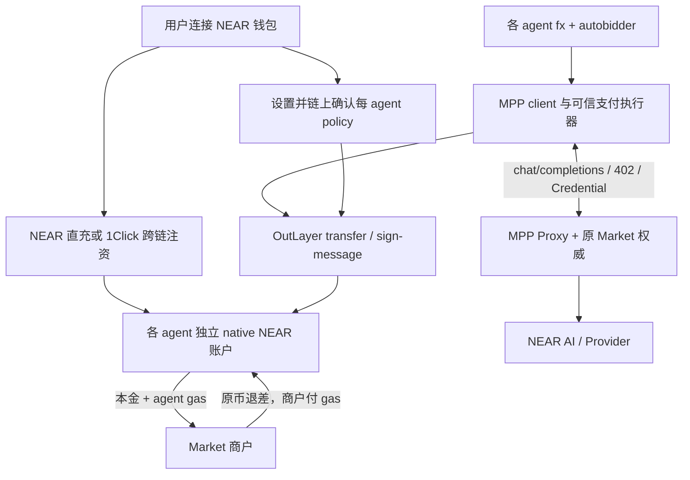

# Agent API → OutLayer Custody 迁移规格与调研

- 状态：**Draft — for review；钱包原语 testnet 已实测，迁移实现及真实 MPP/P3 未验收。**
- 日期：2026-11-14，America/New_York。
- 产品选择：用 OutLayer 托管每个 agent 的独立钱包；agent 自付 native NEAR 本金和付款 gas；商户承担原币退款及退款 gas。
- 审阅基线：本仓库整合分支 `72b8bc3fd911a900cfd5d924caf440035e20f8cf`；OutLayer 公共源码 `2d50bfab14389857e6e50e84e76d5652b944e1cc`，不等同于 hosted 二进制已由本项目完成 attestation 核验。
- 本文是当前钱包层合同。与旧 Agent API/grant、NEP-366、项目 gas-key 路线冲突时以本文为准；历史源码与验收原样保留，不把文档迁移称为实现完成。

## 1. 选择及不变量

OutLayer 在本 MVP 中提供 **custody/signing/policy**，不承担 fx 任务运行、模型采购决策、Market 接纳、计量、结算或 MPP 协议实现。不是将 agent 执行迁入 OutLayer WASM compute。



本轮 review 方案采用以下选择：

1. 每 agent 使用新建、独立、无 binding 的 OutLayer custody wallet。其 implicit account 同时是付款主体、gas payer 和退款目的地。
2. Owner 首版是已认证 NEAR 账户，亲自发起策略存储/更新/冻结交易，成为链上 controller。用户资金来源可以来自其他受支持链，源链身份不自动取得 controller 权限。
3. 首版使用随机 `/register` + 每钱包 `wk_`，密钥只保存在后端 secret store。浏览器、fx、模型和工具只有应用会话/任务引用，无钱包密钥。
4. 不使用 personal binding、Agent Connect lease、项目托管 agent 私钥或 gas-key、逐单 Intents 付款。Binding 会将资产账户与 executor/gas 账户分开，超出本路线。[O2][O3]
5. 任务总预算、并发预留、订单价格、全局付款消费与退款责任仍由本项目原权威承担。OutLayer 是必要的签名守卫，不能替代这些合同。
6. 保留 `bitrouter-near-direct/charge` v1：普通单笔 native Transfer + 同一 key 的 NEP-413 原订单绑定。换 custody provider 不自动升级 wire version；任何不兼容 schema 变更须另行版本化。

## 2. 调研结论和证据等级

| 能力 | 已核对的事实 | 对本项目的含义 |
| --- | --- | --- |
| 独立钱包 | `/register` 在 testnet 返回钱包 ID、API key 与 implicit account | 不再需要 Agent API partner key；注册成功不代表已有链上账户、资金或 owner 控制权 |
| 原生付款 | `/wallet/v1/transfer` 发普通 NEAR Transfer；实测 signer 是 agent | 满足 agent 自付本金与 gas；不使用 Intents 余额 |
| Policy 控制权 | 首次 `store_wallet_policy` 的 predecessor 成为 owner；更新和 freeze 核验原 controller [O4] | 先确认用户 controller，再开放注资；应用不能先代写一份后宣称用户已拥有控制权 |
| 单笔限制和白名单 | Hosted testnet 真实付款通过，越额/非白名单均 `403 policy_denied` | 最小支付 policy 可行；不能将这些结果扩展成全部 capability 已验证 |
| 冻结 | Controller 冻结上链后真实 API 返回 `403 wallet_frozen` | 阻止后续签名；不回滚已签/已发送付款，不阻断商户向 agent 退款 |
| NEP-413 | 文档有 `/wallet/v1/sign-message`；公共 keystore 固定 message hash、32-byte nonce、recipient 并签 NEP-413 digest [O1][O5] | 具备所需能力；**当前五项实测未验证 MPP exact-message/nonce 与响应编码**，列为 G1 gate |
| 累计限额 | 日/小时/月金额和 rate counter 由 gateway 提供，官方明确并发下 best-effort [O1] | 每 agent 跨任务串行化资金写入；本项目原子任务预算仍是硬权威 |
| 身份/余额 | 实测 `/address` 有 `asset_account_id:null`，`executor_account_id` 等于 implicit address；`balance` 标记 `account:executor` | Ready 必须检查此模式与独立 RPC；未来不能默默接入 binding 后沿用同一判定 |
| 恢复 | 文档给出 `request_id`、查询与 idempotency；实测 transfer 查询返回原 hash [O1] | UUID request_id 替代 `op_...` correlation；尚未故障注入证明 native 去重完整合同 |
| 网络 | native/策略/签名接口支持两网络；Intents 依赖接口 testnet 不支持 [O1] | 可先 testnet 完成 MPP；跨链注资须独立 mainnet 有界验收 |
| TEE | 公共源码与官方可验证部署说明可用 [O5][O7] | 本轮 API/链上测试不是 deployed keystore measurement、gateway 或 custody 安全审计 |

### 2.1 已有真实 testnet 证据

可分享证据：[wallet-policy evidence](../acceptance/2026-11-14-outlayer-wallet-policy-evidence.json)。测试 controller 也是独立 custody 钱包，**不是浏览器连接的最终用户钱包**。

| 测试 | 结果 | 交易/错误 |
| --- | --- | --- |
| 策略创建、指定 controller | FINAL + SuccessValue，version 1 | `7yxwVh4aUg28kdiE9DCQSENNBUe3yZfRrSiosYkFGLFZ` |
| 白名单内 0.0001 test NEAR 支付 | FINAL + SuccessValue，agent signer | `BP4fqM6dqbwG7Jpb3vwT1MV3crjbu55FTRQ1jP4DzoKn` |
| 超过 0.001 test NEAR 单笔上限 | HTTP 403 | `policy_denied`，明确比较 0.002 > 0.001 |
| 非白名单收款人 | HTTP 403 | `policy_denied`，明确收款人不在 whitelist |
| 冻结后小额白名单付款 | HTTP 403 | `wallet_frozen`；冻结交易 `7WFVtGNAFEF41Jf9wiAFgrJp8BhUZ6bLniDTzK7pGR8K` |

Agent 先收到 `0.1 test NEAR`，支付本金 `0.0001`，实际支付 gas `0.0008349895375`，余额最终为 `0.0990650104625`；整数对账精确相等。此 gas 是该次 testnet 观测，不是 mainnet 报价、上限或平均性能。拒绝案例后余额无额外变动；agent 保持冻结。上述结果只证明五项钱包原语，不证明真实 MPP、推理、退款、跨链、连接钱包或 P3 PASS。

## 3. Owner → policy → funding 的产品流程

### 3.1 身份与绑定记录

后端先验证 owner 的登录签名与会话（域、nonce、有效期和重放保护），建立：

`verified_owner → buyer_id → wallet_provider=outlayer → wallet_id → network/implicit_account/key → policy_controller/version/hash → Market principal → refund_binding_version`

`wallet_id`、label、公开地址或 funding hash 都不能建立应用 owner。每个 agent 的 `walletCredentialRef` 是 secret-store 引用；操作 journal 不持有 `wk_`。新 owner、wallet 或 payer 是新绑定，不覆盖有未清责任的旧记录。

随机钱包注册的 ACK 丢失也要记录 create-unknown。未建立可恢复身份前不得给候选账户注资；不能假定无认证 `/register` 支持调用方去重。若无法恢复，原创建记录保留为孤立/待核对，可另建未注资候选并显式建立替代关系，不将其当作原钱包恢复。MVP 不为图省事改成要求浏览器提供 raw NEAR 签名的 deterministic-wallet auth。

### 3.2 用户策略控制权建立

1. 后端注册钱包并保存密钥；独立读取 address，校验 canonical key bytes、implicit 地址与网络、无 binding。
2. 用户在本应用查看 merchant、单笔 native 限额、NEP-413 recipient、本项目任务授权及 gas 语义；确认目标 controller 是自己的已认证 NEAR account。
3. 后端调用 `encrypt-policy`，再调用 `sign-policy`，其中 `caller` 必须来自已验证 owner，不接受浏览器任意 account。校验密文和明文 policy hash 绑定（使用已核对 canonical 算法；不假设 JSON stringify 就等价）。
4. 浏览器钱包以该 owner 直接调用已固定网络的 OutLayer 合约 `store_wallet_policy`，附经 view 估算并展示的 storage deposit。`version/locked/valid_until` 使用同一次签名响应；不手写/复用旧 version。MVP `locked=false`，不引入多签批准流程。
5. 独立 RPC 验证最终交易及 `get_wallet_policy`：controller、canonical wallet key、exact encrypted blob/version/locked/frozen。再核对 API policy 视图和预期规则。只收到签名或 API 可读缓存不算生效。
6. **只有上述结果一致，才展示可用注资地址和付款入口。** Policy 缺失、controller 不符、已有未知 policy、读回失败或 capability 不符均阻止运行。

新钱包无 policy 时权限宽，bootstrap 阶段凭证保密和本项目只读/禁止付款守卫是明确的信任边界。 **删除 policy 不是撤销付款权限**：无 policy 会回到宽权限状态。撤销使用冻结/收紧 policy、应用停购和凭证处置；不能提供“一键删除 policy 来停付”的 UI。`valid_until` 是 policy-store 签名可用期限，不是已安装 policy 的自动到期时间。首个签名绑定 caller 防止被其他账户抢用，但持有 wallet credential 的主体能申请其他 policy 签名；未建立 controller 前不可将 API key 交给模型或使用带 key 的公开 handoff 链接。

策略更新先停新采购并取得本地资金 fence；更新 FINAL、读回新版本后才能以新授权创建付款。用户可在应用外直接冻结/更新，故签名与版本读回不存在跨系统原子事务：提交前再读当前 policy，版本有变则拒绝新发送；若签名/资金动作已发生后才发现变更，保留旧操作及责任，进入核对/退款，不能倒推为未付款或重发。冻结不是对已签交易的即时链上撤销保证。

本 MVP 自建窄 policy UI，不把 `https://app.outlayer.ai/wallet?key=...` 的 bearer handoff URL暴露在页面、历史、分析或日志中。OutLayer UI 是否存在某个“Development Wallet”不是产品前提；先前现场连接列表没有此选项。本轮没有验证用户钱包浏览器签 `store_wallet_policy` 的完整 UX；这仍须验收。

### 3.3 最小 policy

下列是本项目拟用模板，限额来自用户授权并以 yoctoNEAR 整数字符串编码。首轮支付 policy 只开放 native transfer 和 MPP 域签名：

```json
{
  "rules": {
    "transaction_types": ["transfer"],
    "allowed_tokens": ["native"],
    "addresses": {"mode": "whitelist", "list": ["<merchant.near>"]},
    "limits": {"per_transaction": {"native": "<positive-yocto-string>"}}
  },
  "capabilities": {
    "raw_sign": {"allowed": false},
    "sign_message": {"allowed": true, "allowed_recipients": ["<exact-mpp-realm>"]},
    "swap": {"allowed": false},
    "cross_chain_withdraw": {"allowed": false},
    "limit_order": {"allowed": false},
    "confidential": {"allowed": false},
    "payment_check": {"allowed": false},
    "evm_sign": {"allowed": false, "raw_tx": false},
    "solana_sign": {"allowed": false, "raw_tx": false},
    "intents_call": {"allowed": false}
  }
}
```

不开放 `call`、`delete` 或 `*` 收款/资产/签名域。`sign_message` 不等于 raw transaction signing，且不能用来签 Intents verifier。完整模板尚须 hosted policy-schema 与拒绝测试；五项实测使用的是较小模板，不将未测试字段称为通过。

如用户设置 cumulative/day/rate 等辅助护栏，UI 说明其与本项目任务总预算不同。单笔 limit 约束转出本金，不保证限制链上实际 gas，也不具备业务订单理解。授权到期在本项目执行器强制；不将 OutLayer 周期/time-window 当作逐任务撤销/到期。

### 3.4 注资和 gas

首个有界 MPP 集成可用 testnet faucet/NEAR 直充来隔离支付验收；完整产品仍支持受支持源链经外部 1Click 注资到 agent **原生 NEAR 账户**，`recipientType=DESTINATION_CHAIN`。不走 `/wallet/v1/intents/deposit/cross-chain` 再把 Intents balance 冒充 native 资金。OutLayer 对本项目跨链 funding 不是必经代理。

源链 fee、兑换滑点、目标最小到账、源链退款和每 agent 原始 funding identity 保持原合同。NEAR 用户可直接给各 agent 转账，避免无必要兑换。NEAR owner 自己还须有设置/冻结 policy 所需 gas 和 storage；这些 onboarding 费用与 agent 付款 gas、商户退款 gas 分列，不默认为项目赞助。

可运行条件：owner/controller/policy/task authorization 一致，agent 账户存在，FINAL native spendable balance 足够本金 + gas reserve + gas floor，原权威预算预留成功，MPP route 已合格。仅 registration、trial calls、Intents/wNEAR 余额或 source transfer hash 不满足。

## 4. OutLayer adapter 合同

### 4.1 外部 API 与内部操作

下列是 adapter 计划，非声称当前源码已实现。网络/base URL/contract 由服务端 allowlist 固定，不能由模型/请求体指定。[O1]

| 内部能力 | OutLayer 路径 | 输入/校验 |
| --- | --- | --- |
| 创建钱包 | `POST /register` | 随机 custody；注册响应秘密仅写 secret store |
| 地址/余额 | `GET /wallet/v1/address?chain=near`、`/balance?chain=near` | 校验无 binding、payer 和 key；余额须独立 RPC 核对 |
| 策略加密 | `POST /wallet/v1/encrypt-policy` | `{wallet_id,rules,capabilities}`；保存原明文 hash、密文与 schema/version |
| 策略签名 | `POST /wallet/v1/sign-policy` | `{encrypted_data,caller}`；验 caller、version、locked、deadline、public_key_hex |
| 读取策略 | `GET /wallet/v1/policy` | UI/校验辅助；链上 policy record 为控制权依据 |
| 本金支付 | `POST /wallet/v1/transfer` | `{to,amount}`；`Authorization: Bearer wk_…`；固定 `X-Idempotency-Key` |
| NEP-413 | `POST /wallet/v1/sign-message` | `{message,recipient,nonce}`；nonce 必须由原 Challenge 提供，不能省略让 API 随机生成 |
| 原操作查询 | `GET /wallet/v1/requests/{request_id}` | UUID；认证到原钱包并检查 operation type；未返回原 body 时靠持久 journal 和 RPC 核对 exact Transfer，不能假称响应已回显 |
| 更新/冻结/解冻 | 用户钱包调用 OutLayer contract | 当前 controller 发送；应用先阻止新采购，链上 FINAL 后更新状态 |

API 额度/429 与可用性必须进入采购的停购/等待逻辑；若使用付费 OutLayer 服务，其订阅/调用费用另列并明确承担方，不将它混入 merchant inference 本金或当成 native gas。

MVP agent 不使用通用 `/call`。此前测试 controller 用 `/call` 写 policy 是测试夹具；生产由用户钱包直接发同等合约调用，不能为此给 agent policy 开任意 call 权限。

### 4.2 已发现的编码/接口差异

- `/address` 实测 `public_key` 是 `ed25519:<64 hex>`；`sign-message` 源码返回 `ed25519:<base58>`。存 canonical 32-byte key；分别构造 contract hex 和 RPC/MPP base58，不能仅去掉前缀后统一按 base58 解码。
- `/encrypt-policy` 实测 `wallet_pubkey` 返回 wallet UUID，不能拿去调用合约。使用 `/sign-policy.public_key_hex` 与独立 address 核对后构造 `ed25519:<hex>`。
- Policy store 必须传 `wallet_pubkey, encrypted_data, wallet_signature, version, locked, valid_until, storage_refund_to`。其中 signature 是 hex，deadline 是秒；不能与 MPP 毫秒期限混用。[O4][O5]
- NEP-413 响应字段是 `account_id/public_key/signature/nonce`，不是旧 Agent API 的 `near_account_id`；signature 文档/源码为 `ed25519:<base58>`。本项目 v1 Credential 接收 base64 64-byte signature：adapter 严格解码再转码，不改 wire contract、不接受不明格式。[O5]
- Sign response 未必回显 message/recipient：客户端用原冻结输入做本地 cryptographic verification，验证 nonce 与 Challenge 一致、key/account 与 binding 一致，message/recipient/txHash 任一修改均须失败。冻结后若签名被拒绝，本金已付的订单进入原付款恢复/退款流程，绝不再付一次。

### 4.3 持久发送与状态归一化

每个付款先原子持久化：provider/network、agent/buyer/task、wallet/payer/key、bindingVersion、policy controller/version/hash、credentialRef、original challenge/body hash、`X-Idempotency-Key`、principal/gas reserve、截止时间及原 writer fence。标记 `possibly_sent` 在 HTTP 前提交。

返回身份分两层：顶层 transfer 可能直接返回 `tx_hash`，查询记录可能在 `result.tx_hash/result.signer_id`；保存原 `request_id`，规范化并与已存 hash 比对。返回的 provider success 不等于付款验收，仍独立验 FINAL receipts。无 request_id 的 policy refusal 不伪造 UUID。已知 request_id 后只读原操作，冲突进入 review。

| 观察值 | 本项目处理 |
| --- | --- |
| `success` + hash | 验证原身份与独立链上结果后才 paid；不能只信 HTTP 200 |
| `processing` | 查询原 request，保留预留；不能启动第二付款 |
| `pending_approval` / `approved` | 当前无多签 MVP 意外出现即停购核对；不是付款成功 |
| `failed` 或 HTTP 422 `onchain_tx_failed` | 保存 tx 与完整失败证据/actual gas；不自动释放本金责任或重付 |
| `needs_review` / 未识别状态 | 业务 Unknown；保留责任，停自动发送，人工核对 |
| HTTP 403 `policy_denied` / `wallet_frozen` | 首次、明确未签/未发的原请求可按未发送关闭；此前 possibly_sent 的超时/歧义请求不能靠后来的 403 证明原请求没付款 |
| 401 / 429 / 5xx / timeout | 不推出 zero principal；不切 signer/route 或换 idempotency key |
| `duplicate_idempotency_key` | 只有映射回同钱包/原 request_id/原 body 才恢复；不作为新成功付款 |

**尚未冻结的 upstream 合同：**当前官方文档的 idempotency 恢复说明集中于 withdraw/swap，不能自动证明 native transfer 的 body-conflict、并发、重启、保留期限和超时后的效果。源码审查不覆盖 hosted coordinator 完整去重实现。G1 必须故障注入验证或取得可核对的服务合同；未完成前，无 request_id 的 ACK 丢失不自动重 POST，即使同 key 也只进入 review/原记录核对。过期后更不能以重 POST 方式冒险形成首次发送。已有 hash 可独立核对，不能单靠请求列表为空证明未发送。

Wallet key 失效不能抹掉旧付款；同 wallet 新 credential 可用于恢复已知 request 的能力须单独验收，不把创建新钱包或新 request 当作恢复。无 raw signed bytes 时如实标注不可取得，不伪造本地链上候选。

## 5. 不变的付款、预算与退款权威

1. MPP client 仍直接请求 Proxy `/v1/chat/completions`；fx 取得普通模型结果，钱包 REST 不暴露为模型自主调用工具。
2. Autobidder 仍跨轮管理任务预算、单轮权衡 cost/speed；wallet adapter 不设置 ask、清算价或可用供给。
3. 一个逻辑资金 writer 串行化每 agent 跨任务预留/发送，原子检查 principal、估计 gas、gas floor、全部未决付款/退款和最终可用余额。租约/锁不因 HTTP timeout 提前移交新付款权；bidder 可并发计算，付款不能绕过 fence。
4. Gas reserve 是估计/停购阈值，不是 native Transfer 的链上费用硬上限。实际 gas 超估仍记账，阻止新采购。单笔本金 cap 不能表述为 total-wallet-debit 硬上限。
5. 付款按独立 RPC 验单一 exact Transfer、agent signer/key、merchant receipt、完整 FINAL 图；NEP-413 绑定原 Challenge/terms/txHash；原权威全局消费实际资金移动一次。OutLayer policy 不懂 orderRef，不能独立保证不重付。
6. 继续按量预付、Market 实际计量结算、native NEAR 原币退差，整数金额及冻结 FX 不变。本金 `P=C+H+W+R` 不含 gas。
7. 商户退款使用独立 merchant sender/outbox/原操作身份，向该原 agent 退款；由商户支付 gas。Agent frozen、policy 撤销或 wallet API key 失效不阻挡普通入账，退款核对可由 RPC 完成。
8. NEAR 交易已执行而 MPP signature、订单租约或 provider 失败时，保留本金/费用/退款负债；不通过第二次发送、未确认余额释放或另开订单抹掉 Unknown。

## 6. 旧实现迁移与存量责任

| 当前代码/合同 | 修改计划 | 保留部分 |
| --- | --- | --- |
| `clients/buyer-gateway/src/{config,onboarding,store,server}.mjs` | Agent API create/grant/correlation 改为 OutLayer register、credentialRef、用户 policy 交易/读回；真实 source precision/native funding | 登录验证、owner 隔离、不可变分配计划、部分失败恢复 |
| `services/mpp-near-direct/contract.mjs` | 将 Agent API 专用 `nativePolicy()` 与 provider payload 移出通用合同；新增 OutLayer policy builder/adapter；generic binding + policy snapshot | v1 challenge、金额/FX、canonical order binding、principal conservation、预算策略 |
| `services/mpp-near-direct/near.mjs` | 保留 strict base58/base64 v1 verifier；在 adapter 规范化 OutLayer hex/base58；增实际 receipt vectors | 独立 FINAL 验款、receipt graph、全局消费身份原则 |
| P1/P2 authority/client/fx | 选中 native agent-paid route；用真实 OutLayer adapter 替换 fixture；同步 gas 预算/账务 | 原 PG/Redis writer、接纳、任务/工具、bid revision、恢复 |
| 未交付 P3 `native-wallet.mjs` 草稿 | 替换 SDK 方法与 `op_...` parser，改为 OutLayer UUID/status/body；取消 grant 专有校验 | durable send-before-HTTP、fencing、exact payment、actual gas、Unknown 守恒 |
| tests/SDK lock/env | 新增 provider contract 和故障测试；生产 runtime 移除 Agent API SDK、partner/grant env 的强制依赖 | 历史 interop/NEP-366/gas-key fixtures 显式归档，不能当 live route |
| README/部署 readiness | live 与 controlled demo 明确区分；固定 OutLayer network/base/contract/secret refs | 现有 demo 不自动因文档改变成为生产版 |

不迁移或删除真实 agent 的链上账户/旧 grant，不自动转移旧余额。已有 Agent API 未决付款、执行、退款仍绑定旧 provider/binding；保留最小只恢复能力，禁止其新采购。无未决责任的 agent 才能显式新建 OutLayer 绑定；旧资金转出另有授权。切 provider 后不得把旧 public hash、correlation 或余额标签重解释为 OutLayer 记录。

P0/P1/P2 历史结果不重新标为 OutLayer PASS；特别是 NEP-366 fixture 的本金/gas 语义不能沿用。本文不变更代码、git 分支、部署或外部钱包状态。

## 7. 交付顺序与验收

| 阶段 | 内容 | 退出条件 |
| --- | --- | --- |
| O0 规格/原语 | 当前文档 + 既有 testnet 五项 | 已有钱包原语通过；当前交付，不称 P3 |
| O1 adapter/owner | 后端 secret 隔离、随机钱包、policy builder、浏览器 controller、字节规范化、NEP-413 | 真实用户钱包设置/更新/冻结、exact nonce/message 本地验签；错误网络/字段/越权/禁用能力拒绝 |
| O2 单调用 MPP | 一个 testnet agent、真实 NEAR、原 PG/Redis + MPP v1、一个真实 provider 调用 | 402 → 一次付款/验签/接纳 → 实际 usage → merchant 差额退款，费用独立对账 |
| O3 故障与多 agent | 两个独立 fx、工具续轮、原操作恢复、并发预算/取消 | 下表故障矩阵通过；不能以五项原语替代 |
| O4 有界 mainnet | 用户连接钱包 + 受支持跨链 funding + 两 agent 自付 + 真实任务 | 冻结金额/fee/gas/provider/deployment 上限后执行，证据和当前源一致；G1/P3 单独验收 |

| Gate | 必测 | 通过标准/当前状态 |
| --- | --- | --- |
| G-owner | 错 owner/caller、无 policy、别人抢先成为 controller、刷新/重复创建、storage fee | 不允许注资/运行；原创建可恢复；浏览器链上 owner 可独立验证。待实现 |
| G-policy | native per-tx、merchant whitelist、freeze；禁止 call/raw_sign/delete/EVM/Intents；签名 recipient | 前三项已实测；完整模板及签名域/禁用能力待测 |
| G-sign | 指定 nonce、exact bindingMessage、key 编码、篡改 nonce/domain/terms/hash，freeze between pay/sign | 本地密码学验证和实际 MPP Credential，失败保留原付款/退款，不重付。待测 |
| G-recovery | native POST 同 key 同 body、异 body、并发、服务重启、ACK 丢失、保留期和 TTL | 一个原资金动作；无法证明时 Unknown，不换 key；status schema 经真实数据固定。查询 readback 已验证，其余待测 |
| G-budget | 同 agent 多任务、两 worker、锁过期、累计 cap 竞争、gas 超估、故意无关转出 | 唯一原预算 writer，无超额本金采购；actual gas 不被退款清零。待测 |
| G-refund | 计量退差、确定失败、晚到款、ACK 丢失、agent frozen/key 失效、dust | 商户原操作一次退款，所有正数本金应退、agent 入账 FINAL，商户付 gas。待测 |
| G-task | 两 agent、不同预算/偏好、tool 续轮、暂停、重启 | 各轮独立资金关联、原执行恢复、真实产物；无模拟 speed 承诺。待测 |
| G-deployment | 实际 keystore/gateway 信任、配置网络和 chain ID、生产密钥保管、版本/限流 | 固定实际服务及升级策略；源码 pin 不等于 deployed attestation PASS。待核对 |

O4 仍需要真实 NEAR AI/Provider 凭证与有界调用额度，不能因不再依赖 Agent API partner key 就认定无外部条件。Testnet 无 Intents solver，不可验收 mainnet 跨链；NEAR AI 的上游 API 计费仍与买方 MPP 商户账务分开。

## 8. Review 重点与待关闭合同

推荐 MVP 采用本无 binding 随机 custody 路线：它已用真实链证明 agent principal/gas 语义及最小 policy，且不用接管用户主钱包。但 `wk_` 是具备受 policy 限制的支出能力，应用仍是可信执行器；不是“后端没有任何钱包权限”。

以下保留为明确 gate，不靠假设关闭：native transfer 去重与保留期限、exact NEP-413 interop、浏览器 owner-controller UX、policy 更新/冻结与在途签名的边界、真实 merchant refund、实际 deployed keystore 版本/证明与服务可用性。若其中任何项不满足，不静默改用 raw signing、绑定用户主钱包或新建支付合约；单独 review 合同替代。

## 9. 一手来源

- [O1 Agent Custody](https://app.outlayer.ai/docs/agent-custody)：公开路径、NEP-413、policy 及累计限额并发边界、network/error/status。网页是 2026-11-14 核对快照；hosted native 去重仍按 gate 处理。
- [O2 Personal Account Binding](https://app.outlayer.ai/docs/account-binding)、[O3 Binding API](https://app.outlayer.ai/docs/binding-api)：解释为何本 MVP 不采用 executor/asset account 分离与 NEP-591 安装路径。
- [O4 Contract wallet.rs 固定源码](https://github.com/out-layer/outlayer/blob/2d50bfab14389857e6e50e84e76d5652b944e1cc/contract/src/wallet.rs#L347)：存储、controller、version/expiry、freeze 与 storage cost。
- [O5 Keystore API 固定源码](https://github.com/out-layer/outlayer/blob/2d50bfab14389857e6e50e84e76d5652b944e1cc/keystore-worker/src/api.rs#L4486)：policy 签名；同文件 L5349 NEP-413 编码，L6020 message/recipient/nonce 检查。公共 worker 源码不覆盖 hosted coordinator 所有状态/去重行为。
- [O6 Deterministic Wallets 源码文档](https://github.com/out-layer/outlayer/blob/2d50bfab14389857e6e50e84e76d5652b944e1cc/docs/DETERMINISTIC_WALLETS.md)：Flow 7 为 policy 流程参考，旧例漏字段以实际接口/合约为准；不据此要求浏览器 raw auth 签名。
- [O7 Trust & Verification](https://app.outlayer.ai/docs/trust-verification)：部署验证方法；本项目尚未完成实际 custody 服务独立证明核验。
- [E1 本项目脱敏链上证据](../acceptance/2026-11-14-outlayer-wallet-policy-evidence.json)：五项 testnet 结果及实际付款 gas；不含 API key/handoff URL。
